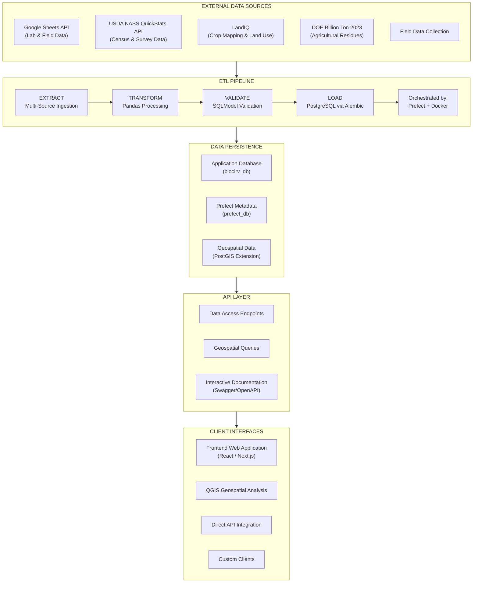
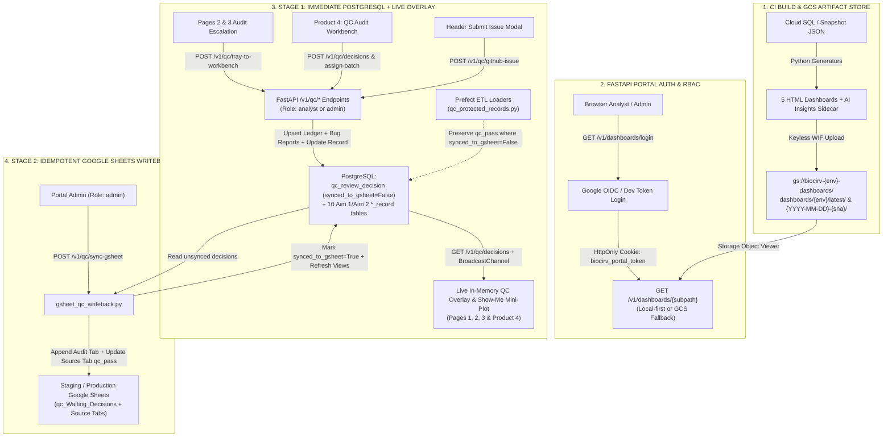

# CA-Biositing Architecture Documentation

## Overview

CA-Biositing is a comprehensive geospatial bioeconomy platform for biodiversity
data management and analysis, specifically focused on California biositing
activities. The project combines ETL data pipelines, REST APIs, geospatial
analysis tools, and web interfaces to support biodiversity research and
conservation efforts. It processes data from Google Sheets into PostgreSQL
databases and provides both programmatic and visual access to the data.

## System Architecture Diagram



## Core Technology Stack

### Backend Infrastructure

- **Programming Language**: Python 3.12+
- **Database**: PostgreSQL 13+ with PostGIS extension
- **Database Migrations**: Alembic for schema versioning
- **Data Models**: SQLModel (combining SQLAlchemy + Pydantic)
- **API Framework**: FastAPI with automatic OpenAPI documentation
- **Data Processing**: pandas for transformation and analysis

### ETL Pipeline & Orchestration

- **Workflow Orchestration**: Prefect for pipeline management
- **Containerization**: Docker & Docker Compose for service orchestration
- **Data Sources**: Google Sheets API (lab & field data), USDA NASS QuickStats
  API (census & survey), LandIQ (crop mapping), DOE Billion Ton 2023
  (agricultural residues)
- **Data Validation**: Pydantic models for type safety and validation

### Frontend & Visualization

- **Frontend Framework**: React/Next.js (separate repository:
  `cal-bioscape-frontend`)
- **Geospatial Analysis**: QGIS integration for advanced spatial analysis
- **Package Management**: Node.js/npm for frontend dependencies

### Development & Deployment

- **Package Management**: Pixi for Python dependency management and task
  automation
- **Development Environment**: VS Code with dev containers
- **Code Quality**: Pre-commit hooks, pytest for testing
- **Version Control**: Git with submodules for frontend integration

### Cloud Infrastructure & Services

- **Google Cloud Platform**:
  - Google Sheets API for data ingestion
  - Google Cloud credentials management
  - Potential cloud deployment target
- **Database Hosting**: Containerized PostgreSQL (development), cloud SQL
  (production)
- **Container Registry**: For Docker image distribution

## Detailed Project Structure

### Namespace Package Architecture (PEP 420)

```
ca-biositing/
├── src/ca_biositing/                    # PEP 420 namespace package root for all submodules
│   ├── datamodels/                      # Database models, schema definitions, and ORM setup
│   │   ├── ca_biositing/datamodels/     # SQLModel-based data models
│   │   │   ├── models/                  # Hand-written SQLModel classes (91 models, 15 subdirs)
│   │   │   │   ├── __init__.py          # Central re-export of all models
│   │   │   │   ├── base.py              # Base classes (BaseEntity, LookupBase, etc.)
│   │   │   │   ├── aim1_records/        # Aim 1 analytical records
│   │   │   │   ├── aim2_records/        # Aim 2 processing records
│   │   │   │   ├── core/                # ETL lineage and run tracking
│   │   │   │   ├── external_data/       # LandIQ, USDA, Billion Ton records
│   │   │   │   ├── field_sampling/      # Field samples and collection methods
│   │   │   │   ├── general_analysis/    # Observations and analysis types
│   │   │   │   ├── places/              # Location and address models
│   │   │   │   └── ...                  # (+ 6 more domain subdirectories)
│   │   │   ├── views.py                 # 7 materialized view definitions
│   │   │   ├── config.py                # SQLModel and database configuration
│   │   │   └── database.py              # Database engine setup and connection logic
│   │   ├── tests/                       # Unit tests for datamodels package
│   │   └── pyproject.toml               # Independent packaging and dependencies for datamodels
│   │
│   ├── pipeline/                        # ETL and workflow orchestration components
│   │   ├── ca_biositing/pipeline/       # Main ETL logic for data ingestion and transformation
│   │   │   ├── etl/                     # Extract, Transform, Load core logic
│   │   │   ├── load/                    # Data loading processes into PostgreSQL
│   │   │   ├── transform/               # Data transformation utilities using pandas
│   │   │   ├── flows/                   # Prefect flow definitions for orchestrating pipelines
│   │   │   └── utils/                   # Helper scripts and utility functions for ETL tasks
│   │   ├── tests/                       # Pipeline-specific tests
│   │   └── pyproject.toml               # Pipeline-specific dependencies and build info
│   │
│   └── webservice/                      # FastAPI backend service for REST API access
│       ├── ca_biositing/webservice/     # Web service source files
│       │   ├── main.py                  # FastAPI entry point (app startup)
│       │   └── __init__.py              # Package initialization
│       ├── tests/                       # Tests for webservice routes and API endpoints
│       └── pyproject.toml               # Dependencies for webservice package
│
├── resources/                           # Infrastructure, Docker, and Prefect configuration
│   ├── docker/                          # Docker setup for local and production environments
│   │   ├── docker-compose.yml           # Multi-container setup for development
│   │   ├── pipeline.dockerfile          # Dockerfile for ETL pipeline container
│   │   ├── .env.example                 # Environment variable template for local setup
│   │   └── create_prefect_db.sql        # SQL script for Prefect metadata DB initialization
│   └── prefect/                         # Prefect deployment and orchestration setup
│       ├── prefect.yaml                 # Prefect deployment configuration
│       ├── deploy.py                    # Script to automate Prefect flow deployment
│       └── run_prefect_flow.py          # Script to run master ETL Prefect flow
│
├── docs/                                # MkDocs documentation folder
│   ├── architecture.md                  # Main architecture document (this file)
│   ├── api/                             # REST API documentation
│   ├── pipeline/                        # Pipeline workflow documentation (ETL, Docker, Prefect, GCP)
│   ├── datamodels/                      # Datamodel documentation overview
│   ├── webservice/                      # FastAPI and API overview documentation
│   └── resources/                       # Deployment and infra docs (Docker/Prefect)
│
├── alembic/                             # Database migration management (Alembic)
│   ├── env.py                           # Alembic environment configuration
│   └── versions/                        # Versioned migration scripts
│
├── tests/                               # Integration and namespace import tests
├── frontend/ (submodule: cal-bioscape-frontend)  # React/Next.js frontend repo as Git submodule
├── .devcontainer/                       # VS Code dev container configuration for reproducible dev env
├── .github/                             # CI/CD workflows, issue templates, PR templates
├── .vscode/                             # Editor settings and recommended extensions
├── pixi.toml                            # Pixi project config for dependency & task management
├── pixi.lock                            # Dependency lock file for reproducibility
├── readthedocs.yaml                     # ReadTheDocs build configuration
├── .pre-commit-config.yaml              # Code linting and formatting pre-commit hooks
├── config.py                            # Global configuration and environment variables
└── README.md                            # Root project overview and instructions
```

## Data Flow Architecture

### 1. Data Ingestion (Extract)

```
Data Sources ──APIs──▶ Python ETL Pipeline (Prefect-orchestrated)
     │                        │
     ├── Google Sheets        ├── Google Sheets API Client (credentials.json)
     │   ├── Lab Data         │
     │   ├── Field Samples    │
     │   └── Resource Info    │
     │                        │
     ├── USDA NASS API        ├── QuickStats REST Client (API key auth)
     │   ├── Census Data      │   └── 16+ commodity mappings
     │   └── Survey Data      │
     │                        │
     ├── LandIQ               ├── Crop mapping & land use data
     │                        │
     └── DOE Billion Ton      └── Agricultural residue estimates
```

### 2. Data Processing (Transform)

```
Raw Data ──pandas──▶ Cleaned Data ──SQLModel──▶ Validated Data
    │                     │                         │
    ├── Data Cleaning     ├── Normalization         ├── Type Validation
    ├── Format Conversion ├── Standardization       ├── Business Rules
    └── Quality Checks    └── Enrichment           └── Constraint Checking
```

### 3. Data Persistence (Load)

```
Validated Data ──Alembic──▶ PostgreSQL Database
       │                         │
       ├── Schema Validation     ├── ACID Transactions
       ├── Batch Processing      ├── Geospatial Extensions
       └── Conflict Resolution   └── Performance Optimization
```

### 4. Data Access & Consumption

```
PostgreSQL ──SQLModel──▶ FastAPI ──HTTP/JSON──▶ Client Applications
     │                     │                        │
     ├── Query Optimization├── REST Endpoints       ├── Web Frontend
     ├── Geospatial Queries├── OpenAPI Documentation├── QGIS Integration
     └── Aggregations      └── Type-safe Responses └── Direct API Access
```

## Service Architecture (Docker Compose)

### Development Environment Services

1. **PostgreSQL Database** (`db`)
   - **Image**: PostgreSQL 13+
   - **Purpose**: Primary data storage for application and Prefect metadata
   - **Databases**:
     - `biocirv_db` - Application data
     - `prefect_db` - Prefect workflow metadata
   - **Extensions**: PostGIS for geospatial data support
   - **Port**: 5432 (configurable)
   - **Persistence**: Docker volumes for data durability

2. **Database Migration** (`setup-db`)
   - **Purpose**: One-time schema initialization and upgrades
   - **Tool**: Alembic for version-controlled migrations
   - **Dependency**: Waits for database health check
   - **Execution**: Runs on service startup

3. **Prefect Server** (`prefect-server`)
   - **Purpose**: Workflow orchestration and monitoring
   - **Port**: 4200 (Web UI and API)
   - **Features**:
     - Flow scheduling and execution
     - Real-time monitoring dashboard
     - Workflow history and logging
     - Work pool management

4. **Prefect Worker** (`prefect-worker`)
   - **Purpose**: Execute flow runs from work pools
   - **Features**:
     - Process-based task execution
     - Access to Google Cloud credentials
     - Connection to application database
     - Automatic retry and error handling

### Network Architecture

- **Internal Network**: `prefect-network` bridge network
- **Service Discovery**: Container names as hostnames
- **External Access**: Mapped ports for UI and database access

## Data Models & Entities

All models are hand-written SQLModel classes in
`src/ca_biositing/datamodels/ca_biositing/datamodels/models/`, organized into 15
subdirectories (91 models total). Four base mixins (`BaseEntity`, `LookupBase`,
`Aim1RecordBase`, `Aim2RecordBase`) in `models/base.py` provide shared columns.

### Core Domain Models

#### Resource & Biomass Models (`resource_information/`)

- **Resource**: Core biomass resource definitions
- **ResourceClass**, **ResourceSubclass**: Hierarchical resource classification
- **ResourceAvailability**: Seasonal and quantitative availability data
- **ResourceMorphology**, **ResourceCounterfactual**: Physical characteristics
- **PrimaryAgProduct**: Agricultural product classifications

#### Geographic Models (`places/`)

- **Place**: Primary geographic entity (county-level, with FIPS geoid)
- **LocationAddress**: Address information linked to places

#### Field Sampling (`field_sampling/`)

- **FieldSample**: Field collection metadata and measurements
- **HarvestMethod**, **CollectionMethod**, **AgTreatment**: Methodology lookups
- **SoilType**, **LocationSoilType**: Soil classification

#### Aim 1 Analytical Records (`aim1_records/`)

- **ProximateRecord**, **UltimateRecord**, **CompositionalRecord**: Core
  analyses
- **IcpRecord**, **XrfRecord**, **XrdRecord**: Elemental/structural analyses
- **CalorimetryRecord**, **FtnirRecord**, **RgbRecord**: Thermal/spectral
  analyses

#### Aim 2 Processing Records (`aim2_records/`)

- **AutoclaveRecord**, **FermentationRecord**, **GasificationRecord**,
  **PretreatmentRecord**: Conversion process data

#### External Data (`external_data/`)

- **UsdaCensusRecord**, **UsdaSurveyRecord**, **UsdaCommodity**: USDA NASS data
- **LandiqRecord**, **LandiqResourceMapping**: Land IQ crop mapping data
- **BillionTon2023Record**: DOE Billion Ton agricultural residue data
- **Polygon**: Geospatial polygon data (PostGIS geometry)

#### People & Organizations (`people/`)

- **Contact**: Researchers and contact information
- **Provider**: Research institutions and organizations

#### Experiment & Equipment (`experiment_equipment/`)

- **Experiment**, **ExperimentAnalysis**: Experimental design and linkage
- **Equipment**, **ExperimentEquipment**: Lab equipment tracking

#### Methods, Parameters & Units (`methods_parameters_units/`)

- **Method**, **MethodCategory**, **MethodStandard**: Methodology definitions
- **Parameter**, **Unit**, **ParameterUnit**: Measurement framework

#### Core Metadata (`core/`)

- **EtlRun**, **LineageGroup**, **EntityLineage**: ETL tracking and data lineage

#### Infrastructure (`infrastructure/`)

- **InfrastructureBiodieselPlants**, **InfrastructureEthanolBiorefineries**,
  **InfrastructureLandfills**, and 10 other facility types

## Google Cloud Integration

### Google Sheets API Integration

```
Google Cloud Platform
├── Service Account Authentication
│   ├── credentials.json (local development)
│   └── IAM roles for Sheets API access
├── Google Sheets API v4
│   ├── Read access to research data sheets
│   ├── Rate limiting and quota management
│   └── Error handling and retry logic
└── Data Security
    ├── OAuth 2.0 authentication flow
    ├── API key management
    └── Access logging and monitoring
```

### Authentication Flow

1. **Service Account**: Created in Google Cloud Console
2. **Credentials**: Downloaded as `credentials.json`
3. **API Access**: Sheets API enabled for project
4. **Permissions**: Service account granted read access to target sheets
5. **ETL Integration**: Pipeline authenticates and extracts data

### Cloud Deployment Considerations

- **Google Cloud SQL**: PostgreSQL managed database service
- **Google Cloud Run**: Containerized API deployment
- **Google Cloud Build**: CI/CD pipeline for automated deployment
- **Google Cloud Storage**: Backup and archival storage
- **Google Cloud Monitoring**: Application and infrastructure monitoring

## API Architecture (FastAPI)

### REST API Design

The API is organized around feedstock data access, using crop names and
geographic identifiers (FIPS geoid codes) as primary query parameters:

```text
/v1/feedstocks/
├── /usda/census/                          # USDA Census agricultural data
│   ├── GET /crops                                           # Discovery: available crops
│   ├── GET /resources                                       # Discovery: available resources
│   ├── GET /geoids                                          # Discovery: available geoids
│   ├── GET /parameters                                      # Discovery: available parameters
│   ├── GET /crops/{crop}/geoid/{geoid}/parameters           # All census parameters
│   ├── GET /crops/{crop}/geoid/{geoid}/parameters/{param}   # Single census parameter
│   ├── GET /resources/{resource}/geoid/{geoid}/parameters   # By resource name
│   └── GET /resources/{resource}/geoid/{geoid}/parameters/{param}
├── /usda/survey/                          # USDA Survey agricultural data
│   ├── GET /crops                                           # Discovery: available crops
│   ├── GET /resources                                       # Discovery: available resources
│   ├── GET /geoids                                          # Discovery: available geoids
│   ├── GET /parameters                                      # Discovery: available parameters
│   ├── GET /crops/{crop}/geoid/{geoid}/parameters           # All survey parameters
│   ├── GET /crops/{crop}/geoid/{geoid}/parameters/{param}   # Single survey parameter
│   ├── GET /resources/{resource}/geoid/{geoid}/parameters   # By resource name
│   └── GET /resources/{resource}/geoid/{geoid}/parameters/{param}
├── /analysis/                             # Laboratory analysis data
│   ├── GET /resources                                       # Discovery: available resources
│   ├── GET /geoids                                          # Discovery: available geoids
│   ├── GET /parameters                                      # Discovery: available parameters
│   ├── GET /resources/{resource}/geoid/{geoid}/parameters   # All analysis parameters
│   └── GET /resources/{resource}/geoid/{geoid}/parameters/{param}
└── /availability/                         # Seasonal availability
    └── GET /resources/{resource}/geoid/{geoid}              # Availability window
```

### API Features

- **Auto-generated Documentation**: Swagger UI at `/docs`
- **Type Safety**: Pydantic models for request/response validation
- **Geospatial Queries**: PostGIS integration for spatial operations
- **Pagination**: Efficient handling of large datasets
- **Filtering & Search**: Query parameters for data filtering
- **CORS Support**: Cross-origin resource sharing for web frontend

## Frontend Architecture

### Frontend Repository Integration

- **Repository**: `sustainability-software-lab/cal-bioscape-frontend`
- **Integration**: Git submodule in `frontend/` directory
- **Technology**: React/Next.js with TypeScript
- **Package Management**: npm for Node.js dependencies
- **Development**: Hot reloading and development server

### Frontend-Backend Communication

```
Frontend (React) ──HTTP/REST──▶ Backend API (FastAPI)
     │                               │
     ├── Data Visualization          ├── JSON Responses
     ├── Interactive Maps            ├── Geospatial Data
     ├── Search & Filtering          ├── Query Processing
     └── User Interface              └── Authentication
```

## Development Workflow & Environment Management

### Pixi Environment Configuration

```
Environments:
├── default: General development, testing, pre-commit
├── gis: QGIS and geospatial analysis tools
├── etl: ETL pipeline (used in Docker containers)
├── webservice: FastAPI web service
├── frontend: Node.js/npm for frontend development
├── py312/py313: Python version-specific environments
├── docs: To generate docs using MKdocs
```

### Key Development Tasks

- **Service Management**: Start/stop/monitor Docker services
- **Schema Changes**: Edit SQLModel classes, then `migrate-autogenerate` +
  `migrate`
- **Materialized Views**: Refresh after data loads with `refresh-views`
- **ETL Operations**: Deploy and run data pipelines
- **Testing**: Comprehensive test suites with coverage
- **Code Quality**: Pre-commit hooks, linting, formatting

## Deployment & Operations

### Container Orchestration

Local development uses Docker Compose to run all services together — the
PostgreSQL database, Prefect workflow server, and Prefect worker run as
co-located containers defined in `resources/docker/docker-compose.yml`. The
`setup-db` service runs `alembic upgrade head` at startup so the database schema
is always current before the worker comes online.

### Database Management

Schema changes are version-controlled with Alembic migrations. Developers
generate migrations locally with `pixi run migrate-autogenerate`, review the
generated script in `alembic/versions/`, and apply it with `pixi run migrate`.
There is no separate schema synchronization step — Alembic is the single source
of truth for schema state.

### Monitoring & Observability

The Prefect UI (`http://localhost:4200`) provides visibility into pipeline run
history, task state, and logs for each flow run. Application health is exposed
via the `/v1/health` endpoint on the FastAPI service.

## Security Considerations

### Authentication & API Security

API access is controlled via JWT (JSON Web Token) authentication. Clients obtain
a token from `/v1/auth/token` using username and password credentials;
subsequent requests include the token in the `Authorization: Bearer` header. The
FastAPI service validates the token signature on each request — no server-side
session state is stored.

Google Sheets access uses a Google Cloud service account credential file
(`credentials.json`), which is loaded at ETL runtime and never committed to the
repository.

### Data Handling

Development credentials (`biocirv_dev_password`) are clearly scoped to local
Docker use and defined in `resources/docker/.env.example`. Production
deployments use secrets managed outside the repository via environment variables
injected at runtime.

## Scalability & Performance

The current architecture is optimized for the project's scale: a single
PostgreSQL instance with PostGIS handles all spatial and relational queries.
Analytical queries are accelerated by materialized views in the `ca_biositing`
schema that pre-compute joins and aggregations — these are refreshed after each
ETL load with `pixi run refresh-views`.

The FastAPI service uses async request handling (Uvicorn/ASGI) for I/O-bound
operations, and pagination is implemented on all collection endpoints to bound
response sizes. The Prefect worker processes ETL tasks concurrently where
dependencies allow, with automatic retry on transient failures.

## Future Architecture Considerations

### Service Decomposition

The current monorepo structure works well while the team is small and components
are tightly coupled through shared data models. If different parts of the system
— for example, the ETL pipeline and the web service — need to scale
independently, be deployed on different schedules, or be maintained by separate
teams, breaking them into standalone services with an API gateway would reduce
coupling. This is not planned imminently; the namespace package structure
(`ca_biositing.*`) already provides the logical separation that would make such
a transition tractable when the need arises.

### Cloud-Native Migration

The pipeline currently runs on a single Docker host. As data volume or
processing frequency increases, moving the Prefect worker to a managed cloud
execution environment — such as Cloud Run jobs or Vertex AI pipelines — would
allow per-run scaling without a persistent worker process. The Prefect
deployment configuration in `resources/prefect/` is already structured to
support this migration path.

### Analytical Query Layer

As the number and complexity of research questions grows, the current
materialized view approach may reach its limits. A dedicated analytical layer —
such as a set of curated summary tables or integration with an OLAP store —
could improve query performance and make it easier for researchers to explore
the data without writing raw SQL. The existing `ca_biositing` materialized view
schema is the first step in this direction.

## BioCirV 5-Product Analytical & Two-Stage QC Audit Workbench Architecture

The internal BioCirV analytical suite comprises five interactive HTML products
generated from PostgreSQL or an offline snapshot, stored in a dedicated Google
Cloud Storage bucket (`gs://biocirv-{env}-dashboards/`), and served behind an
isolated FastAPI portal authentication layer with a two-stage Quality Control
(QC) review workflow.

| Product                                             | File Path                                     | Purpose                                                                                                                                                                                                                                                                                                                               |
| :-------------------------------------------------- | :-------------------------------------------- | :------------------------------------------------------------------------------------------------------------------------------------------------------------------------------------------------------------------------------------------------------------------------------------------------------------------------------------ |
| **Product 1: Resource Characterization & AI Brief** | `metadata/resource_analysis_dashboard.html`   | Single-resource characterization dashboard with executive synthesis brief, KPI cards, sticky left filter sidebar, 10 individual analytical domain pills, proximate mass-balance closure (`95–105%` parity with `mv_biomass_proximate_data.py`), and contextual `"👁 Show me"` flag mini-plots.                                         |
| **Product 2: Statistical Snapshot**                 | `metadata/resource_qc_outlier_dashboard.html` | Within-group ($\text{RSD}_{\text{within}}$) vs. method-stratified between-sample ($\text{RSD}_{\text{between}}$, $\text{SD}_{\text{between}}$) replicate precision scatter/ratio charts, 3-test outlier screening (`Dixon's Q` guarded by $\text{RSD} \ge 10\%$, `RSD > 20%`, `>3×SD_pooled`), and mined bench notes audit trail.     |
| **Product 3: Interactive Data Visualizer**          | `metadata/resource_explorer_dashboard.html`   | High-DPI HTML5 `<canvas>` visualizer with 2D rectangular brush zoom (`#canvas-zoom-brush`), sticky left filter sidebar, 3-section statistical screening & lab notes drawer, canonical 6-part `replicate_group_key` point selection, `"📤 Export Slice (.HTML)"` collaborator export, and `"👁 Show me"` `?highlight_rk=` deep-linking. |
| **Product 4: QC Audit Workbench**                   | `metadata/resource_audit_workbench.html`      | Default dark-mode two-stage QC triage and governance workspace (`in_review` default workflow state, `Approve Pass`, `Reject / Fail`, `Revert to Pass`, auto-filled analyst assignee, multi-row bulk assignment up to 500 items, contextual `"👁 Show me"` mini-plots, and admin-only Stage 2 Google Sheets writeback).                 |
| **Product 5: Environment & Schema Drift Monitor**   | `db_environment_drift_dashboard.html`         | Database schema, table row count, and environment drift verification dashboard.                                                                                                                                                                                                                                                       |



!!! note "Same-Browser `BroadcastChannel` vs. Cross-Analyst Refresh"
`BroadcastChannel("biocirv_qc_decisions")` synchronizes open dashboard tabs
within the **same browser** immediately when a Stage 1 QC decision or tray
export is saved. Cross-analyst updates made by another user on a different
machine or browser are fetched on initial page load or on-demand via the
explicit **`↻ Refresh QC State`** header button, with zero background
`setInterval` polling.

## Architecture Decisions

### 2026-10-27: Canonical 6-Part Replicate Keys, Proximate Mass-Balance Parity & Contextual Audit Mini-Plots (Accepted)

- **Decision:** Standardize replicate cohort keys across Python generators,
  FastAPI `/v1/qc/*` routes, and browser overlays on the 6-part key
  `{resource}::{sample}::{domain_slug}::{param}::{context_label}::{experiment}`;
  guard Dixon's Q outlier screening with $\text{RSD}_{\text{within}} \ge 10\%$
  and stratify between-sample precision by the 5-tuple
  `(resource, domain, parameter, units, method_or_strain)`; align
  `proximate_sum` closure (`95–105%`) with `mv_biomass_proximate_data.py` by
  averaging replicates per component (`moisture`, `volatile_matter`,
  `fixed_carbon`, `ash`) within `(resource_name, experiment, prep_method)`
  before summing; persist portal bug submissions in PostgreSQL via
  `qc_review_decision` (`record_table="portal_bug_report"`,
  `flag_type="bug_report"`); support bulk analyst assignment
  (`POST /v1/qc/decisions/assign-batch`, capped at 500 items); and embed an
  interactive `"👁 Show me"` mini-plot popover across all 4 biomass dashboard
  products with `?highlight_rk=` deep-linking into the Interactive Data
  Visualizer.
- **Why:** Earlier 3-part keys (`resource::sample::param`) collapsed distinct
  experiments or methods into false replicate cohorts and caused `decision_id`
  collisions; unguarded Dixon's Q flagged tight replicates ($\text{RSD} < 10\%$)
  as outliers; summing unaveraged proximate replicates produced false $>105\%$
  mass-balance flags; and analysts triaging flags in the QC Audit Workbench
  needed immediate visual distribution context without losing their place in the
  queue.
- **Result:** Zero `decision_id` collisions across multi-experiment replicate
  cohorts, 100% proximate mass-balance parity between the data portal and QC
  dashboards, durable in-database bug report tracking (`GET /v1/qc/bug-issues`),
  single-click bulk queue assignment, and zero-synthetic-data contextual
  mini-plots with 1-click pulse-highlighted deep links into
  `resource_explorer_dashboard.html`.

### 2026-10-19: GCS Dashboard Artifact Store, Isolated Portal Auth & Two-Stage QC Governance (Accepted)

- **Decision:** Move generated HTML dashboards (Products 1–5) and large
  database/insights JSON snapshots out of Git tracking into a dedicated,
  lifecycle-managed GCS bucket (`gs://biocirv-{env}-dashboards/`); gate internal
  dashboard and QC routes behind an isolated portal cookie
  (`biocirv_portal_token`) with 2-role RBAC (`analyst` and `admin`); and
  decouple QC governance into Stage 1 (immediate PostgreSQL persistence + ETL
  upsert protection + live browser overlay) and Stage 2 (admin-only idempotent
  Google Sheets writeback).
- **Why:** Committing multi-megabyte generated HTML/JSON artifacts bloated
  repository history and risked leaking internal provider data to public GitHub
  Pages. At the same time, analysts needed sub-second QC flagging and cross-tab
  visual feedback without waiting for static HTML rebuilds or risking routine
  Google Sheets ETL runs overwriting their in-progress PostgreSQL `qc_pass`
  overrides before source worksheets were updated.
- **Result:** Git history remains free of generated artifact bloat (enforced by
  `scripts/check_no_generated_artifacts.py` in CI), internal dashboards are
  served securely via `/v1/dashboards/*` from local files or GCS without
  colliding with CalBioScape's `access_token` cookie, ETL upserts preserve
  unsynced Stage 1 `qc_pass` decisions (`synced_to_gsheet = False`) across all
  10 Aim 1/Aim 2 record loaders, and admins can batch-promote verified decisions
  back to Google Sheets and refresh materialized views on demand.

This architecture supports the project's mission of providing a robust,
maintainable platform for California bioeconomy data management, with clear
extension points for future growth.
