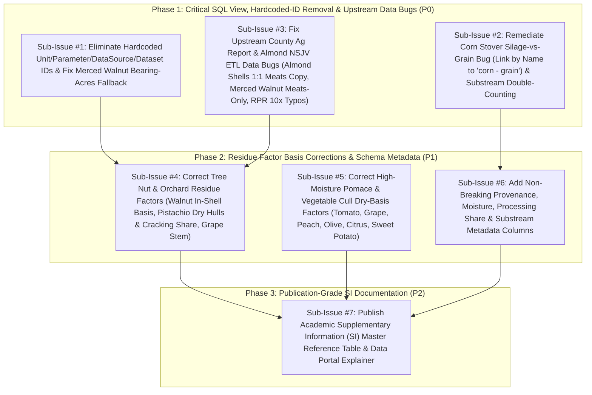

# Residue Factor & Biomass Volume Estimation Remediation Plan (Wave 2 Peer-Review Verified)

> [!IMPORTANT] **Wave 2 Verification Against Live PostgreSQL (`biocirv_db`) &
> Actual Code (`mv_biomass_volume_estimate.py`)** Every SQL query, table name,
> line number, and single-year North San Joaquin Valley (NSJV: San Joaquin
> `06077`, Stanislaus `06099`, Merced `06047`) output in this plan has been
> verified directly against the live `biocirv_db` database (see
> [`docs/audit/BASELINE_DB_VERIFICATION.md`](file:///Users/pjsmitty301/ca-biositing/docs/audit/BASELINE_DB_VERIFICATION.md)
> and
> [`docs/audit/MASTER_RESOURCE_INVENTORY.md`](file:///Users/pjsmitty301/ca-biositing/docs/audit/MASTER_RESOURCE_INVENTORY.md)).
>
> - **Correction of Wave 1 False Positives (`F1`–`F3`)**:
>   - **`F1` (`Sub-Issue #0` Deleted)**: `public.place` has **zero** duplicate
>     rows (`06047` `'merced'`, `06077` `'san joaquin'`, `06099` `'stanislaus'`
>     each appear exactly once, lowercase). All 5 `Place` joins in
>     [`mv_biomass_volume_estimate.py`](file:///Users/pjsmitty301/ca-biositing/src/ca_biositing/datamodels/ca_biositing/datamodels/data_portal_views/mv_biomass_volume_estimate.py)
>     (lines 79, 166, 247, 338, 398) join on `geoid` equality
>     (`CountyAgReportRecord.geoid == Place.geoid` or
>     `UsdaCensusRecord.geoid == Place.geoid`). Neither `public.calag_raw` nor
>     `_calag_tons_unit_id` exists in the database or codebase. **Sub-Issue #0
>     has been deleted outright.**
>   - **`F2` (`county_ag_report_record` vs. `resource_production_record`
>     Forensics Corrected)**: Path C (`commodity_direct`) in
>     `mv_biomass_volume_estimate.py` queries `public.county_ag_report_record`
>     (not `public.resource_production_record`). The 1:1 `'almond shells'` copy
>     of `'almond meats'` in `county_ag_report_record` occurs in **3 of 6
>     county-year rows** (`2023` San Joaquin `06077` `110,200 t`, `2023`
>     Stanislaus `06099` `235,431 t`, and `2024` Stanislaus `06099`
>     `241,260 t`), while `2023` Merced (`120,743 t` vs. `143,774 t` meats),
>     `2024` Merced (`91,194 t` vs. `149,234 t` meats), and `2024` San Joaquin
>     (`68,100 t` vs. `111,900 t` meats) are distinct. Separately,
>     `public.resource_production_record` (populated by
>     [`almond_nsjv.py`](file:///Users/pjsmitty301/ca-biositing/src/ca_biositing/pipeline/ca_biositing/pipeline/etl/transform/production/almond_nsjv.py)
>     and queried by
>     [`mv_biomass_search.py`](file:///Users/pjsmitty301/ca-biositing/src/ca_biositing/datamodels/ca_biositing/datamodels/data_portal_views/mv_biomass_search.py))
>     contains 21 rows with non-FIPS `geoid = 'NSJV'`, two 10× missing-zero data
>     entry bugs (`2019` San Joaquin `'almond hulls'` = `18,000 t` vs.
>     `180,000 t`; `2024` San Joaquin `'almond hulls'` = `24,300 t` vs.
>     `243,000 t`), the same 3 meats-copied shell rows, and a missing `2024`
>     Merced `'almond shells'` row.
>   - **`F3` (`primary_ag_product` Names & Snapshot IDs Verified)**: All
>     `public.primary_ag_product` names and current snapshot IDs match the live
>     table (`'rice'` `[id=1]`, `'almonds'` `[id=2]`, `'hay - alfalfa'`
>     `[id=3]`, `'melons - watermelon'` `[id=4]`, `'sargassum'` `[id=5]`,
>     `'walnuts'` `[id=6]`, `'plums & prunes'` `[id=7]`, `'pistachios'`
>     `[id=8]`, `'sweet potatoes'` `[id=9]`, `'cucumbers and pickles'`
>     `[id=10]`, `'oranges'` `[id=11]`, `'peaches'` `[id=12]`, `'pears'`
>     `[id=15]`, `'corn - all'` `[id=16]`, `'olives - processing'` `[id=20]`,
>     `'cherries'` `[id=22]`, `'grapes'` `[id=23]`, `'winter wheat'` `[id=25]`,
>     `'cotton'` `[id=26]`, `'apricots'` `[id=27]`, `'tomatoes for processing'`
>     `[id=29]`, `'almond meats'` `[id=35]`, `'almond shells'` `[id=37]`,
>     `'corn - grain'` `[id=45]`, `'silage - corn'` `[id=56]`,
>     `'tomatoes for market'` `[id=67]`, `'almond hulls'` `[id=71]`).
> - **Note on Snapshot Primary Key IDs in Diagnostic Tables**: Integer primary
>   key IDs (`resource_id`, `primary_ag_product_id`, `RF_ID`, `carr_id`,
>   `rpr_id`) shown in diagnostic tables below are **point-in-time references
>   from the current `biocirv_db` snapshot only**. As mandated in Constraint #2
>   below, **no code, view, migration, or ETL script may ever hardcode or filter
>   by integer primary key IDs**—all matching must use immutable lowercase
>   `name` (`func.lower(Model.name)`).

---

## 1. Architectural & Non-Breaking Schema Constraints

1. **Zero Breaking Changes to `data_portal.mv_*` or `ca_biositing.*`**:
   - The frontend and FastAPI webservice depend directly on the column names and
     types of the materialized views in
     `src/ca_biositing/datamodels/ca_biositing/datamodels/data_portal_views/`
     (specifically `data_portal.mv_biomass_volume_estimate`,
     `data_portal.mv_biomass_search`, `data_portal.mv_usda_county_production`,
     and `data_portal.mv_biomass_availability`).
   - All existing columns in `data_portal.mv_biomass_volume_estimate`
     (`source_type`, `resource_id`, `resource_name`, `primary_ag_product_id`,
     `primary_ag_product_name`, `geoid`, `county`, `year`, `prod_Min_tons`,
     `prod_Mid_tons`, `prod_Max_tons`, `dry_tons`, `wet_tons`) **must remain
     unchanged in name and type**.
   - Any new metadata columns added to base tables (`public.residue_factor`,
     `public.resource_availability`, `public.resource`) must be **nullable with
     safe defaults** so no existing SQLAlchemy model query, Pydantic response
     schema, or frontend query breaks.
2. **Zero Hardcoded Primary Key IDs (Immutable Name-Based Matching Rule)**:
   - **Rule**: **NEVER hardcode `resource.id`, `primary_ag_product.id`,
     `unit.id`, `parameter.id`, `data_source.id`, or `dataset.id` in any SQL
     view, Alembic migration, ETL transform, or test.**
   - **Why IDs Change Across Rebuilds**: Reference tables in `ca-biositing` are
     **not** seeded with deterministic integer IDs in migrations. Instead,
     [`normalize_dataframes()` / `replace_name_with_id_df()`](file:///Users/pjsmitty301/ca-biositing/src/ca_biositing/pipeline/ca_biositing/pipeline/utils/name_id_swap.py#L35-L245)
     and
     [`_ensure_parameters_and_units()`](file:///Users/pjsmitty301/ca-biositing/src/ca_biositing/pipeline/ca_biositing/pipeline/etl/transform/usda/usda_census_survey.py#L504-L590)
     auto-create missing lookup records dynamically during ETL runs. Whenever
     the database is rebuilt, refreshed, or ETL flows execute in a different
     order (or rows are added/reordered in Google Sheets), auto-increment
     integer `id` values shift.
   - **Mandatory Pattern**: Always join lookup tables (`Resource`,
     `PrimaryAgProduct`, `Unit`, `Parameter`, `DataSource`, `Dataset`,
     `UsdaCommodity`) and match on
     `func.lower(Model.name) == '<canonical_lowercase_name>'` in SQLAlchemy
     views/queries, or resolve names to IDs at runtime via
     `normalize_dataframes()` in ETL transforms.
3. **Feature Branch Workflow**:
   - All work will be executed on a dedicated feature branch
     (`feat/residue-factor-remediation`) with isolated, reviewable PRs per
     sub-issue.
4. **Google Sheets Source-of-Truth Alignment**:
   - Because ETL pipelines (`static_resource_info` flow) ingest `residue_factor`
     and `resource_availability` from the project Google Sheet
     (`13rwxml9JEC2BJOrZ7m5tRDj2zf-6tNRHEY0KvIauNOA`), any factor corrections
     must be synchronized in both the upstream Google Sheet (with human sign-off
     on each literature citation) and local static assets
     (`pixi run update-static-resource-info`).

### 1.1 Codebase Audit: All Current Hardcoded-ID Issues to Eliminate

A complete audit of `src/ca_biositing/datamodels/` and
`src/ca_biositing/pipeline/` identified **four locations** where integer primary
keys are currently hardcoded:

| File & Lines                                                                                                                                                                                                                                          | Hardcoded IDs Found                                                                                                                                                                                                                                                                                                                                                                                                                                                              | Why It Breaks / Drift Risk                                                                                                                                                                                                                                                                                                                                              | Required Remediation                                                                                                                                                                                                                                                                                                                                                                                                                                                                                                                 |
| :---------------------------------------------------------------------------------------------------------------------------------------------------------------------------------------------------------------------------------------------------- | :------------------------------------------------------------------------------------------------------------------------------------------------------------------------------------------------------------------------------------------------------------------------------------------------------------------------------------------------------------------------------------------------------------------------------------------------------------------------------- | :---------------------------------------------------------------------------------------------------------------------------------------------------------------------------------------------------------------------------------------------------------------------------------------------------------------------------------------------------------------------- | :----------------------------------------------------------------------------------------------------------------------------------------------------------------------------------------------------------------------------------------------------------------------------------------------------------------------------------------------------------------------------------------------------------------------------------------------------------------------------------------------------------------------------------- |
| **[`mv_biomass_volume_estimate.py`](file:///Users/pjsmitty301/ca-biositing/src/ca_biositing/datamodels/ca_biositing/datamodels/data_portal_views/mv_biomass_volume_estimate.py#L40-L45)** (Lines 40–45, 114–115, 134–144, 170, 283–288, 307–317, 342) | `_acreage_unit_id = 18` `_param_bearing_id = 5` `_param_bnb_id = 7` `_param_harvested_id = 3` Stale comment IDs: `grape vines (resource 8)` [now `7`], `almond woodchips (resource 34)` [now `1`], `almond branches (resource 51)` [now `16`], `cotton stem mix (resource 4)` [now `6`], `grape stem (resource 47)` [now `23`], `walnut tree sticks (resource 25)` [now `15`], `wheat straw (resource 40)` [now `34`], `grape vine prunings (resource 32)` [now `4`] | Comment at line 40 falsely claims `# These IDs are stable across environments (seeded from migrations)`. In fact, `'acres'` shifted from `18` to `19` (`18` is now `'bushels'`), causing Path B and Path D to return **0 rows**. Furthermore, every single `resource.id` in the comments at lines 114–115 and 283–288 has already drifted from its original integer ID! | **Delete `_acreage_unit_id`, `_param_bearing_id`, `_param_bnb_id`, and `_param_harvested_id` completely.** Join `Parameter` and `Unit` in Path B and Path D and filter by `func.lower(Unit.name) == "acres"` and `func.lower(Parameter.name)` (matching Path A lines 61–65, Path E lines 383–387, and [`mv_usda_county_production.py`](file:///Users/pjsmitty301/ca-biositing/src/ca_biositing/datamodels/ca_biositing/datamodels/data_portal_views/mv_usda_county_production.py#L39-L46)). Remove stale resource IDs from comments. |
| **[`county_ag_report_record.py`](file:///Users/pjsmitty301/ca-biositing/src/ca_biositing/pipeline/ca_biositing/pipeline/etl/transform/analysis/county_ag_report_record.py#L141-L156)** (Lines 141–156)                                                | `county_ds_map = {("merced", 2023): 1, ("san joaquin", 2023): 2, ("stanislaus", 2023): 3, ("merced", 2024): 5, ("san joaquin", 2024): 6, ("stanislaus", 2024): 7}`                                                                                                                                                                                                                                                                                                               | Hardcodes `data_source.id` integers (`1, 2, 3, 5, 6, 7`) for County Ag Report data sources. If `data_source` is rebuilt in a different order, records link to the wrong `DataSource`.                                                                                                                                                                                   | Resolve `data_source_id` dynamically by querying `DataSource` via `func.lower(DataSource.name)` (or `normalize_dataframes` on `data_source_name`).                                                                                                                                                                                                                                                                                                                                                                                   |
| **[`county_ag_report_observation.py`](file:///Users/pjsmitty301/ca-biositing/src/ca_biositing/pipeline/ca_biositing/pipeline/etl/transform/analysis/county_ag_report_observation.py#L71-L79)** (Lines 71–79)                                          | Duplicate `county_ds_map = {("merced", 2023): 1, ..., ("stanislaus", 2024): 7}`                                                                                                                                                                                                                                                                                                                                                                                                  | Same hardcoded `data_source.id` mapping (`1, 2, 3, 5, 6, 7`) used when constructing `record_id` / filtering County Ag Report observations.                                                                                                                                                                                                                              | Resolve via `DataSource.name` lookup or join directly to `CountyAgReportRecord.record_id` without hardcoded `data_source_id` integers.                                                                                                                                                                                                                                                                                                                                                                                               |
| **[`pretreatment_record.py`](file:///Users/pjsmitty301/ca-biositing/src/ca_biositing/pipeline/ca_biositing/pipeline/etl/transform/analysis/pretreatment_record.py#L121-L122)** (Lines 121–122)                                                        | `record_df['dataset_id'] = 1` (`# Set dataset_id = 1 (biocirv) for all records`)                                                                                                                                                                                                                                                                                                                                                                                                 | Hardcodes `dataset.id = 1` instead of resolving `'biocirv'` by name.                                                                                                                                                                                                                                                                                                    | Set `record_df['dataset'] = 'biocirv'` prior to `normalize_dataframes(record_df, {'dataset': (Dataset, 'name')})` so `dataset_id` is resolved by name.                                                                                                                                                                                                                                                                                                                                                                               |

_(All other views in `data_portal_views/` and ETL transforms in
`pipeline/etl/transform/` already resolve `Resource`, `PrimaryAgProduct`,
`Parameter`, and `Unit` dynamically by lowercase `name`.)_

---

## 2. Verified Governing Equations & Closed- vs. Open-Boundary Processing Caveat

### 2.1 Four-Case Dry & Wet Biomass Volume Equations (`B1` Verified)

To eliminate unit conflation across weight-based (`factor_type = 'weight'`),
area-based (`factor_type = 'area'`), and direct commodity
(`factor_type = 'commodity'`) pathways in
`data_portal.mv_biomass_volume_estimate`, every active resource stream $i$
associated with primary commodity $c$ in county $k$ and year $t$ is governed by
one of four explicit cases.

Let:

- $P_{c,k,t}$ = primary agricultural production volume (tons as reported in
  `county_ag_report_record` or grain-equivalent tons in `usda_census_record`)
- $A_{c,k,t}$ = harvested or bearing acreage (acres, matched via
  `func.lower(Unit.name) == 'acres'`)
- $f_{i,\text{dry}}$ = dry-matter residue factor (dry tons residue per marketed
  ton of $P_{c,k,t}$ for weight-based streams, or dry tons residue per acre for
  area-based streams)
- $\text{MC}_i \in [0, 1)$ = wet-basis moisture content fraction of residue
  stream $i$ as generated/collected (from
  `resource_availability.moisture_content_pct / 100.0` or
  `residue_factor.moisture_content`)
- $\alpha_{\text{proc},i} \in (0, 1]$ = fraction of primary commodity
  $P_{c,k,t}$ routed to the specific processing pathway that generates residue
  $i$ (default $1.0$ where all harvested crop enters the pathway)
- $\beta_{\text{collect},i} \in (0, 1]$ = sustainable or regulatory collectible
  fraction of field residue $i$ (default $1.0$ for processing/mill byproducts;
  $<1.0$ where soil conservation or mandatory plowdown restricts removal)

$$\text{Case 1 (Weight-Based Processing / Field Residue, \texttt{factor\_type = 'weight'}):}$$
$$\text{Dry Tons}_{i,k,t} = P_{c,k,t} \times \alpha_{\text{proc},i} \times \beta_{\text{collect},i} \times f_{i,\text{dry}}, \qquad \text{Wet Tons}_{i,k,t} = \frac{\text{Dry Tons}_{i,k,t}}{1 - \text{MC}_i}$$

$$\text{Case 2 (Area-Based Orchard Pruning / Field Residue, \texttt{factor\_type = 'area'}):}$$
$$\text{Dry Tons}_{i,k,t} = A_{c,k,t} \times \beta_{\text{collect},i} \times f_{i,\text{dry}}, \qquad \text{Wet Tons}_{i,k,t} = \frac{\text{Dry Tons}_{i,k,t}}{1 - \text{MC}_i}$$

$$\text{Case 3 (Direct Commodity Production Report, \texttt{factor\_type = 'commodity'}):}$$
$$\text{Wet Tons}_{i,k,t} = P_{i,k,t}, \qquad \text{Dry Tons}_{i,k,t} = P_{i,k,t} \times (1 - \text{MC}_i)$$

$$\text{Case 4 (Substream / Excluded Resource, \texttt{is\_substream = true} or \texttt{EXCLUDED\_RESOURCES}):}$$
$$\text{Dry Tons}_{i,k,t} = \text{excluded from regional additive totals (or reported as non-additive substream)}$$

> [!NOTE] **Backward-Compatible View Implementation**: Until `moisture_content`,
> `processing_share` ($\alpha_{\text{proc}}$), and `collectible_fraction`
> ($\beta_{\text{collect}}$) columns are populated on `public.residue_factor`,
> `COALESCE` defaults ($\alpha_{\text{proc}} = 1.0$, $\beta_{\text{collect}} =
> 1.0$, and joining `resource_availability.moisture_content_pct` with fallback
> $\text{MC}_i = 0.0$) preserve 100% SQL compatibility while enabling exact
> wet/dry differentiation
> (`wet_tons = dry_tons / NULLIF(1.0 - COALESCE(mc, 0.0), 0.0)` instead of
> `wet_tons = dry_tons`).

### 2.2 Closed-Boundary vs. Open-Boundary Processing Allocation ($\alpha_{\text{proc}}$ Caveat)

A critical distinction raised in peer review governs how
$\alpha_{\text{proc},i}$ is interpreted for **hullers** vs. **shelling/cracking
or cannery plants**:

1. **Hulling & Primary Dehydration (`pistachio hulls`,
   `pistachio stems & leaves`, `almond hulls`, `walnut hulls`) —
   $\alpha\_{\text{proc}} = 1.00$**:
   - Virtually 100% of harvested pistachios, almonds, and walnuts undergo
     hulling within hours of harvest to prevent aflatoxin/_Aspergillus_
     contamination and hull stain. Hulling occurs at or near orchard-adjacent
     hullers; no cracking share reduction applies ($\alpha_{\text{proc}} =
     1.00$).
2. **Pistachio Shelling / Cracking (`pistachio shells`) — Closed-Boundary
   (`0.25`) vs. Open-Boundary (`1.00`)**:
   - Physically, dry pistachio shells (`~5–7%` MC) represent
     **$0.44\text{--}0.49\text{ dry t per ton of dry marketable in-shell
     yield}$** (`~49%` of the dry nut weight in _Kerman_ / _Golden Hills_).
   - However, because `70–80%` of California pistachios are sold to consumers
     **in-shell** (naturally split), only **$\alpha\_{\text{proc}} \approx
     0.20\text{--}0.30$ (`mid = 0.25`)** of harvested pistachio tonnage is
     mechanically cracked at commercial shelling plants (primarily closed-shell
     nuts, shelling stock, and defects), generating **`0.10–0.15 dry t`
     (`mid = 0.123 dry t`)** of loose commercial shell byproduct at the shelling
     plant per ton of total harvested pistachios.
   - **Geographic Open-Boundary Caveat for NSJV**: Major California pistachio
     cracking/processing facilities (e.g., Wonderful Pistachios & Almonds in
     Lost Hills/Kern County, Keenan Farms in Kettleman City/Kings County,
     Primex, Nichols Pistachio in Tulare/Fresno, Setton Farms in Terra Bella)
     are heavily concentrated in the **South San Joaquin Valley** (Kern, Kings,
     Tulare, Fresno, Madera counties) rather than inside the 3-county NSJV
     boundary (Merced, Stanislaus, San Joaquin). Conversely, a processor located
     inside or near the NSJV may import raw in-shell nuts from neighboring
     counties.
   - **Resolution in Methodology & SI Table**:
     - For **county-of-origin supply potential** (`mv_biomass_volume_estimate`),
       we report both the **physical anatomical shell factor**
       ($f_{\text{anatomical}} = 0.490\text{ dry t/t}$, representing total shell
       mass grown in the county) and the **commercial cracking-share factor**
       ($f_{\text{cracked}} = f_{\text{anatomical}} \times \alpha_{\text{proc}}
       = 0.490 \times 0.25 = 0.123\text{ dry t/t}$, range `0.100–0.150`), and
       explicitly document in the Supplementary Information (SI) table that
       county-level `county_ag_report_record` tonnage reflects **orchard county
       of origin**, whereas actual shell accumulation occurs at centralized
       hulling/cracking facilities across the broader San Joaquin Valley.

---

## 3. Verified Baseline Database Diagnostics (Single-Year NSJV Outputs)

All current outputs in `data_portal.mv_biomass_volume_estimate` for the 3 NSJV
counties (`06047` Merced, `06077` San Joaquin, `06099` Stanislaus) have been
queried by single year (`2023` and `2024` for County Ag Report Paths A & C;
`2017` and `2022` for USDA Census Paths B, D, & E). **Multi-year sums
(`2023+2024` or `2017+2019+2020+2021+2022`) are never reported as annual
production.** _(Integer IDs in brackets below are diagnostic references from the
current DB snapshot only.)_

| Path in `mv_biomass_volume_estimate.py`                   | Lines   | Resource (`name` `[snapshot id]`)                                                                                                                                                | Current DB Factor (`[snapshot RF_ID]`)                                   | Primary Ag Product (`name` `[snapshot pap_id]`) & NSJV Base (`2023` / `2024` or `2017` / `2022`)                            | Current Single-Year MV Output (`dry_tons`)                                                                                                                                                    | Verified Status & Root Cause                                                                                                                                                                                                                                                                                                                                                                                                                                                                                  |
| :-------------------------------------------------------- | :------ | :------------------------------------------------------------------------------------------------------------------------------------------------------------------------------- | :----------------------------------------------------------------------- | :-------------------------------------------------------------------------------------------------------------------------- | :-------------------------------------------------------------------------------------------------------------------------------------------------------------------------------------------- | :------------------------------------------------------------------------------------------------------------------------------------------------------------------------------------------------------------------------------------------------------------------------------------------------------------------------------------------------------------------------------------------------------------------------------------------------------------------------------------------------------------ |
| **Path A** (`ag_report_volume`, weight)                   | 60–145  | `'rice straw'` `[id=2]`                                                                                                                                                          | `[RF=25]`, `weight`, `0.70 / 1.05 / 1.40`                                | `'rice'` `[pap=1]`: `2023 = 55,800 t`; `2024 = 58,600 t`                                                                    | `2023`: **`58,590.00 t`** `2024`: **`61,530.00 t`**                                                                                                                                        | Gross straw (`1.05 t/t`); sustainable collectible fraction ($\beta_{\text{collect}} \approx 0.25\text{--}0.50$) needed for realistic removal.                                                                                                                                                                                                                                                                                                                                                                 |
| **Path A** (`ag_report_volume`, weight)                   | 60–145  | `'walnut shelling fines'` `[id=8]`                                                                                                                                               | `[RF=34]`, `weight`, `1.34 / 1.494 / 1.647`                              | `'walnuts'` `[pap=6]`: `2023 = 242,318 t`; `2024 = 182,324 t` (Merced 2023/2024 is meats-only!)                             | `2023`: **`362,023.09 t`** `2024`: **`272,392.06 t`**                                                                                                                                      | **Double Bug**: (1) Duplicate of kernel-basis shell factor `1.494` (`~30–75×` too high; true fines `0.01–0.03 t/t`). (2) Merced `'walnuts'` (`2023`/`2024`) reports walnut meats (`15,984 t` / `15,315 t`) instead of in-shell (`~58k–65k t`).                                                                                                                                                                                                                                                                |
| **Path A** (`ag_report_volume`, weight)                   | 60–145  | `'pistachio shells'` `[id=10]`                                                                                                                                                   | `[RF=23]`, `weight`, `0.12 / 0.15 / 0.18`                                | `'pistachios'` `[pap=8]`: `2023 = 36,747 t`; `2024 = 31,211 t`                                                              | `2023`: **`5,512.05 t`** `2024`: **`4,681.65 t`**                                                                                                                                          | Current `0.15` (`0.12–0.18`) is close to commercial cracking share (`0.490 × 0.25 = 0.123 dry t/t`), whereas anatomical shell mass is `0.490 dry t/t` (`0.44–0.52`). Needs explicit $\alpha_{\text{proc}}$ documentation.                                                                                                                                                                                                                                                                                     |
| **Path A** (`ag_report_volume`, weight)                   | 60–145  | `'walnut hulls'` `[id=14]`                                                                                                                                                       | `[RF=33]`, `weight`, `0.469 / 0.524 / 0.578`                             | `'walnuts'` `[pap=6]`: `2023 = 242,318 t`; `2024 = 182,324 t`                                                               | `2023`: **`126,974.63 t`** `2024`: **`95,537.78 t`**                                                                                                                                       | `0.524` is **2× too high** for dry hulls (`~0.20–0.28 dry t/t in-shell`, `mid = 0.24`; wet green hull is `1.2–2.0 wet t/t` at `80–85%` MC). Also affected by Merced meats-only `'walnuts'` rows.                                                                                                                                                                                                                                                                                                              |
| **Path A** (`ag_report_volume`, weight)                   | 60–145  | `'tomato pomace'` `[id=19]`                                                                                                                                                      | `[RF=31]`, `weight`, `0.03 / 0.04 / 0.05`                                | `'tomatoes for processing'` `[pap=29]`: `2023 = 2,917,029 t`; `2024 = 2,270,955 t`                                          | `2023`: **`116,681.16 t`** `2024`: **`90,838.20 t`**                                                                                                                                       | **Wet-vs-Dry Bug (`~4.4×` overestimate)**: `0.04` is **wet** pomace (`75–80%` MC) per wet ton of fresh tomatoes (`94%` MC). True dry factor is **`0.009 dry t/t`** (`0.006–0.012`), or **`26,253 dry t`** (`2023`) / **`20,439 dry t`** (`2024`).                                                                                                                                                                                                                                                             |
| **Path A** (`ag_report_volume`, weight)                   | 60–145  | `'grape pomace'` `[id=22]`                                                                                                                                                       | `[RF=12]`, `weight`, `0.20 / 0.25 / 0.30`                                | `'grapes'` `[pap=23]`: `2023 = 876,780 t`; `2024 = 757,146 t`                                                               | `2023`: **`219,195.00 t`** `2024`: **`189,286.50 t`**                                                                                                                                      | **Wet-vs-Dry Bug (`~3.3×` overestimate)**: `0.25` is **wet** pressed pomace (`55–65%` MC) per wet ton crushed. True dry factor is **`0.075 dry t/t`** (`0.050–0.100`), or **`65,759 dry t`** (`2023`) / **`56,786 dry t`** (`2024`).                                                                                                                                                                                                                                                                          |
| **Path A** (`ag_report_volume`, weight)                   | 60–145  | `'pistachio stems & leaves'` `[id=24]`                                                                                                                                           | `[RF=24]`, `weight`, `0.045 / 0.056 / 0.068`                             | `'pistachios'` `[pap=8]`: `2023 = 36,747 t`; `2024 = 31,211 t`                                                              | `2023`: **`2,057.83 t`** `2024`: **`1,747.82 t`**                                                                                                                                          | Represents huller leaf/twig/rachis trash (`~0.05–0.10 dry t/t`). Orchard dormant prunings (`~0.5–1.0 dry t/ac`) are a separate area-based stream.                                                                                                                                                                                                                                                                                                                                                             |
| **Path A** (`ag_report_volume`, weight)                   | 60–145  | `'walnut shells'` `[id=27]`                                                                                                                                                      | `[RF=35]`, `weight`, `1.34 / 1.494 / 1.647`                              | `'walnuts'` `[pap=6]`: `2023 = 242,318 t`; `2024 = 182,324 t`                                                               | `2023`: **`362,023.09 t`** `2024`: **`272,392.06 t`**                                                                                                                                      | **Kernel-vs-In-Shell Basis Bug (`~2.8×` overestimate)**: `1.494` is shell-to-**kernel** (`60/40`), applied to SJ/Stanislaus **in-shell** production! True in-shell factor is **`0.54 dry t/t in-shell`** (`0.50–0.58`) × cracking share $\alpha_{\text{proc}}$. Plus Merced `'walnuts'` is meats-only.                                                                                                                                                                                                        |
| **Path A** (`ag_report_volume`, weight)                   | 60–145  | `'sweet potato culls'` `[id=28]`                                                                                                                                                 | `[RF=30]`, `weight`, `0.312 / 0.406 / 0.50`                              | `'sweet potatoes'` `[pap=9]`: `2023 = 332,554 t`; `2024 = 259,374 t`                                                        | `2023`: **`135,016.92 t`** `2024`: **`105,305.84 t`**                                                                                                                                      | **Wet-vs-Dry & Cull Rate Bug (`~7.4×` dry overestimate)**: Fresh sweet potatoes are `72–75%` water (`28%` DM), and `0.406` (`40.6%`) is an extreme cull rate (typical `15–25%`). At `20%` wet cull × `28%` DM, true dry factor is **`0.055 dry t/t`** (`0.035–0.085`).                                                                                                                                                                                                                                        |
| **Path A** (`ag_report_volume`, weight)                   | 60–145  | `'peach pomace'` `[id=29]`                                                                                                                                                       | `[RF=19]`, `weight`, `0.15 / 0.24 / 0.35`                                | `'peaches'` `[pap=12]`: `2023 = 133,229 t`; `2024 = 116,918 t`                                                              | `2023`: **`31,974.96 t`** `2024`: **`28,060.32 t`**                                                                                                                                        | **Wet-vs-Dry Bug (`~6–8×` overestimate)**: `0.24` is **wet** cannery waste (`80–85%` MC) across peel/pulp/cull streams. True dry factor is **`0.035 dry t/t`** (`0.020–0.050`).                                                                                                                                                                                                                                                                                                                               |
| **Path A** (`ag_report_volume`, weight)                   | 60–145  | `'olive pomace'` `[id=30]`                                                                                                                                                       | `[RF=17]`, `weight`, `0.20 / 0.35 / 0.50`                                | `'olives - processing'` `[pap=20]`: `2023 = 15,170 t`; `2024 = 28,235 t`                                                    | `2023`: **`5,309.50 t`** `2024`: **`9,882.25 t`**                                                                                                                                          | Wet 3-phase pomace (`~50%` MC) vs. 2-phase _alperujo_ (`0.75–0.85 wet t/t` at `65%` MC = **`0.28 dry t/t`**, range `0.22–0.34 dry t/t`).                                                                                                                                                                                                                                                                                                                                                                      |
| **Path A** (`ag_report_volume`, weight)                   | 60–145  | `'pistachio hulls'` `[id=35]`                                                                                                                                                    | `[RF=22]`, `weight`, `0.118 / 0.147 / 0.177`                             | `'pistachios'` `[pap=8]`: `2023 = 36,747 t`; `2024 = 31,211 t`                                                              | `2023`: **`5,401.81 t`** `2024`: **`4,588.02 t`**                                                                                                                                          | Under-scaled by `~1.9×`: dry hull mass per ton of dry marketable in-shell pistachio is **`0.275 dry t/t`** (`0.24–0.32`, vs. `1.15–1.60 wet t/t` at `80%` MC).                                                                                                                                                                                                                                                                                                                                                |
| **Path A** (`ag_report_volume`, weight)                   | 60–145  | `'rice hulls'` `[id=36]`                                                                                                                                                         | `[RF=24]`, `weight`, `0.22 / 0.235 / 0.25`                               | `'rice'` `[pap=1]`: `2023 = 55,800 t`; `2024 = 58,600 t`                                                                    | `2023`: **`13,113.00 t`** `2024`: **`13,771.00 t`**                                                                                                                                        | Slightly above standard _Calrose_ dry hull yield (`0.20 wet t/t` at `10%` MC = **`0.18 dry t/t`**, range `0.16–0.20`).                                                                                                                                                                                                                                                                                                                                                                                        |
| **Path B** (`census_based_volumes`, weight + NULL factor) | 150–231 | `'grape vines'` `[id=7]`, `'almond woodchips'` `[id=1]`, `'orange pomace'` `[id=38]`, `'wheat straw'` `[id=34]`                                                                  | `'grape vines'` (`weight`, `prune=1.1`); others (`weight`, `prune=NULL`) | USDA Census (`2017`, `2022`): `'grapes'` (`130,552 ac` / `138,770 ac`)                                                      | **0 rows** (`NULL`)                                                                                                                                                                           | **Bug #1 (Hardcoded `_acreage_unit_id = 18` `'bushels'` instead of joining `Unit` on `func.lower(Unit.name) == 'acres'`)**: Replacing hardcoded unit/parameter IDs with name-based joins immediately restores `'grape vines'`: `2017 = 143,607.2 t`, **`2022 = 152,647.0 t`**.                                                                                                                                                                                                                                |
| **Path C** (`commodity_direct`, commodity)                | 236–305 | `'almond shells'` `[id=5]`                                                                                                                                                       | `[RF=5]`, `commodity`                                                    | `'almond shells'` `[pap=37]` in `county_ag_report_record`                                                                   | `2023`: **`466,374.00 t`** `2024`: **`400,554.00 t`**                                                                                                                                      | **Upstream ETL Copy Bug**: `2023` SJ (`110,200 t`), `2023` Stanislaus (`235,431 t`), and `2024` Stanislaus (`241,260 t`) copied `'almond meats'` 1:1 instead of shell weight (`~0.65–0.70 t/t kernel`, true NSJV total `~333k–343k wet t` or **`~306k–316k dry t`**).                                                                                                                                                                                                                                         |
| **Path C** (`commodity_direct`, commodity)                | 236–305 | `'almond hulls'` `[id=32]`                                                                                                                                                       | `[RF=4]`, `commodity`                                                    | `'almond hulls'` `[pap=71]` in `county_ag_report_record`                                                                    | `2023`: **`1,009,416.00 t`** `2024`: **`976,054.00 t`**                                                                                                                                    | Matches County Ag Report hull tonnage (`~2.06 t/t` meats in 2023, `~1.94 t/t` meats in 2024), but reported as `dry_tons = wet_tons` without `10–12%` moisture deduction (`~898k` / `~869k dry t`).                                                                                                                                                                                                                                                                                                            |
| **Path D** (`acreage_based_volumes`, area)                | 310–383 | `'cotton stem mix'` `[id=6]` (`prune=1.2`), `'walnut tree sticks'` `[id=15]` (`prune=0.6`), `'almond branches'` `[id=16]` (`prune=1.5`), `'grape stem'` `[id=23]` (`prune=NULL`) | `factor_type = 'area'`                                                   | USDA Census (`2017`, `2022`) acres (`'area bearing & non-bearing'`, `'area bearing'`, `'area harvested'`)                   | **0 rows** (`NULL`)                                                                                                                                                                           | **Bug #1 (Hardcoded `_acreage_unit_id = 18` `'bushels'`) + Merced 2022 Walnut `(D)` Fallback**: Joining `Unit` on `func.lower(Unit.name) == 'acres'` and adding `bearing_acres` (`'area bearing'`) to `COALESCE` restores `'almond branches'` (`2022 = 783,568.5 t`), `'cotton stem mix'` (`2022 = 39,981.6 t`), and `'walnut tree sticks'` (`2022 =` **`70,666.8 t`**, including `6,815.4 t` from Merced's `11,359 bearing acres`).                                                                          |
| **Path E** (`census_production_weight`, weight)           | 388–455 | `'corn stover whole'` `[id=12]` (`1.02`), `'corn stover stalks'` `[id=26]` (`0.571`), `'corn stover cobs'` `[id=21]` (`0.153`), `'corn stover husks'` `[id=33]` (`0.082`)        | `factor_type = 'weight'`                                                 | `'corn - all'` `[pap=16]` joined to Census `'tons'`, which is **corn silage** (`2017 = 4,517,173 t`; `2022 = 5,216,315 t`)! | `'corn stover whole'` (`2022`): **`5,320,641.30 t`** `'corn stover stalks'`: **`2,978,515.87 t`** `'corn stover cobs'`: **`798,096.20 t`** `'corn stover husks'`: **`427,737.83 t`** | **Silage-vs-Grain Bug (`~43.5×` overestimate) + Double-Counted Substreams**: Path E filters `func.lower(Unit.name) == 'tons'`, which in USDA Census is **whole-plant corn silage** (leaving 0 stover!). Re-linking corn stover resources by name to `'corn - grain'` routes them through Path A (`106,243 t` in `2023`; `122,305 t` in `2024` $\rightarrow$ `~91,369` / `~105,182 dry t` gross, or `~36.5k–42.1k dry t` sustainable). Also `stalks`, `cobs`, `husks` are substreams of `'corn stover whole'`. |

> [!NOTE] **Verified Excluded Resources (`A3`)**: `'alfalfa'` and `'sargassum'`
> are already listed by lowercase name in `EXCLUDED_RESOURCES` in
> [`common.py`](file:///Users/pjsmitty301/ca-biositing/src/ca_biositing/datamodels/ca_biositing/datamodels/data_portal_views/common.py)
> (`EXCLUDED_RESOURCES = ['alfalfa', 'sargassum']`, filtered via
> `~func.lower(Resource.name).in_(EXCLUDED_RESOURCES)` at lines 82, 169, 250,
> 341, 401 of `mv_biomass_volume_estimate.py`). Both return **0 rows** in
> `data_portal.mv_biomass_volume_estimate` and `data_portal.mv_biomass_search`.

---

## 4. Prioritized Remediation Sub-Issues (GitHub Project Structure)

We will organize this remediation effort under a dedicated **GitHub Project
(`Residue Factor & Biomass Volume Verification`)** on feature branch
`feat/residue-factor-remediation`, broken into **7 focused, agent-executable
GitHub Issues** (`Sub-Issues #1–#7`). Each issue that modifies literature
residue factors requires explicit **Human Literature Sign-Off** via a checklist
in the issue before merging.

---

### Sub-Issue #1 (P0): Eliminate All Hardcoded Unit/Parameter/DataSource/Dataset IDs and Fix Merced Walnut Bearing-Acres Fallback

- **Problem Statement**:
  1. In
     [`mv_biomass_volume_estimate.py`](file:///Users/pjsmitty301/ca-biositing/src/ca_biositing/datamodels/ca_biositing/datamodels/data_portal_views/mv_biomass_volume_estimate.py)
     (lines 40–45), four module-level integer constants
     (`_acreage_unit_id = 18`, `_param_bearing_id = 5`, `_param_bnb_id = 7`,
     `_param_harvested_id = 3`) hardcode `public.unit.id` and
     `public.parameter.id` under the false assumption that lookup IDs are
     static. Because lookup tables are populated dynamically at ETL runtime,
     `'acres'` is `id = 19` and `'bushels'` is `id = 18` in `biocirv_db`,
     causing **Path B** (`census_based_volumes`, line 170) and **Path D**
     (`acreage_based_volumes`, line 342) to join against `'bushels'` and return
     **0 rows** (`NULL`) for all acreage-based orchard and field residue streams
     (`'almond branches'`, `'walnut tree sticks'`, `'grape vines'`,
     `'cotton stem mix'`).
  2. In Path D (lines 321–329, 360–369), `bnb_acres` extracts `'area bearing'`
     alongside `'area bearing & non-bearing'` and `'area harvested'`, but the
     outer `COALESCE(bnb_acres.bnb_acres, bnb_acres.harvested_acres)` at lines
     361–363 omits `bnb_acres.bearing_acres`. In 2022 USDA Census for Merced
     County (`06047`) `'walnuts'`, `'area bearing & non-bearing'` is suppressed
     `(D)` (`NULL`), whereas `'area bearing'` is present (`11,359 acres`).
  3. Three ETL transform scripts also hardcode foreign key IDs that can drift on
     DB rebuilds:
     [`county_ag_report_record.py`](file:///Users/pjsmitty301/ca-biositing/src/ca_biositing/pipeline/ca_biositing/pipeline/etl/transform/analysis/county_ag_report_record.py#L141-L156)
     and
     [`county_ag_report_observation.py`](file:///Users/pjsmitty301/ca-biositing/src/ca_biositing/pipeline/ca_biositing/pipeline/etl/transform/analysis/county_ag_report_observation.py#L71-L79)
     hardcode `county_ds_map` (`data_source_id` `1, 2, 3, 5, 6, 7`), and
     [`pretreatment_record.py`](file:///Users/pjsmitty301/ca-biositing/src/ca_biositing/pipeline/ca_biositing/pipeline/etl/transform/analysis/pretreatment_record.py#L121-L122)
     hardcodes `record_df['dataset_id'] = 1`.
- **Exact Code Changes (Zero Hardcoded IDs)**:
  - In `mv_biomass_volume_estimate.py`:
    1. **Delete `_acreage_unit_id`, `_param_bearing_id`, `_param_bnb_id`, and
       `_param_harvested_id` completely** (and remove stale `(resource XX)`
       integer IDs from comments at lines 114–115 and 283–288).
    2. In both **Path B** (`census_acres`, lines 122–150) and **Path D**
       (`bnb_acres`, lines 295–323), join `Parameter`
       (`Observation.parameter_id == Parameter.id`) and `Unit`
       (`Observation.unit_id == Unit.id`) and filter by lowercase name:
       - `func.lower(Unit.name) == "acres"`
       - `func.lower(Parameter.name).in_(["area bearing & non-bearing", "area bearing", "area harvested"])`
       - Use `func.lower(Parameter.name) == "area bearing & non-bearing"`,
         `func.lower(Parameter.name) == "area bearing"`, and
         `func.lower(Parameter.name) == "area harvested"` inside the `case(...)`
         expressions.
    3. In Path D (`acreage_based_volumes`, lines 360–369), update `COALESCE` to
       `func.coalesce(bnb_acres.c.bnb_acres, bnb_acres.c.bearing_acres, bnb_acres.c.harvested_acres)`
       so Merced 2022 walnuts falls back to `bearing_acres` (`11,359 ac`).
  - In `county_ag_report_record.py`, `county_ag_report_observation.py`, and
    `pretreatment_record.py`:
    - Replace hardcoded `data_source_id` (`1, 2, 3, 5, 6, 7`) and
      `dataset_id = 1` with runtime name lookups against `DataSource.name` and
      `Dataset.name` (`'biocirv'`).
  - Run
    `pixi run compile-mv-fixes -m "Replace hardcoded unit and parameter IDs with name joins and add bearing_acres fallback"`
    and `pixi run refresh-views`.
- **Verified Quantitative Impact (NSJV Single-Year 2022)**:
  - `'almond branches'`: `0 t` $\rightarrow$ **`783,568.50 t`**
    (`522,379 ac × 1.5`)
  - `'grape vines'`: `0 t` $\rightarrow$ **`152,647.00 t`** (`138,770 ac × 1.1`)
  - `'walnut tree sticks'`: `0 t` $\rightarrow$ **`70,666.80 t`**
    (`117,778 ac × 0.6`, including `6,815.40 t` from Merced's
    `11,359 bearing acres`)
  - `'cotton stem mix'`: `0 t` $\rightarrow$ **`39,981.60 t`**
    (`33,318 ac × 1.2`)

---

### Sub-Issue #2 (P0): Remediate Corn Stover Silage-vs-Grain Bug (Link by Name to `'corn - grain'`) and Substream Double-Counting

- **Problem Statement**:
  1. In `mv_biomass_volume_estimate.py`, **Path E** (`census_production_weight`,
     lines 388–455) joins `'corn stover whole'` (`mid = 1.02`),
     `'corn stover stalks'` (`mid = 0.571`), `'corn stover cobs'`
     (`mid = 0.153`), and `'corn stover husks'` (`mid = 0.082`) via
     `PrimaryAgProduct.name == 'corn - all'` to USDA Census `'production'` in
     **`'tons'` (`func.lower(Unit.name) == 'tons'`)**.
  2. In USDA NASS Census data, **corn for grain** is reported in **bushels
     (`'bu'` / `'bushels'`)**, whereas **corn for silage** is reported in **wet
     tons (`'tons'`)** (`4,517,173 t` in 2017; `5,216,315 t` in 2022 across the
     3 NSJV counties). Because corn silage harvests and ensiles the entire
     above-ground plant at `65–70%` moisture for dairy feed, **corn silage
     leaves zero harvestable stover**.
  3. Meanwhile, `public.primary_ag_product` **already contains** distinct
     entries for `'corn - grain'` and `'silage - corn'`, and
     `public.county_ag_report_record` already contains 4 NSJV rows for
     `'corn - grain'` (San Joaquin `87,000 t` and Merced `19,243 t` =
     **`106,243 t`** in 2023; San Joaquin `101,000 t` and Merced `21,305 t` =
     **`122,305 t`** in 2024; Stanislaus grows silage corn only).
  4. Furthermore, `'corn stover stalks'` (`0.571`), `'corn stover cobs'`
     (`0.153`), and `'corn stover husks'` (`0.082`) are anatomical substreams of
     `'corn stover whole'` (`1.02`, with leaves `~0.214` omitted); summing all
     four rows in the MV multiplies stover by `1.826×`.
- **Exact Code & Data Changes (Matched by Immutable Name)**:
  1. In the upstream Google Sheet and `public.resource` /
     `public.residue_factor` ETL mapping, re-link `'corn stover whole'`,
     `'corn stover stalks'`, `'corn stover cobs'`, and `'corn stover husks'`
     from `primary_ag_product` `'corn - all'` to **`'corn - grain'`** (resolved
     dynamically via `func.lower(PrimaryAgProduct.name) == 'corn - grain'`,
     never by hardcoded `id`). This automatically routes corn stover through
     **Path A** (`ag_report_volume`) using County Ag Report `'corn - grain'`
     tonnage (`106,243 t` in 2023; `122,305 t` in 2024)!
  2. If USDA Census fallback (Path E) is retained for counties/years lacking
     County Ag Report grain corn, convert Census grain corn bushels
     (`func.lower(Unit.name).in_(['bu', 'bushels'])`) to tons using standard
     `56 lb/bu` (`0.028 tons/bu`) rather than joining
     `func.lower(Unit.name) == 'tons'` (silage).
  3. Convert air-dry grain-to-stover factors (`1.00 t/t` at `14–15%` MC =
     **`0.86 dry t/t`** gross; sustainable removal at $\beta_{\text{collect}} =
     0.40$ = **`0.344 dry t/t`**) and flag `'corn stover stalks'`,
     `'corn stover cobs'`, and `'corn stover husks'` as substreams
     (`is_substream = true`, with parent resolved by
     `func.lower(Resource.name) == 'corn stover whole'`).
- **Verified Quantitative Impact (NSJV Single-Year)**:
  - `'corn stover whole'`: drops from **`5,320,641.30 t`** (2022 Census silage
    bug) to **`91,369 dry t` gross / `36,548 dry t` sustainable** (2023) and
    **`105,182 dry t` gross / `42,073 dry t` sustainable** (2024).

---

### Sub-Issue #3 (P0): Fix Upstream `county_ag_report_record` and `resource_production_record` (`almond_nsjv.py`) Data Bugs

- **Problem Statement**:
  1. **`county_ag_report_record` Almond Shells 1:1 Meats Copy (3 of 6
     County-Year Rows)**:
     - In `public.county_ag_report_record`, `'almond shells'` (`pc-132`) has 6
       rows across `(geoid, data_year)`. Three of those rows are **exact 1:1
       copies** of `'almond meats'` (`pc-131`):
       - `(geoid='06077', data_year=2023)` (San Joaquin):
         `'almond shells' = 110,200 t` == `'almond meats' = 110,200 t`
       - `(geoid='06099', data_year=2023)` (Stanislaus):
         `'almond shells' = 235,431 t` == `'almond meats' = 235,431 t`
       - `(geoid='06099', data_year=2024)` (Stanislaus):
         `'almond shells' = 241,260 t` == `'almond meats' = 241,260 t`
     - By contrast, `(geoid='06047', data_year=2023)` (Merced `120,743 t` shells
       vs. `143,774 t` meats = `0.840`), `(geoid='06047', data_year=2024)`
       (Merced `91,194 t` shells vs. `149,234 t` meats = `0.611`), and
       `(geoid='06077', data_year=2024)` (San Joaquin `68,100 t` shells vs.
       `111,900 t` meats = `0.609`) report actual County Ag Commissioner shell
       tonnages.
  2. **`county_ag_report_record` Merced Walnuts Meats-Only Basis Mismatch
     (`geoid='06047'`, `data_year IN (2023, 2024)`)**:
     - For `'walnuts'` (`pc-004`), San Joaquin (`06077`: `160,000 t` in 2023,
       `111,000 t` in 2024) and Stanislaus (`06099`: `66,334 t` in 2023,
       `56,009 t` in 2024) report **in-shell** walnut tons (`~2.0–2.4 t/ac`).
     - Merced (`06047`) reports **`15,984 t` (2023)** and **`15,315 t` (2024)**
       across `~29,500 bearing acres` (`0.52 t/ac`), which is **walnut meats
       (kernels) only** from the Merced County Ag Report (omitting
       `~46,000 t/yr` of walnut shells in Merced).
  3. **`resource_production_record` (`almond_nsjv.py`) Anomalies**:
     - Queried by `data_portal.mv_biomass_search`:
       - **Non-FIPS `geoid = 'NSJV'`**: 21 rows (2017–2023 regional aggregates)
         have `geoid = 'NSJV'`, failing county-level `JOIN place ON geoid`.
       - **10× Missing-Zero Typos**:
         `(geoid='06077', year=2019, resource='almond hulls')` = `18,000 t`
         instead of `180,000 t`, and
         `(geoid='06077', year=2024, resource='almond hulls')` = `24,300 t`
         instead of `243,000 t`.
       - **Same 1:1 Meats Copy on Shells**:
         `(geoid='06077', year=2023, resource='almond shells')` (`110,200 t`),
         `(geoid='06099', year=2023, resource='almond shells')` (`235,431 t`),
         `(geoid='06099', year=2024, resource='almond shells')` (`241,260 t`),
         plus a missing `(geoid='06047', year=2024, resource='almond shells')`
         row.
  4. **Moisture Deduction in Path C (`commodity_direct`)**:
     - `'almond hulls'` (`~10–12%` MC as-marketed) and `'almond shells'`
       (`~8–10%` MC) set `dry_tons = wet_tons = prod_tons`.
- **Exact Code & Data Changes (Matched by Natural Keys
  `(geoid, data_year, func.lower(name))`)**:
  - Audit and fix the upstream Google Sheet / transform scripts
    (`almond_nsjv.py` and County Ag Report ingestion) matching on
    `(geoid, data_year, func.lower(primary_ag_product_name))` and
    `(geoid, year, func.lower(resource_name))`—never by hardcoded `carr_id` or
    `rpr_id`.
  - Apply dry-matter conversion `dry_tons = prod_tons * (1 - MC)` in Path C
    (`'almond hulls'` MC `= 0.11`, `'almond shells'` MC `= 0.09`).

---

### Sub-Issue #4 (P1): Correct Tree Nut & Orchard Residue Factors (`walnut shells`, `walnut shelling fines`, `walnut hulls`, `pistachio hulls`, `pistachio shells`, `grape stem`)

- **Problem Statement & Verified Fixes (All Matched by
  `func.lower(Resource.name)` & `func.lower(PrimaryAgProduct.name)`)**:
  1. **`'walnut shells'`**: Currently `1.34 / 1.494 / 1.647` (kernel-basis ratio
     `60% shell / 40% kernel = 1.50`), applied to **in-shell** walnut production
     (`242,318 t` in 2023; `182,324 t` in 2024). Update to in-shell dry basis
     **`0.50 / 0.54 / 0.58 dry t/t in-shell`** (at `~8%` MC), and document
     cracking share $\alpha_{\text{proc}}$ (`~0.65–0.75` of CA walnuts cracked
     for meats vs. sold in-shell).
  2. **`'walnut shelling fines'`**: Currently `1.34 / 1.494 / 1.647` (exact
     copy-paste duplicate of `'walnut shells'`). Update to
     **`0.01 / 0.02 / 0.03 dry t/t in-shell`** and mark `is_substream = true`
     (with parent resolved via `func.lower(Resource.name) == 'walnut shells'`).
  3. **`'walnut hulls'`**: Currently `0.469 / 0.524 / 0.578`. Green walnut hulls
     are `~1.2–2.0 wet t/t in-shell` at `80–85%` moisture, yielding
     **`0.20 / 0.24 / 0.28 dry t/t in-shell`**. Update dry factor to
     `0.20 / 0.24 / 0.28` with `MC = 0.82`.
  4. **`'pistachio hulls'`**: Currently `0.118 / 0.147 / 0.177`. Based on UC
     Davis / APG hulling mass balances (_Kerman_ / _Golden Hills_), green hulls
     are `~1.15–1.60 wet t/t dry in-shell` at `78–82%` moisture, yielding
     **`0.24 / 0.275 / 0.32 dry t/t in-shell`** ($\alpha_{\text{proc}} = 1.00$).
  5. **`'pistachio shells'`**: Currently `0.12 / 0.15 / 0.18`. Document both the
     anatomical shell mass (**`0.44 / 0.49 / 0.52 dry t/t in-shell`**) and the
     commercial cracking-plant factor ($\alpha_{\text{proc}} = 0.25$ cracking
     share $\rightarrow$ **`0.10 / 0.123 / 0.15 dry t/t harvested`**) with the
     NSJV open- vs. closed-boundary processing caveat (§2.2).
  6. **`'grape stem'`**: Currently `factor_type = 'area'` with `NULL` factors in
     `residue_factor`, and `2.0 wet t/ac / 1.1 dry t/ac` in
     `resource_availability` (copied from dormant `'grape vines'` prunings!).
     Winery destemming rachis is a **weight-based** processing residue
     (`factor_type = 'weight'`): **`0.030–0.050 wet t/t crushed`** at `70–75%`
     MC = **`0.008 / 0.011 / 0.015 dry t/t crushed`** (with
     $\alpha_{\text{proc}}$ reflecting the fraction destemmed at the winery vs.
     mechanically harvested with field destemmers).
  7. **`'almond woodchips'`**: Deduplicate the redundant
     `factor_type = 'commodity'` row in `residue_factor`, set
     `'almond woodchips'` to `factor_type = 'area'`, and clearly distinguish
     annual pruning woodchips (`1.0–1.5 dry t/ac`) from end-of-life Whole
     Orchard Recycling (WOR, `~25–35 dry t/ac` once every 22–25 years =
     `~1.0–1.4 dry t/ac/yr` amortized, where `50–70%` is incorporated into
     orchard soil under ABC/CDFA Healthy Soils incentives).

---

### Sub-Issue #5 (P1): Correct High-Moisture Pomace & Vegetable Cull Dry-Basis Factors (`tomato pomace`, `grape pomace`, `peach pomace`, `olive pomace`, `orange pomace`, `sweet potato culls`)

- **Problem Statement**: Path A (`ag_report_volume`) multiplies fresh wet crop
  production (`county_ag_report_record`) by **wet-basis** residue factors
  (`0.04` for `'tomato pomace'`, `0.25` for `'grape pomace'`, `0.24` for
  `'peach pomace'`, `0.406` for `'sweet potato culls'`) and labels the result
  `dry_tons` (with `wet_tons = dry_tons`).
- **Verified Literature Conversions (Dry Tons Residue per Wet Ton
  Marketed/Crushed Crop, Matched by `func.lower(Resource.name)`)**:

| Resource (`name` `[snapshot id, RF_ID]`) | Current DB Factor (`min / mid / max`) | Current 2023 / 2024 NSJV `dry_tons`   | Verified Wet Factor (`wet t / wet t`)                                         | Residue Moisture (`MC`) | Verified Dry Factor (`f_dry`: `min / mid / max`)                                 | Corrected 2023 / 2024 NSJV `dry_tons` | Corrected 2023 / 2024 NSJV `wet_tons` |
| :--------------------------------------- | :------------------------------------ | :------------------------------------ | :---------------------------------------------------------------------------- | :---------------------- | :------------------------------------------------------------------------------- | :------------------------------------ | :------------------------------------ |
| `'tomato pomace'` `[id=19, RF=31]`       | `0.03 / 0.04 / 0.05`                  | `116,681 t` / `90,838 t`              | `0.03 / 0.04 / 0.05`                                                          | `77.5%` (`75–80%`)      | **`0.006 / 0.009 / 0.012`**                                                      | **`26,253 t`** / **`20,439 t`**       | `116,681 t` / `90,838 t`              |
| `'grape pomace'` `[id=22, RF=12]`        | `0.20 / 0.25 / 0.30`                  | `219,195 t` / `189,287 t`             | `0.15 / 0.20 / 0.25`                                                          | `62.5%` (`55–65%`)      | **`0.050 / 0.075 / 0.100`**                                                      | **`65,759 t`** / **`56,786 t`**       | `175,356 t` / `151,429 t`             |
| `'peach pomace'` `[id=29, RF=19]`        | `0.15 / 0.24 / 0.35`                  | `31,975 t` / `28,060 t`               | `0.15 / 0.20 / 0.25`                                                          | `82.5%` (`80–85%`)      | **`0.020 / 0.035 / 0.050`**                                                      | **`4,663 t`** / **`4,092 t`**         | `26,646 t` / `23,384 t`               |
| `'olive pomace'` `[id=30, RF=17]`        | `0.20 / 0.35 / 0.50`                  | `5,310 t` / `9,882 t`                 | `0.65 / 0.80 / 0.90` (2-phase)                                                | `65.0%` (`60–70%`)      | **`0.220 / 0.280 / 0.340`**                                                      | **`4,248 t`** / **`7,906 t`**         | `12,136 t` / `22,588 t`               |
| `'sweet potato culls'` `[id=28, RF=30]`  | `0.312 / 0.406 / 0.50`                | `135,017 t` / `105,306 t`             | `0.125 / 0.200 / 0.300` (cull rate)                                           | `72.5%` (`70–75%`)      | **`0.035 / 0.055 / 0.085`**                                                      | **`18,290 t`** / **`14,266 t`**       | `66,511 t` / `51,875 t`               |
| `'orange pomace'` `[id=38, RF=18]`       | `0.40 / 0.50 / 0.60`                  | `0 t` (`'oranges'` has 0 `carr` rows) | `0.45 / 0.50 / 0.60` (of juiced fraction $\alpha_{\text{proc}} \approx 0.20$) | `80.0%` (`78–82%`)      | **`0.080 / 0.100 / 0.120`** (juiced) or **`0.016 / 0.020 / 0.024`** (total crop) | N/A (`0 carr` rows in NSJV)           | N/A                                   |

---

### Sub-Issue #6 (P1): Non-Breaking Schema Metadata & Provenance Columns (`public.residue_factor`)

- **Problem Statement**: To support academic peer review, separate wet vs. dry
  tons accurately in `mv_biomass_volume_estimate`, prevent substream
  double-counting, and display citation provenance in the Data Portal without
  breaking any existing `data_portal.mv_*` views or FastAPI endpoints,
  `public.residue_factor` needs structured, nullable metadata columns.
- **Exact Non-Breaking Schema Additions
  (`src/ca_biositing/datamodels/ca_biositing/datamodels/models/resource_information/residue_factor.py`)**:
  - `moisture_content: Optional[Decimal] = Field(default=None)` — Wet-basis
    moisture fraction $\text{MC}_i \in [0, 1)$
  - `processing_share: Optional[Decimal] = Field(default=None)` — Fraction of
    commodity entering processing pathway $\alpha_{\text{proc},i} \in (0, 1]$
  - `collectible_fraction: Optional[Decimal] = Field(default=None)` —
    Sustainable/regulatory collectible fraction $\beta_{\text{collect},i} \in
    (0, 1]$
  - `is_substream: Optional[bool] = Field(default=False)` — `True` for
    anatomical/processing sub-fractions (`'corn stover stalks'`,
    `'corn stover cobs'`, `'corn stover husks'`, `'walnut shelling fines'`,
    `'orange peel'`, `'peach peels'`, `'peach seeds'`)
  - `parent_resource_id: Optional[int] = Field(default=None, foreign_key="resource.id")`
    — Populated dynamically at ETL runtime by resolving `parent_resource_name`
    via `normalize_dataframes(..., {'parent_resource': (Resource, 'name')})`
    (never hardcoded by integer `id` in sheets or scripts)
  - `basis_description: Optional[str] = Field(default=None)` — Explicit
    denominator & basis (e.g.,
    `"dry tons residue per dry ton marketable in-shell walnuts"`)
  - `literature_citation: Optional[str] = Field(default=None)` — Primary
    peer-reviewed citation string
  - `citation_doi_or_url: Optional[str] = Field(default=None)` — DOI or
    permanent URL
  - `reference_cultivar_region: Optional[str] = Field(default=None)` — Reference
    cultivar(s) and California region (e.g.,
    `"Chandler / Hartley; San Joaquin Valley North"`)
  - `human_verified: Optional[bool] = Field(default=False)` — Tracks human
    reviewer sign-off
- **Migration & View Update**:
  - Generate Alembic migration via
    `pixi run migrate-autogenerate -m "Add provenance and basis metadata to residue_factor"`,
    apply with `pixi run migrate`, and update `mv_biomass_volume_estimate.py` to
    compute
    `wet_tons = dry_tons / NULLIF(1.0 - COALESCE(rf.moisture_content, ra.moisture_content_pct / 100.0, 0.0), 0.0)`
    and filter `COALESCE(rf.is_substream, false) = false` where additive totals
    are required.

---

### Sub-Issue #7 (P2): Academic Supplementary Information (SI) Master Reference Table & Data Portal Explainer

- **Deliverable**:
  - Produce a journal-ready **Supplementary Information (SI) Master Table**
    (`docs/audit/SI_RESIDUE_FACTOR_REFERENCE_TABLE.md` and CSV/JSON export for
    the frontend explainer modal) covering all active resources in
    `ca-biositing` (keyed by immutable canonical `resource_name` and
    `primary_ag_product_name`), documenting:
    1. Canonical Resource Name, Primary Ag Product Name, and Materialized View
       Calculation Path (Cases 1–4)
    2. Governing Equation ($P_{c,k,t}$ or $A_{c,k,t}$, $f_{i,\text{dry}}$,
       $\text{MC}_i$, $\alpha_{\text{proc},i}$, $\beta_{\text{collect},i}$)
    3. Verified Dry & Wet Residue Factors (Min / Mid / Max) and Moisture Content
       (%)
    4. Cultivar & Regional Reference (North San Joaquin Valley / Crush Districts
       11–13 / Sacramento & San Joaquin Valleys)
    5. Closed-Boundary vs. Open-Boundary Facility Siting Caveats (e.g.,
       pistachio cracking share and South SJV processing concentration)
    6. Primary Literature Citations (UC Davis Cost & Return Studies, California
       Biomass Collaborative / Williams et al. 2015, Breunig et al. 2017, USDA
       NASS, CDFA, peer-reviewed mass balance studies) and Human Verification
       Sign-Off status.

---

## 5. Human-in-the-Loop Literature Review Protocol

Before any PR modifying `residue_factor` values in the Google Sheet or database
is merged:

1. Each GitHub Issue (`Sub-Issues #4, #5, #7`) includes a **Markdown
   Verification Table** listing:
   - Canonical Resource Name & Primary Ag Product Name
   - Old Factor vs. Proposed Verified Dry Factor (`min / mid / max`), Moisture
     Content (`MC`), Processing Share ($\alpha_{\text{proc}}$), and Collectible
     Fraction ($\beta_{\text{collect}}$)
   - Exact Literature Citation, Page/Table Reference, and Cultivar/Region
   - Single-Year NSJV Volume Impact (`2023` and `2024` or `2022` `dry_tons` and
     `wet_tons` before vs. after)
2. A human domain reviewer checks the box (`- [x] Verified by @reviewer`) on
   each resource row in the GitHub Issue to authorize updating the upstream
   Google Sheet (`13rwxml9JEC2BJOrZ7m5tRDj2zf-6tNRHEY0KvIauNOA`) and running
   `pixi run update-static-resource-info`.
