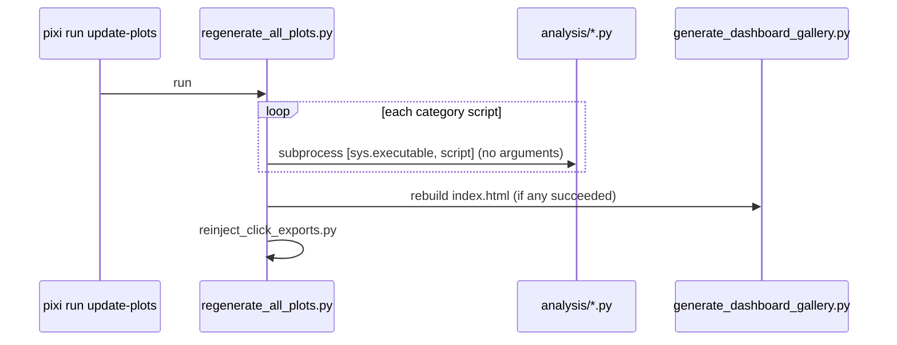

## Purpose
One-command refresh of the analysis outputs and the gallery index, and the path that publishes dashboards outside the repo: GCS through CI, then an allowlisted GitHub Pages subset.

## Key files
| Path:line | Role |
| --- | --- |
| pixi.toml:257 | `update-gallery` runs scripts/generate_dashboard_gallery.py |
| pixi.toml:258 | `refresh-dashboards`: insights, Pages 1-2, Page 3, Product 4, gallery (no drift, no runner) |
| pixi.toml:260 | `update-plots` runs scripts/regenerate_all_plots.py |
| pixi.toml:261 | `serve-gallery`: `python -m http.server 8000` inside exports/plots (local preview only) |
| scripts/regenerate_all_plots.py | Runs each `*.py` in `analysis/{composition,conversion,geospatial,metadata}` as a subprocess, then the gallery, then click-export reinjection; exits 1 if any script failed |
| scripts/generate_dashboard_gallery.py:432 | Globs `*.html` per category under exports/plots and writes index.html and login.html (see the gallery concept) |
| scripts/viz/reinject_click_exports.py | Re-injects the click-to-export snippet into dashboard HTML |
| .github/workflows/dashboard-artifacts.yml | Builds the drift page and the resource suite in CI, uploads them to GCS (`dashboards/<env>/<date-sha>` and `latest`) |
| .github/workflows/gh-pages.yml:44 | `GH_PAGES_GALLERY_GLOB`: allowlist copied from GCS latest (index.html and metadata/resource_analysis_dashboard.html by default) |
| .github/workflows/gh-pages.yml:108 | Skips internal dashboards even if listed: the workbench, QC outlier page, explorer and drift page |
| .github/workflows/gh-pages.yml:6-13 | Push triggers: resources/assets, the mapping scripts, the gallery script, and the workflow itself |

## How it works

The runner keeps going after a failure and reports all failures at the end. No workflow in .github runs `update-plots`.

CI path: `dashboard-artifacts.yml` runs on pushes to main that touch the generator files, on a Monday cron, on manual dispatch, and after the staging and production ETL workflows complete. It runs the drift script and the resource scripts directly, then the gallery. Its publish step copies `exports/plots/` to GCS, but it is skipped when the build used the minimal CI fixtures. `gh-pages.yml` runs after that workflow completes, copies the allowlisted files from GCS `latest` into `_site/gallery/`, and writes a placeholder page if index.html is missing.

## Interfaces
- **Inputs:** live Postgres (`update-plots` and CI), or snapshots; the existing exports/plots tree; GCS `latest` (Pages job).
- **Outputs:** exports/plots/** (local only, gitignored at .gitignore:142); GCS objects in the dashboards bucket; GitHub Pages `/gallery/` with only the allowlisted files.

## Gotchas
- **Nothing under exports/plots is committed any more** (ae147f6, #522). The earlier step of committing regenerated plots does not apply, and PRs cannot show chart diffs.
- **Pages copies only an allowlist.** Changing what is public means changing `GH_PAGES_GALLERY_GLOB` (a repository variable can override it), not adding files to exports/plots.
- The gallery globs whatever HTML exists, so orphaned HTML stays listed until deleted by hand (inferred from the glob).
- `exports/gallery.md` is a separate, hand-maintained markdown gallery and is already stale (see bugs/analysis-gallery-stale-entries).
- `update-plots` now also runs the resource scripts with no arguments, so it needs a live database (regenerate_all_plots.py:26).

## History
- `707afa8` (PR #442, 2026-07-06): added the gallery generator, the runner and the gh-pages workflow.
- `2dcfa81` (PR #451, 2026-07-07): mapping sync automation in the same window.
- `1fcadb4` (PR #521, 2026-10-19): gh-pages reads GCS and publishes the allowlist; dashboards built by dashboard-artifacts.yml.
- `ae147f6` (PR #522, 2026-10-19): exports/plots untracked and gitignored.
- `c4cbf2d` (PR #525, 2026-10-19): gallery expanded to five products and login portal.

## Open questions
- Whether `update-plots` should run in CI. The dashboard workflow now covers the resource suite, so this is open only for the older analysis scripts (inferred).

# Related Concepts
- [Analysis visualization scripts (analysis/) and how they query the DB](analysis-visualization-scripts.md): Scripts whose output this runner executes and indexes
- [System overview (start here)](system-overview.md): Places the static analysis gallery alongside the API and frontend
- [Publish analysis as committed static HTML instead of a live dashboard](../decisions/analysis-static-html-gallery.md): The static-publish choice that this mechanism implements
- [exports/gallery.md and analysis outputs reference scripts that do not exist](../bugs/analysis-gallery-stale-entries.md): Hand-maintained gallery.md has drifted from the generated output
- [Dashboard gallery index and login portal (scripts/generate_dashboard_gallery.py)](analysis-dashboard-gallery-and-portal.md): gallery generator and login page this runner calls
- [Five-product BioCirV resource dashboard suite and how each is generated](analysis-resource-dashboard-suite.md): resource dashboards built by CI and refresh-dashboards
- [Multi-environment DB drift assessment (4 layers, local/staging/production)](analysis-db-drift-assessment.md): drift page built by CI and db-drift-compare
