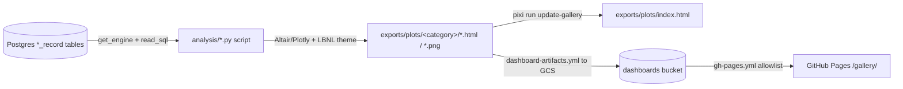

## Purpose
Produces the project’s analytical charts (composition, conversion, geospatial, metadata, lineage) as standalone HTML/PNG files written under `exports/plots/`. These files are no longer committed (ae147f6, PR #522); they are regenerated locally or in CI and published through the GCS dashboards bucket and the GitHub Pages allowlist. The scripts are plain Python files, each with a `main()` or module-level body. Jupytext-style `# %%` headers are used in some files.

## Key files
| Path:line | Role |
|---|---|
| `analysis/composition/proximate_distribution_viz.py:34-43` | `main()`; hardcoded `EXCLUDED_PROVIDERS` / `EXCLUDED_RESOURCES` lists |
| `analysis/composition/proximate_distribution_viz.py:47-57` | UNION ALL over `*_record` tables for the proximate dashboard |
| `analysis/composition/proximate_distribution_viz.py:202-212` | Writes `proximate_distribution.html` and dashboard HTML, then `inject_click_export()` |
| `analysis/composition/calorimetry_distribution_viz.py:168-169` | Example export path `exports/plots/composition/calorimetry_distribution.html` |
| `analysis/conversion/fermentation_distribution_viz.py:224-225` | Export to `exports/plots/conversion/` |
| `analysis/composition/moisture_vs_ash_viz.py:74-84` | Writes both HTML and PNG |
| `analysis/composition/*.py` (9 scripts), `analysis/conversion/*.py` (4 scripts) | Same pattern: `get_engine()`, `pd.read_sql` with bound `:excluded` / `:excluded_providers` tuples, Altair chart, `LBNL_PALETTE` |
| `analysis/sample_lineage_flow_viz.py` | Sankey; sits at `analysis/` root, see lineage concept |

## How it works

Each script: (1) sets `os.environ["POSTGRES_HOST"] = "localhost"` before importing the datamodels engine; (2) runs a SQL that labels each row `Portal Compliant` vs `Raw` via a CASE on resource name, provider codename, and `qc_pass = "fail"`; (3) builds the chart; (4) `os.makedirs` the category folder and saves HTML.

## Interfaces
- **Inputs:** Postgres database reached through `ca_biositing.datamodels.database.get_engine` (base tables such as `compositional_record`, `proximate_record`, `icp_record`, `fermentation_record`, plus `observation`, `resource`, `provider`). They do NOT read `analysis_data_view`; they query base tables directly (verified by grep of the SQL).
- **Outputs:** files under `exports/plots/composition/`, `exports/plots/conversion/`, `exports/plots/metadata/`, `exports/plots/geospatial/` (docstring only, see below), `exports/plots/lineage/`, plus `exports/plots/ca_county_biomass.html`. Untracked and gitignored (.gitignore:142).
- **Callers:** `pixi run update-plots` (`scripts/regenerate_all_plots.py`), or manual `python analysis/<cat>/<script>.py`. Shared theme: `ca_biositing.visualization.theme` (see `architecture/analysis-visualization-package`).

## Gotchas
- **Output paths are relative to the current working directory.** Scripts write to `exports/plots/...` literally, so they must be run from the repo root.
- **Exclusion lists are duplicated.** Twelve scripts carry literal copies of `EXCLUDED_RESOURCES` and `EXCLUDED_PROVIDERS` instead of importing `data_portal_views/common.py`. See `requirements/analysis-qc-filter-parity`.
- `analysis/geospatial/viz_county_biomass.py` has a docstring that says `exports/plots/geospatial/`, but the code writes `exports/plots/ca_county_biomass.html`.
- Several scripts do work at import time (no `__main__` guard). See `architecture/analysis-metadata-dashboards`.
- Charts are only as fresh as the last run; nothing re-runs them on DB changes. Because the outputs are untracked, a PR cannot show a chart change.

## History
- `707afa8` (PR #442, 2026-07-06): created the gallery and CI deployment of `exports/plots`.
- `d4f6b33` (PR #472, 2026-09-02): added `jaguar` to exclusions across MVs and plots.
- `f372f18` (PR #483, 2026-09-17): click-to-export audit tool injected into dashboards.
- `464e168` (PR #486, 2026-09-24): `experiment_name` filter added to composition charts.
- `5547c44` (PR #468, 2026-08-17): pretreatment variance chart added.
- `7fa56a9` (PR #463, 2026-07-31): fermentation chart parameters and yields updated.
- `ae147f6` (PR #522, 2026-10-19): exports/plots untracked; publish path changed to GCS and the Pages allowlist (`1fcadb4`, PR #521).

## Open questions
- Whether these scripts should move to `analysis_data_view` so chart filters cannot drift from the portal (inferred; confirm with the maintainers).
- Who runs `update-plots` and how often (inferred: manual; no workflow invokes it).

# Related Concepts
- [System overview (start here)](system-overview.md): Analysis layer is the downstream consumer of the datamodels DB produced by the ETL pipeline
- [ca_biositing.visualization package and LBNL theme](analysis-visualization-package.md): Shared LBNL theme and engine import used by every script
- [Plot regeneration, HTML gallery index, and GitHub Pages deploy](analysis-regeneration-and-gallery.md): Runner and gallery that execute these scripts and index their output
- [Analysis chart exclusions must match the portal QC definitions](../requirements/analysis-qc-filter-parity.md): Exclusion lists in these scripts must match the portal definitions
- [Dashboard gallery index and login portal (scripts/generate_dashboard_gallery.py)](analysis-dashboard-gallery-and-portal.md): index and login page built over these outputs
