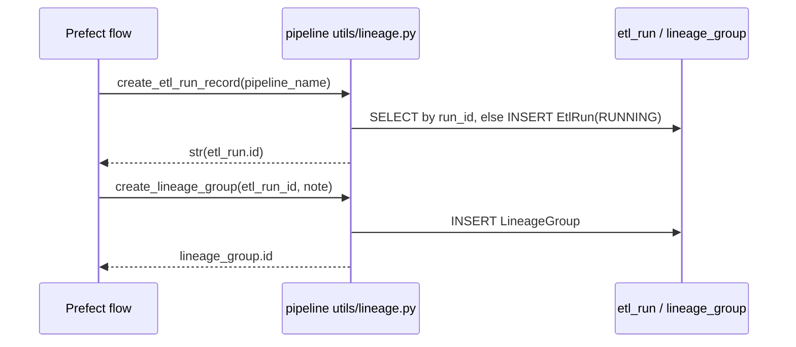

## Purpose
Run-level provenance. Each pipeline run gets an `etl_run` row; loaded records point to it via `etl_run_id`, and optionally to a `lineage_group`.

## Key files
| Path:line | Role |
|---|---|
| `models/core/etl_run.py:6` | `EtlRun` table `etl_run`: `id`, `run_id` (Prefect flow-run id as str), `started_at`, `completed_at`, `pipeline_name`, `status` (free text), `records_ingested`, `note`. Not a `BaseEntity`. |
| `models/core/lineage.py:5` | `LineageGroup` table `lineage_group`: `id`, `etl_run_id` (FK `etl_run.id`), `note`; `etl_run` relationship |
| `models/core/lineage.py:16` | `EntityLineage` table `entity_lineage`: `id`, `lineage_group_id` (no FK), `source_table`, `source_row_id`, `note` |
| `src/ca_biositing/pipeline/ca_biositing/pipeline/utils/lineage.py` | `create_etl_run_record` (creates `EtlRun` with `status="RUNNING"`, idempotent on `run_id`) and `create_lineage_group` |

## How it works

## Interfaces
- Inputs: Prefect flow-run id and pipeline name.
- Outputs: integer `etl_run.id` and `lineage_group.id`, passed to loaders that set `etl_run_id` / `lineage_group_id` on domain rows.
- Callers: pipeline flows (e.g. `residue_factors_flow` is mocked in `src/ca_biositing/pipeline/tests/test_residue_factors_flow.py:82`).

## Gotchas
- `EntityLineage` is exported (`models/__init__.py:14`) but no file under `src/` outside the datamodels package references it (grep, inferred unused; confirm before relying on it).
- `lineage_group_id` on `BaseEntity` and `EntityLineage` has no FK to `lineage_group`.
- Types cross the pipeline boundary as strings: `create_etl_run_record` returns `str(...)` while the column is an int FK.
- `status` is unconstrained text; `"RUNNING"` is the only value seen in this slice.

## History
- `7a41e0e` (2026-02-12, PR #112) created these tables in the SQLModel migration.
- `alembic/versions/0003_core_tables.py` creates `etl_run`, `lineage_group`, `entity_lineage`.

## Open questions
- Is `entity_lineage` planned for use, or should it be dropped? (no plan found under `plans/`)

# Related Concepts
- [Datamodels base mixins (BaseEntity, LookupBase, Aim1/Aim2RecordBase)](datamodels-base.md): BaseEntity.etl_run_id references etl_run.id
- [System overview (start here)](system-overview.md): hub: ETL provenance model
