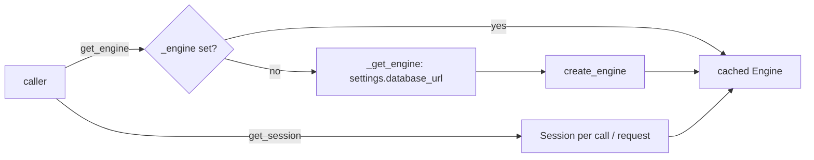

## Purpose
Single place where the datamodels package creates its SQLAlchemy engine and hands out sessions. Written to avoid connecting at import time.

## Key files
| Path:line | Role |
|---|---|
| `database.py:11-14` | `_get_engine()`: imports `settings` from `.config` inside the function, then `create_engine(settings.database_url, echo=False)` |
| `database.py:18-26` | module global `_engine = None`; `get_engine()` creates it on first call |
| `database.py:29-41` | `get_session()`: generator yielding `Session(get_engine())`, intended as a FastAPI dependency |
| `database.py:45-47` | module `__getattr__("engine")` returns `get_engine()`, kept for backward compatibility |

## How it works

## Interfaces
- Inputs: `settings.database_url` (see architecture/datamodels-settings-env).
- Callers: webservice `src/ca_biositing/webservice/ca_biositing/webservice/dependencies.py:15,26` (`SessionDep = Depends(get_session)`); scripts and notebooks use `get_engine()` per README quick start.
- Not used by the pipeline: `src/ca_biositing/pipeline/ca_biositing/pipeline/utils/lineage.py:8` imports its own engine from `ca_biositing.pipeline.utils.engine`.
- Not used by Alembic: `alembic/env.py:33-37` reads `DATABASE_URL` from the environment and falls back to `settings.database_url`.

## Gotchas
- `get_session` does not commit; callers must commit explicitly (read from code, not from a test).
- No pool options are passed; SQLAlchemy defaults apply.
- The singleton has no lock; concurrent first calls could each build an engine (inferred from code; low impact because `create_engine` is cheap and lazy).
- `tests/conftest.py` builds an in-memory SQLite engine. PostGIS `Geometry` columns (e.g. `multilinestring`, `infrastructure_petroleum_pipelines`) are not SQLite types, so tests that create all tables this way may not work for those models (inferred; not run).

## History
- `ab8fa6c` (PR #84, Berkeley Upstream) and `a9a86eb` touched the file before the SQLModel migration.
- `5bdefc9` (2026-02-19, PR #125, GCP staging via Pulumi and Cloud Run) last substantive change to the package config path that feeds this module; see settings concept.

## Open questions
- Whether `get_session` should commit/rollback itself (currently left to callers; confirm with webservice routers).

# Related Concepts
- [Do not create the DB engine or open connections at import time](../requirements/datamodels-lazy-engine.md): the lazy-init pattern here is the enforced requirement
- [Datamodels settings and DB environment variables (config.py)](datamodels-settings-env.md): supplies settings.database_url
- [System overview (start here)](system-overview.md): hub: where DB access sits in the system
