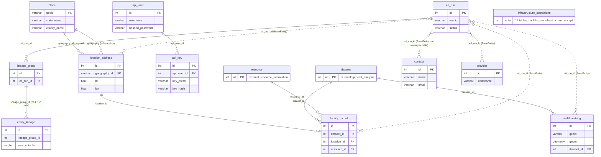

## Purpose
Entity-relationship view of the core, places, people, auth and infrastructure tables. Only FKs verified in code (`foreign_key=` in the model files) are drawn. Tables from other domains (`dataset`, `resource`) are stubs.

## Diagram

## Verified FK list (source of the diagram)
| Child column | Target | Code location |
|---|---|---|
| `base.py` `etl_run_id` (BaseEntity) | `etl_run.id` | `models/base.py:23` |
| `lineage_group.etl_run_id` | `etl_run.id` | `models/core/lineage.py:9` |
| `location_address.geography_id` | `place.geoid` | `models/places/location_address.py:10` |
| `multilinestring.dataset_id` | `dataset.id` | `models/places/multilinestring.py:14` |
| `api_key.api_user_id` | `api_user.id` | `models/auth/api_key.py:29` |
| `facility_record.dataset_id` / `location_id` / `resource_id` | `dataset.id` / `location_address.id` / `resource.id` | `models/infrastructure/facility_record.py:11,13,15` |

Notes: `contact` and `provider` have no FKs of their own; they are only targets. Incoming FKs from other domains: `field_sample` and `experiment` and `prepared_sample` (to contact/provider/location_address), and `usda_census`, `billion_ton`, `resource_availability` (to place). Those are outside this slice.

# Related Concepts
- [Places tables: place (GEOID natural key), location_address, multilinestring](datamodels-places.md): diagram details place and location_address
- [Infrastructure tables (infrastructure_* facility datasets, facility_record)](datamodels-infrastructure.md): facility_record edges and standalone infra tables
- [System overview (start here)](system-overview.md): hub: schema overview
