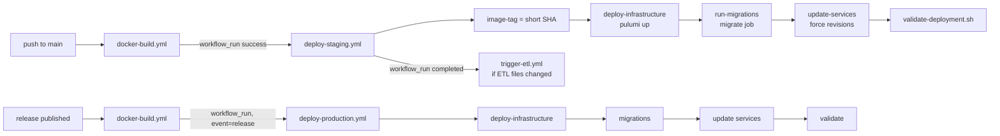

## Purpose
Automates GHCR image builds and the GCP deploy. Staging deploys after every successful image build on `main`. Production deploys on release (image built from the release) or manual dispatch, and its Pulumi job runs only on pushes to `main` that touch the infra folder for preview.

## Key files
| Path:line | Role |
|---|---|
| .github/workflows/docker-build.yml:1-83 | Builds `pipeline` and `webservice` for linux/amd64 and pushes to `ghcr.io/<repo>/<name>`. Triggers: push to main (paths), release published, PR (build only). Tags: `latest` on default branch, short SHA, branch, `v{{version}}` |
| .github/workflows/deploy-staging.yml:1-200 | Jobs: `preview` (PR, `cloud-plan-direct`), `image-tag`, `deploy-infrastructure` (`cloud-deploy-direct`), `run-migrations` (`cloud-migrate-ci`), `update-services` (`cloud-update-services`), `validate-deployment` (`scripts/validate-deployment.sh`). Triggered by `workflow_run` of Build and Push on main |
| .github/workflows/deploy-production.yml:1-207 | Same chain for `DEPLOY_ENV=production`, environment `production`; `preview` runs on pushes to main touching `deployment/cloud/gcp/infrastructure/**` or `pixi.toml`; image-tag gated on `workflow_run.event == "release"` |
| .github/workflows/trigger-etl.yml:1-92 | After "Deploy Staging": if pipeline/datamodels/alembic/prefect files changed in the deployed commit, runs `cloud-trigger-etl` (environment `etl-staging`) |
| .github/workflows/trigger-etl-production.yml | Production counterpart (environment `etl-production`) |
| .github/workflows/migrations.yml | Separate CI check: alembic upgrade/check/downgrade on a Postgres service, not a deploy |
| .github/workflows/cd.yml | Builds and publishes the datamodels, pipeline, and webservice Python packages (TestPyPI and PyPI), not the cloud deploy |

## How it works

Each deploy job authenticates via `google-github-actions/auth@v3` with WIF and sets up pixi with `environments: deployment`, pixi v0.63.2. Migrations run only after Pulumi succeeds, and service updates run only after migrations.

## Interfaces
- **Image tag**: short SHA (`${SHA::7}`) of the docker-build run head. For `workflow_dispatch`, the most recent successful docker-build run on `main` is used (deploy-staging.yml image-tag step).
- **Env in workflows**: `GCP_PROJECT`, `GCP_REGION`, `DEPLOY_ENV`, `WIF_PROVIDER`, `DEPLOYER_SA`; the WIF values are hard-coded per environment in the workflow `env:` block.
- **Scripts called**: scripts/validate-deployment.sh, pixi tasks in pixi.toml `[feature.cloud.tasks]`, which map to scripts/cloud-*.sh.

## Gotchas
- deployment/README says the staging build step "submits a Cloud Build". That is outdated: docker-build.yml pushes to GHCR and Cloud Run pulls through AR (see bugs/doc-drift-infra).
- Pull request runs of deploy-staging authenticate to GCP through WIF for the preview job (deploy-staging.yml preview job, `id-token: write`). See bugs/infra-deployer-trust-scope.
- `deploy-staging.yml` line 24 has a NOTE to update `WIF_PROVIDER` after a pool rename; the values are literal in YAML and must stay in sync with `wif.py` outputs.
- Production preview runs on push, but production deploy runs on release; a push to main that touches infra does not deploy production by itself (inferred from `if` conditions; confirm in Actions history).
- Staging `validate-deployment.sh` checks `prefect-auth /api/health` and the worker Ready condition, not flow health.

## History
- 13675d8 (PR #189, 2026-03-20): first automated staging deploy with WIF.
- 4e271b6 (PR #192): dropped the Cloud Build image step; images come from GHCR.
- 4a27f23 (PR #240, 2026-03-30): production waits for docker-build (workflow_run) rather than release directly; semver tags use `v` prefix.
- 27252ae (PR #216): ETL trigger workflow added.
- 42b07d0 (2026-03-23): staging environment added to deploy jobs.
- db578ad (PR #340, 2026-05-08): maintenance reset of staging; new backup buckets.

## Open questions
- Whether GitHub environment protection rules (required reviewers) are configured on `staging`, `production`, `etl-staging`, `etl-production` (not visible in repo; confirm in repo settings).

# Related Concepts
- [System overview (start here)](system-overview.md): CI/CD is how code reaches the cloud half of the system.
- [GCP cloud topology per environment (Cloud Run, Cloud SQL, AR proxies, GCS, WIF)](infra-cloud-topology.md): The resources these jobs create and update.
- [Decision: keyless GitHub Actions to GCP via Workload Identity Federation](../decisions/infra-wif-keyless-ci.md): Auth model used by every deploy job.
- [Prefect on Cloud Run: server, always-on worker, auth proxy, and ETL trigger job](infra-prefect-cloud-run.md): trigger-etl runs the registration job described there.
- [Alembic migrations: env.py, URL resolution, autogenerate filters, MV handling](migrations.md): run-migrations executes alembic upgrade head in the migrate job.
- [Test suite layout, how to run each suite, and fixture map](testing.md): ci.yml and migrations.yml run tests and migration checks; deploy workflows do not.
