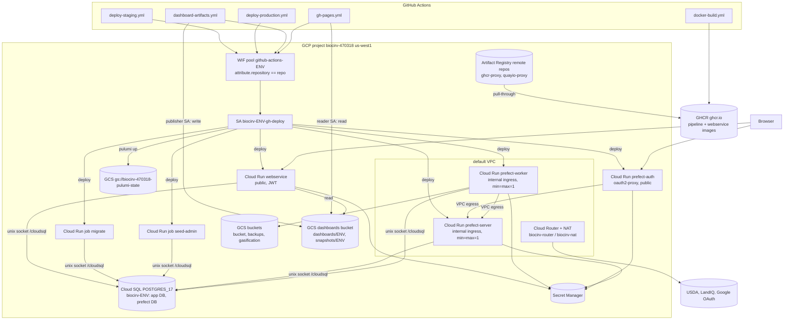

## Purpose
Describes the production-shaped deployment in GCP project biocirv-470318, region us-west1. Each environment (staging, production) is a separate Pulumi stack with resources named biocirv-{env}-*. Verified from deployment/cloud/gcp/infrastructure/*.py at HEAD a2c8de8. Snapshot: re-verify before relying on specific values.

## Key files
| Path:line | Role |
|---|---|
| deployment/cloud/gcp/infrastructure/config.py:9-13 | STACK_NAME from DEPLOY_ENV (default staging), GCP_PROJECT, GCP_REGION |
| config.py:60 | service-account prefix: prod for production, else the env name (30-char limit) |
| config.py:81-90 | image bases: AR remote repos ghcr-proxy and quayio-proxy; IMAGE_TAG (default latest) |
| config.py:30 | dashboards bucket name |
| cloud_sql.py:31-40 | Cloud SQL POSTGRES_17, db-custom-2-8192, public IP with ENCRYPTED_ONLY, deletion_protection=True |
| cloud_run.py:60 | webservice service (public, min 0 and max 10, allUsers invoker at 234-238) |
| cloud_run.py:110-117 | webservice dashboards env vars (bucket and prefix) |
| cloud_run.py:243 and 313 | jobs migrate and seed-admin |
| cloud_run.py:407-418 | prefect-server (internal ingress at 412, min=max=1) |
| cloud_run.py:508-518 | prefect-worker (internal, min=max=1) |
| cloud_run.py:700-720 | oauth2-proxy service named biocirv-{env}-prefect-auth (public, min 0 and max 2) |
| secret_manager.py | Secret Manager secrets and generated passwords |
| storage.py:20-166 | buckets: biocirv-{env}-bucket (public objectViewer, line 41-52), -backups (versioned), -gasification-data, -dashboards (see architecture/infra-dashboards-gcs-bucket) |
| networking.py | shared Cloud Router biocirv-router and Cloud NAT biocirv-nat (imported, retained) |
| artifact_registry.py | shared AR remote repos ghcr-proxy and quayio-proxy |
| wif.py:37-149 | WIF pool and provider, deployer SA biocirv-{env}-gh-deploy, and the dashboards SA bindings |

## How it works

Pulumi creates 9 APIs (apis.py), Workload Identity, the deployer SA, AR repos, Cloud SQL with the biocirv-{env} and prefect databases, biocirv_user and biocirv_readonly, eight service accounts (iam.py:29-95, six with role bindings), four buckets, Cloud NAT, and the Cloud Run services and jobs above.

Cloud Run services and key settings:

| Service | Ingress | Scale | Resources | Secrets mounted | Identity |
|---|---|---|---|---|---|
| webservice | ALL (public, allUsers invoker) | 0-10 | 1 CPU / 512Mi | db-password, jwt-secret, oauth2-client-id, gsheets-credentials | cr-websvc |
| prefect-auth (oauth2-proxy) | ALL (public) | 0-2 | 1 CPU / 512Mi, VPC egress | oauth2 client id and secret, cookie secret | cr-pfct-auth |
| prefect-server | INTERNAL_ONLY | 1-1 | 1 CPU / 1Gi | none (DB URL from the Cloud SQL socket) | cr-prefect |
| prefect-worker | INTERNAL_ONLY | 1-1 | 2 CPU / 2Gi, VPC egress | db-password, usda-api-key, google-maps-api-key, gsheets-credentials | cr-worker |

## Interfaces
- Inputs: env vars DEPLOY_ENV, IMAGE_TAG, optional image overrides, CORS_ORIGINS, LANDIQ_SHAPEFILE_URL (config.py). Manually uploaded secret versions (GSheets creds, USDA key, OAuth client id and secret) are set outside Pulumi (deployment/README.md).
- Outputs (deploy.py:89-132): webservice_url, prefect_server_url, oauth2_proxy_url, migration_job_name, seed_admin_job_name, bucket names including dashboards_bucket_name, deployer_sa_email, wif_provider_name, SA emails, secret names.
- Callers: GitHub Actions (architecture/infra-ci-cd-pipelines and architecture/tooling-ci-workflows) and operator scripts.

## Gotchas
- Cloud Run accepts images only from gcr.io, docker.pkg.dev or docker.io, so GHCR images go through the AR remote repo (see decisions/infra-ghcr-via-artifact-registry).
- Pulumi pins Cloud Run images to the tag at deploy time. CI passes a commit SHA tag (config.py:81-90).
- storage.py grants objectViewer on the gasification bucket to a hard-coded external data-portal SA (manual, not Pulumi-managed beyond that grant).
- The frontend SA is created here, but the frontend Cloud Run service is not defined in this repo.
- Cloud SQL has public IPv4 enabled (cloud_sql.py) with encrypted-only SSL. Cloud Run connects through the socket volume (inferred; confirm no authorized networks are set).
- Production has a dashboards bucket and SAs but no CI publish path (see bugs/dashboards-production-latest-unpublished).

## History
- 5bdefc9 (PR #125, 2026-02-19): first Pulumi GCP staging stack.
- 13675d8 (PR #189, 2026-03-20): WIF, deployer SA, GitHub Actions automation.
- 844ef97 (PR #203, 2026-03-24): names derived from DEPLOY_ENV.
- d4f3a33 (PR #228, 2026-03-30): production bootstrapped in the same project.
- 701fd3a (PR #249, 2026-04-03): over-privileged runtime SA bindings removed, frontend SA added.
- 752a80d (2026-10-19, PR #520): dashboards bucket, publisher and reader SAs, webservice dashboards env, and the oauth2-client-id and gsheets-credentials mounts (commit message: #520).

## Open questions
- Whether production deletion protection and backup retention meet the team’s recovery targets (inferred from config; confirm with the ops owner).

# Related Concepts
- [System overview (start here)](system-overview.md): Cloud deployment is the production shape of the system described in the overview.
- [Local Docker Compose topology (db, setup-db, Prefect server/worker, oauth2-proxy)](infra-local-topology.md): Local compose stack mirrors these services.
- [Pulumi Automation API program: modules, stacks, naming, and commands](infra-pulumi-program.md): Pulumi modules that create each box in this diagram.
- [Prefect on Cloud Run: server, always-on worker, auth proxy, and ETL trigger job](infra-prefect-cloud-run.md): Detail of the Prefect server, worker, and auth services.
- [Decision: images built to GHCR, pulled by Cloud Run through Artifact Registry proxies](../decisions/infra-ghcr-via-artifact-registry.md): Why images come through AR proxies.
- [Decision: keyless GitHub Actions to GCP via Workload Identity Federation](../decisions/infra-wif-keyless-ci.md): How CI gets the deployer identity.
- [GCS dashboards bucket, its service accounts, WIF bindings, and runtime reads](infra-dashboards-gcs-bucket.md): the dashboards bucket and SAs added to this topology
- [gh-pages.yml: builds the public Pages gallery from the GCS latest bundle](ci-gh-pages-gallery-consumer.md): the Pages build that reads the dashboards bucket
