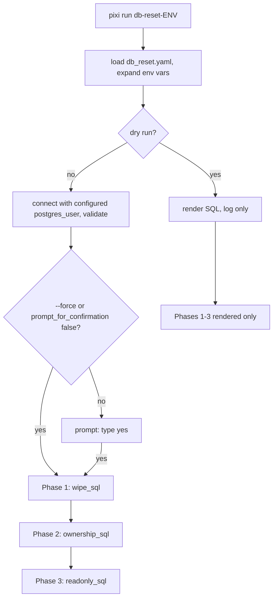

## Purpose
Drops and rebuilds the `public`, `ca_biositing`, and `data_portal` schemas on a target database, restores extensions, and re-grants control to `biocirv_user` and read-only to `biocirv_readonly`. Used for clean-slate loads and environment resets. After a reset, migrations and ETL must be run again. Added in 0ccbb0f (PR #387, 2026-06-01); safety checks hardened in b656a19 (PR #464, 2026-09-29).

## Key files
| Path:line | Role |
|---|---|
| scripts/db_reset.py:31-60 | `DatabaseResetOrchestrator.__init__`, logging to `logs/db_reset/reset_{env}_{timestamp}.log` |
| scripts/db_reset.py:202-237 | `prompt_confirmation()`: skipped by `--force` or `--dry-run`; otherwise requires typing `yes` |
| scripts/db_reset.py:243-295 | `execute_phase()`: renders Jinja2 SQL, dry-run logs only, else checks `current_database()` equals target (line 285) then executes and commits |
| scripts/db_reset.py:303-337 | `reset()`: connect and validate (310-311), confirmation (314), Phases 1-3; dry-run errors are logged and swallowed, real errors re-raised |
| scripts/db_reset.py:340-382 | argparse: `--env {local,staging,production}`, `--dry-run`, `--force` |
| scripts/sql/db_reset_wipe.sql | Phase 1: `DROP SCHEMA ... CASCADE` for each schema, recreate, grant usage, `CREATE EXTENSION IF NOT EXISTS` for postgis, pg_trgm, unaccent, btree_gin |
| scripts/sql/db_reset_ownership.sql | Phase 2: `ALTER SCHEMA ... OWNER TO biocirv_user`, grants ALL, `ALTER DEFAULT PRIVILEGES FOR ROLE postgres`, then `REASSIGN OWNED BY postgres TO biocirv_user` |
| scripts/sql/db_reset_readonly.sql | Phase 3: `GRANT USAGE` and `SELECT` to `biocirv_readonly`, plus default privileges |
| resources/config/db_reset.yaml | Per-env host, port, DB name, users, env-var fallbacks; schemas and extensions lists |
| docs/operations/DB_RESET.md | Operator guide (see Gotchas for drift) |
| pixi.toml:215-220 | Tasks `db-reset-local`, `-local-dry-run`, `-staging`, `-staging-force`, `-prod`, `-prod-force` |

## How it works

Each phase runs in its own transaction, after a `current_database()` check that aborts with `CRITICAL SAFETY ERROR` if the connection is not the configured target database (db_reset.py:280-286, added in b656a19).

## Interfaces
- **Inputs**: `--env`, `--dry-run`, `--force`; `resources/config/db_reset.yaml`; env vars `POSTGRES_*` (local), `DB_HOST_STAGING`, `DB_PORT_STAGING`, `DB_NAME_STAGING`, `DB_USER_STAGING`, `DB_PASSWORD_STAGING` (or `BIOCIRV_STAGING_USER_PW`), and the `_PROD` equivalents.
- **Connection**: staging and production expect a reachable host and port, normally a Cloud SQL Auth Proxy on localhost:5434 / 5435 (per DB_RESET.md; the proxy is not part of this repo).
- **Outputs**: log file under `logs/db_reset/`; no return value beyond exit code.
- **Next steps (printed on success)**: `pixi run migrate` (with `POSTGRES_HOST`/`POSTGRES_PORT` pointing at the proxy for cloud), then ETL.

## Gotchas
- `reset()` connects and validates before showing the confirmation prompt (db_reset.py:310-314), so a live connection exists before the prompt. Nothing is written before the prompt, but do not treat the prompt as the first network contact.
- Dry-run errors are caught and logged, not raised (db_reset.py:333-335). A failing dry run can look like success only in the final log line; read the log.
- `--force` (and the `*-force` pixi tasks) skip the prompt even for production. Do not use in an unattended job.
- Cloud SQL role model: `postgres` must be a member of `biocirv_user`, not the reverse, or `SET ROLE` fails. The fix is documented in DB_RESET.md ("Cloud SQL Permission Model"). Ownership is simulated by grants and default privileges, not true ownership (phase 2 comment).
- `resources/config/db_reset.yaml` local password falls back to a literal development default in the file. Treat it as a dev-only default; never reuse it for cloud targets. Do not copy the value into docs.
- DB_RESET.md has drifted: port convention list (5433/5434/5435 for kb/staging/prod), references to `docs/pipeline/DEPLOYMENT.md` that does not exist, and env var names that differ from the YAML fallbacks (bugs/doc-drift-infra).
- The wipe SQL drops the `public` schema, which is where PostGIS objects live; extensions are recreated afterwards with `IF NOT EXISTS`.

## History
- 0ccbb0f (PR #387, 2026-06-01): tasks and dynamic environment config added.
- b656a19 (PR #464, 2026-09-29): connection reconnect to target DB, `autocommit` switch, and the `current_database()` safety check, after silent failures reported in 099c441.
- 099c441 (2026-08-07): "does not fail silently" fix (precursor to #464).
- dffbaba (PR #363): local port binding changed to loopback, which affects `localhost:5432` targets used here.

## Open questions
- Whether the reset is restricted to a privileged operator workflow or can be run from CI (no workflow references `db-reset-*` tasks; confirm).
- Whether the `DROP SCHEMA ... CASCADE` on `public` breaks any extension owned by another role on Cloud SQL (inferred; confirm on staging with dry run first).

# Related Concepts
- [System overview (start here)](system-overview.md): Operational tooling for the Postgres database that the system stores data in.
- [Alembic migrations: env.py, URL resolution, autogenerate filters, MV handling](migrations.md): The reset is followed by alembic upgrade head to rebuild the schema.
- [Local Docker Compose topology (db, setup-db, Prefect server/worker, oauth2-proxy)](infra-local-topology.md): Local target is the compose db container on localhost:5432.
- [Deploy and infra invariants a change must keep](../requirements/infra-deploy-invariants.md): Safety rule that the connected DB must equal the target DB.
