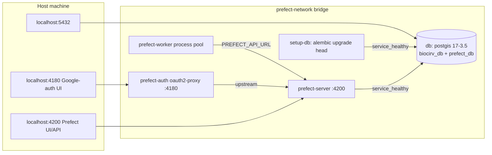

## Purpose
Local development stack defined by `resources/docker/docker-compose.yml`. Brings up PostGIS, a one-shot Alembic migration container, a Prefect 3 server and worker, and an oauth2-proxy in front of the Prefect UI. Started with `pixi run start-services`; torn down with `teardown-services` / `teardown-services-volumes` (the latter deletes `pgdata`).

## Key files
| Path:line | Role |
|---|---|
| resources/docker/docker-compose.yml:2-20 | `db` service: image `postgis/postgis:17-3.5`, container `BioCirV_ETL_db`, host port `127.0.0.1:${POSTGRES_PORT}:5432`, init SQL mount, `pg_isready` healthcheck |
| resources/docker/docker-compose.yml:22-39 | `setup-db`: builds pipeline image, runs `alembic upgrade head` once, waits for db healthy |
| resources/docker/docker-compose.yml:41-67 | `prefect-server`: `prefect server start --host 0.0.0.0 --port 4200`, host port 4200, volume `prefectdata`, curl healthcheck on `${PREFECT_API_URL}/health` |
| resources/docker/docker-compose.yml:69-100 | `prefect-worker`: `prefect worker start --type process --pool biocirv_dev_work_pool`, `PREFECT_API_URL=http://prefect-server:4200/api`, bind-mounts flow code and `credentials.json` |
| resources/docker/docker-compose.yml:102-138 | `prefect-auth`: oauth2-proxy v7.7.1 (Google provider), host port 4180, upstream `prefect-server:4200` |
| resources/docker/docker-compose.yml:140-146 | Named volumes `pgdata`, `prefectdata`; bridge network `prefect-network` |
| resources/docker/pipeline.dockerfile | Image used by setup-db, prefect-server, prefect-worker (see architecture/infra-scripts-inventory for other build inputs) |
| resources/docker/create_prefect_db.sql | Idempotent creation of `prefect_db`, mounted into `/docker-entrypoint-initdb.d/` (runs only on first init of `pgdata`) |
| resources/docker/.env.example | Template for `.env` (POSTGRES_*, DATABASE_URL, PREFECT_API_URL, PREFECT_API_DATABASE_CONNECTION_URL, OAUTH2_PROXY_*) |

## How it works

Startup order is enforced with `depends_on` + `condition: service_healthy` (db first, then prefect-server, then worker and prefect-auth). `setup-db` has no restart policy and exits after migrating; no compose service sets `restart:` (verified by grep).

## Interfaces
- **Hostnames**: inside containers use `db` and `prefect-server`; from the host use `localhost` (ports above). `.env.example` sets `POSTGRES_HOST=db` and `PREFECT_API_URL=http://localhost:4200/api` for host-side runs.
- **Worker pool**: local pool name is `biocirv_dev_work_pool` (compose line 94 and `.env.example`). Cloud pool is `biocirv-{env}-pool` (different; see architecture/infra-prefect-cloud-run).
- **Pixi wrappers**: `exec-db`, `exec-prefect-worker`, `access-db`, `access-prefect-db`, `run-etl` (docker-compose exec into prefect-worker) in pixi.toml.
- **Flow code in worker**: bind mounts put `src/ca_biositing/pipeline/ca_biositing` and `src/ca_biositing/datamodels/ca_biositing/datamodels` into `/app/.pixi/envs/etl/lib/python3.12/...` AND `python3.13/...` site-packages (compose lines 84-87), plus `run_prefect_flow.py` at `/app`. Hot-reload is by bind mount, not reinstall.

## Gotchas
- Postgres port is bound to loopback only (`127.0.0.1:` prefix, compose line 9; PR #363 "Postgres DB Security hardening", commit dffbaba). Other machines cannot reach it.
- `prefect-auth` sets `OAUTH2_PROXY_EMAIL_DOMAINS=*` (compose line 118) so any Google account can log in locally, while the Cloud deployment restricts to `lbl.gov` (config.py `OAUTH2_PROXY_EMAIL_DOMAIN`). Local auth is therefore weaker than cloud auth by design (inferred from config; confirm with the team if this matters).
- The Prefect server is still directly reachable on host port 4200, bypassing oauth2-proxy (kept for host-side pixi tasks; commit 72439c5 message).
- `prefect-server` healthcheck uses the `.env` value of `PREFECT_API_URL` (host-facing `localhost` URL) interpolated at compose time; it works because it runs inside the server container.
- The `db` init SQL only runs when `pgdata` is empty. Recreating the prefect DB on an existing volume requires `teardown-services-volumes` or a manual run.
- resources/AGENTS.md still says PostgreSQL 13; the actual image is postgis 17-3.5 since commit 5bdefc9 (see bugs/doc-drift-infra).

## History
- ab8fa6c (2025-11-05, PR #66): first appearance of the `prefect server` and worker services in compose, alongside `postgres:13`.
- a9a86eb (PR #84): postgis 13-3.1; dc98b30 (PR #108): 15-3.3; 5bdefc9 (PR #125, 2026-02-19): 17-3.5.
- 72439c5 (PR #221) and 09787cd (PR #223): oauth2-proxy added locally, then renamed to `prefect-auth`.
- dffbaba (PR #363, 2026-05-18): localhost binding for the Postgres port.

## Open questions
- Whether `setup-db` should be re-run automatically on every `start-services` (currently it runs on every `up -d`, since it is not profiled; inferred from compose, confirm by running `docker-compose up -d` twice).

# Related Concepts
- [System overview (start here)](system-overview.md): Local stack is the development counterpart of the cloud topology in the system overview.
- [GCP cloud topology per environment (Cloud Run, Cloud SQL, AR proxies, GCS, WIF)](infra-cloud-topology.md): Same services (db, prefect server/worker/auth) exist in GCP with different hostnames and auth.
- [Database reset tool (scripts/db_reset.py): three SQL phases, safety checks, env targets](infra-db-reset.md): Local reset targets the compose db container on localhost:5432.
- [Decision: oauth2-proxy with Google login in front of the Prefect UI and API](../decisions/infra-prefect-auth-oauth2-proxy.md): Why oauth2-proxy fronts the Prefect UI locally and in cloud.
- [Alembic migrations: env.py, URL resolution, autogenerate filters, MV handling](migrations.md): setup-db service runs the Alembic head migration.
