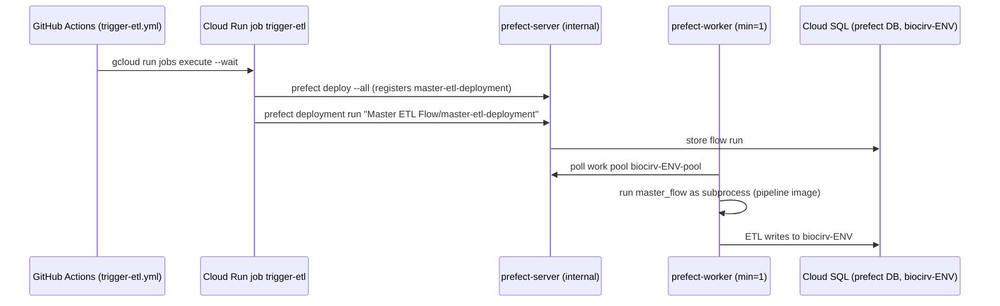

## Purpose
Prefect 3 orchestrates the ETL flows in the cloud. The Prefect server, worker, and oauth2-proxy are Cloud Run services; flow deployments are registered by a separate Cloud Run job that reuses the pipeline image. Local equivalent: architecture/infra-local-topology.

## Key files
| Path:line | Role |
|---|---|
| deployment/cloud/gcp/infrastructure/cloud_run.py:363-452 | `prefect-server`: `prefect server start --host 0.0.0.0 --port 4200`, `PREFECT_API_DATABASE_CONNECTION_URL` pointing at the `prefect` DB via `/cloudsql` socket (asyncpg), `PREFECT_UI_API_URL=/api`, ingress INTERNAL_ONLY, min=max=1 |
| cloud_run.py:464-660 | `prefect-worker`: args run `prefect worker start --pool biocirv-{env}-pool --type process --limit 3 --with-healthcheck` after exporting DB_PASS, USDA key, Maps key from mounted files; env `PREFECT_API_URL`, `CREDENTIALS_PATH`, `GOOGLE_APPLICATION_CREDENTIALS`, `LANDIQ_SHAPEFILE_URL` |
| cloud_run.py:660-775 | `oauth2-proxy` (service `biocirv-{env}-prefect-auth`): Google provider, `--email-domain=lbl.gov`, `--upstream=<prefect-server URL>`, skip-auth route `^/api/health$` |
| scripts/cloud-trigger-etl.sh:1-60 | Creates/updates Cloud Run job `biocirv-{env}-trigger-etl` from the pipeline image, runs `prefect --no-prompt deploy --all && prefect deployment run "Master ETL Flow/master-etl-deployment"` |
| resources/prefect/prefect.yaml:6-32 | Deployment definition `master-etl-deployment` (entrypoint `run_prefect_flow.py:master_flow`, concurrency_limit 7, work pool from `$PREFECT_WORK_POOL_NAME`, pull step sets `/app`) |
| resources/prefect/run_prefect_flow.py:8-28 | `AVAILABLE_FLOWS` ordered registry (order matters) |
| resources/prefect/run_prefect_flow.py:45-74 | `master_flow`: runs each sub-flow in try/except (failures logged, run continues), then `refresh_materialized_views_task` (retries=3) |

## How it works

The worker is a Cloud Run *service* with `min_instance_count=1` ("worker polls for jobs", cloud_run.py:473), not a Cloud Run job. Flows execute as subprocesses inside the worker container.

## Interfaces
- **Cloud Run env (worker)**: `PREFECT_API_URL` = `<prefect-server uri>/api`, `PREFECT_WORK_POOL_NAME=biocirv-{env}-pool`, `DB_USER`, `POSTGRES_DB`, `INSTANCE_CONNECTION_NAME`, `CREDENTIALS_PATH=/app/gsheets-credentials/credentials.json`.
- **Secrets mounted as files** (not env value_source; see comments at cloud_run.py:50-58): `/secrets/<name>/value`, read by an `sh -c` wrapper.
- **Prefect version**: `prefect-version: 3.4.23` in prefect.yaml; pixi `cloud` feature `prefect >=3,<4`; server image `prefecthq/prefect:3-python3.12` (floating major tag, config.py `PREFECT_SERVER_IMAGE`).
- **Pool**: local `biocirv_dev_work_pool`; cloud `biocirv-{env}-pool`. The `prefect.yaml` uses `{{ $PREFECT_WORK_POOL_NAME }}`, so the env var must match the environment.
- **Callers**: architecture/infra-ci-cd-pipelines (trigger-etl workflows); pixi `run-etl` locally.

## Gotchas
- prefect-server ingress is INTERNAL_ONLY: direct browser requests get 404 (deployment/README "Key design decisions"). The service also carries an `allUsers` run.invoker binding (cloud_run.py:452-458), so ingress is the effective gate, not IAM. The worker and trigger job reach it over the VPC.
- The worker and oauth2-proxy need `egress=ALL_TRAFFIC` through the `default` VPC; without Private Google Access on the default subnet, VPC-routed calls to Google APIs fail (deployment/README "Bootstrapping a New Environment" step 2 is a manual `gcloud` change, not in Pulumi).
- `master_flow` swallows sub-flow exceptions (run_prefect_flow.py:70-72). A run can finish green with failed sub-flows; check the logs, not only the run state.
- `run_prefect_flow.py` has DEBUG `print` statements (lines 57-65); noisy but harmless.
- Several flows are commented out in `AVAILABLE_FLOWS` (run_prefect_flow.py:12, 23-26), including `landiq`; whether LandIQ runs in cloud is not established by this slice.

## History
- 5bdefc9 (PR #125): server and worker moved to Cloud Run.
- 27252ae (PR #216, 2026-03-27): automatic ETL trigger after staging deploy.
- 6912294 and b452d81 (2026-03-30): registration moved into a Cloud Run job because calling `prefect deploy` from CI failed (deployment not found, CWD issues).
- f3ca6dd (PR #222) and 79f9344 (PR #226): oauth2-proxy front door; volume-mounted secrets to avoid the Cloud Run env var bug.
- d4f3a33 (PR #228): production stack; `CORS_ORIGINS` and removed hard-coded staging tags.

## Open questions
- Worker runs `--with-healthcheck` (cloud_run.py:496) with container port 8080 (cloud_run.py:499), but its only probe is a TCP startup probe (cloud_run.py:564-565). Confirm the worker is restarted when it hangs (inferred).

# Related Concepts
- [System overview (start here)](system-overview.md): Prefect is the orchestrator in the overall pipeline architecture.
- [GCP cloud topology per environment (Cloud Run, Cloud SQL, AR proxies, GCS, WIF)](infra-cloud-topology.md): Where these services sit in the GCP topology.
- [Local Docker Compose topology (db, setup-db, Prefect server/worker, oauth2-proxy)](infra-local-topology.md): Local Prefect server and worker equivalents.
- [GitHub Actions deploy chain: docker-build, staging/production deploy, migrations, ETL trigger](infra-ci-cd-pipelines.md): CI runs trigger-etl after staging deploy.
- [Decision: oauth2-proxy with Google login in front of the Prefect UI and API](../decisions/infra-prefect-auth-oauth2-proxy.md): Why the Prefect UI sits behind oauth2-proxy.
