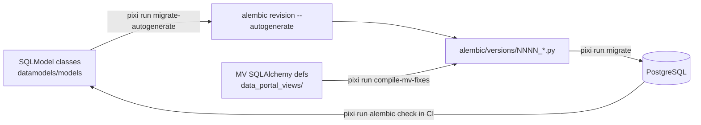

## Purpose
Schema evolution for the ca-biositing PostgreSQL database. SQLModel classes in `src/ca_biositing/datamodels` are the source of truth for tables; Alembic revisions in `alembic/versions/` apply them. Materialized views (MVs) are NOT autogenerated and are written by hand (raw SQL snapshots).

## Key files
| path:line | role |
|---|---|
| `alembic.ini:2` | `script_location = alembic`. No `version_locations` set, so only `alembic/versions/` is loaded; `versions_old/` is inert. |
| `alembic/env.py:21` | `load_dotenv` from repo-root `.env` |
| `alembic/env.py:25` | `import ca_biositing.datamodels.models` registers all tables on `SQLModel.metadata` |
| `alembic/env.py:33-36` | URL: `DATABASE_URL` env var, else `ca_biositing.datamodels.config.settings.database_url` |
| `alembic/env.py:44` | `target_metadata = SQLModel.metadata` |
| `alembic/env.py:47-55` | `MAT_VIEW_NAMES` set (7 legacy view names, see gotchas) |
| `alembic/env.py:58` | `include_object` filter |
| `alembic/env.py:87` | `render_item` adds `import sqlmodel` for sqlmodel types |
| `alembic/env.py:97` / `:116` | offline / online runners; online uses NullPool and `search_path=public` (line 123-124) |
| `alembic/script.py.mako` | revision template (header + upgrade/downgrade stubs) |
| `src/ca_biositing/datamodels/ca_biositing/datamodels/config.py:44` | `Settings.database_url` (DATABASE_URL, then Cloud Run unix socket, then TCP) |
| `scripts/compile_mv_fixes.py:206` | `get_latest_revision()` globs `alembic/versions/*.py` for numeric prefixes |
| `alembic/versions/0026_add_food_processing_infrastructure_datasets.py` | Latest revision: infrastructure tables and address FKs |
| `alembic/AGENTS.md`, `alembic/README` | MV workflow and dual-track guidance |

## How it works

1. `env.py` resolves the URL and imports models, then builds the engine (online) or emits SQL (offline).
2. `include_object` (line 58) returns False for: PostGIS system tables (`spatial_ref_sys`, `geometry_columns`, `geography_columns`, `raster_columns`, `raster_overviews`), tables named in `MAT_VIEW_NAMES`, and unique constraints whose columns equal the PK columns.
3. Autogenerate compares only the default schema (inferred from env.py not setting `include_schemas`; confirm with a dry run). Core tables are created unqualified in `0003_core_tables.py`, so they live in `public`. The MVs live in `ca_biositing` and `data_portal` schemas and are not in `SQLModel.metadata`.
4. Materialized views: each MV change is a revision that drops and recreates views with embedded SQL (see `0024_centralize_qc_constants_across_data_portal_views.py:26` DROP_INDEX_STATEMENTS, `:81` DROP_VIEW_STATEMENTS, `:556` CREATE_INDEX_STATEMENTS, `:611` upgrade, `:648` downgrade). `compile_mv_fixes.py` renders the SQLAlchemy definitions to text and writes the next revision.
5. Table-only revisions such as `0026` are written by autogenerate and reviewed by hand (requirements/autogenerate-then-review).

## Pixi entry points (pixi.toml)
- `pixi run migrate` (line 205): `alembic upgrade head` against the Docker DB.
- `pixi run migrate-autogenerate` (line 211): `alembic revision --autogenerate` (takes no `-m`; pass one via `pixi run alembic revision --autogenerate -m ...`).
- `pixi run compile-mv-fixes -m "..."` (line 212): writes a new MV revision. `--revision NNNN --force` overwrites an existing one.
- `pixi run db-reset-local|-staging|-prod[-force]` (lines 215-220): `scripts/db_reset.py`, which wipes `public`, `ca_biositing`, `data_portal` and re-grants. It does not run migrations itself; the docs say run `pixi run migrate` afterwards.
- `pixi run cloud-migrate` / `cloud-migrate-ci`: runs the `*-migrate` Cloud Run job (`scripts/cloud-migrate-ci.sh`).

## Interfaces
- Inputs: `DATABASE_URL` (or `.env` / settings), SQLModel metadata from `ca_biositing.datamodels.models`.
- Outputs: revision files in `alembic/versions/`; `alembic_version` table in the DB.
- Callers: `pixi` tasks; `.github/workflows/migrations.yml` (runs `alembic upgrade head`, then `alembic check`, then `alembic downgrade base` on a PostGIS 17-3.5 service container, on PRs touching `alembic/**` or `src/ca_biositing/datamodels/**`); `scripts/cloud-migrate-ci.sh`.

## Gotchas
- `alembic check` in CI cannot see MV drift (MVs are excluded). View drift is only caught by reviewing the revision.
- `MAT_VIEW_NAMES` lists 7 names from the pre-refactor `views.py` (`landiq_record_view`, `analysis_data_view`, ...). The current `mv_biomass_*` views live in `data_portal` and are never in `target_metadata`, so the set does not filter them. Treat it as legacy.
- Revision IDs are mixed: numeric (`0001`..`0026`), descriptive (`0008_prox_exper_id_filter`), and old 12-hex IDs in `versions_old/` only. `get_latest_revision` only understands numeric prefixes.
- Revision 0026 drops source address columns and five tables are dropped on downgrade (see bugs/infra-migration-0026-drops-populated-columns).
- `alembic/AGENTS.md` refers to `scripts/extract_view_sql.py`, `scripts/generate_raw_sql_migration.py`, and a `9e8f7a6b5c4e_*` revision. None of these exist at HEAD (see bugs/doc-drift-missing-referenced-artifacts).

## History
- `7a41e0e` (2026-02-12, PR #112): LinkML to SQLModel; Alembic `env.py` rewritten to use `SQLModel.metadata`.
- `d961724` (2026-04-09, PR #258): MV migrations moved to immutable raw SQL.
- `2576d03` (2026-05-19, PR #362): `compile_mv_fixes.py` and `pixi run compile-mv-fixes`.
- `db578ad` (2026-05-08, PR #340): squash to 0001-0004; old chain moved to `versions_old/`. Revisions 0005 and 0006 were added after the squash.
- `0ccbb0f` (2026-06-01, PR #387): db reset tooling; `0002_permissions.py` edited in place.
- f8c9353 (2026-10-22, PR #514): revision `0026_add_food_processing_infrastructure_datasets.py` (down_revision `0025`).

## Open questions
- Whether the `alembic check` step in CI detects non-MV drift only (inferred from `include_object`; confirm by running `pixi run -e py312 alembic check` on a seeded DB).
- Whether `DATABASE_URL` has precedence over settings in the Cloud Run job (inferred from env.py lines 33-36; confirm in the job env).

# Related Concepts
- [System overview (start here)](system-overview.md): Alembic is the schema-management layer that sits between the datamodels package and the running database.
- [Alembic revision chain 0001-0024: what each revision changed and when](../facts/history-schema-timeline.md): Revision-by-revision record of what this env and chain have applied over time.
- [Why alembic history was squashed to 0001-0004 and old revisions moved to versions_old/](../decisions/squash-migration-history.md): Explains why the chain starts at 0001 and why old revisions are not in the live chain.
- [Decision: migrations embed frozen compiled SQL instead of importing view expressions](../decisions/views-compiled-sql-snapshots.md): Why MV revisions embed SQL rather than importing SQLAlchemy definitions.
- [Table changes: edit SQLModel, run migrate-autogenerate, then review the generated revision](../requirements/autogenerate-then-review.md): The required workflow for producing revisions that this env.py serves.
- [Test suite layout, how to run each suite, and fixture map](testing.md): CI migration job is the only automated migration check and runs on a fresh PostGIS container.
- [Migration 0026 drops source address and city columns from 7 infrastructure tables without copying data](../bugs/infra-migration-0026-drops-populated-columns.md): data-loss risk in revision 0026
