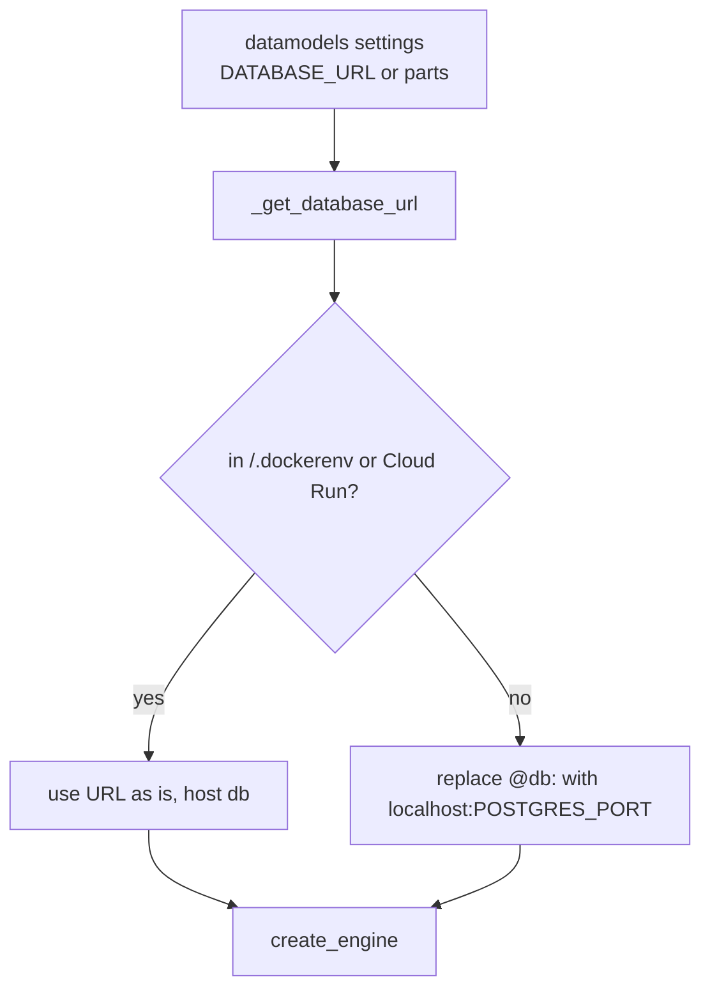

## Purpose
One place to get a SQLAlchemy engine for pipeline tasks. Handles three environments: Docker Compose, Cloud Run (Cloud SQL socket), and host dev (TCP to localhost).

## Key files
| Path:line | Role |
|---|---|
| `src/ca_biositing/pipeline/ca_biositing/pipeline/utils/engine.py:12-25` | `_get_database_url`. Imports `settings` inside the function, then rewrites `@db:5432` and `@db:` to `localhost:<POSTGRES_PORT>` unless `/.dockerenv` exists or `INSTANCE_CONNECTION_NAME` is set. |
| `src/ca_biositing/pipeline/ca_biositing/pipeline/utils/engine.py:28-29` | Module-level `DATABASE_URL` and `engine = create_engine(...)`. These run at import time. |
| `src/ca_biositing/pipeline/ca_biositing/pipeline/utils/engine.py:32-40` | `get_engine()`: new engine each call, `pool_size=5`, `max_overflow=0`, `pool_pre_ping=True`, `connect_timeout=10`. |
| `src/ca_biositing/datamodels/ca_biositing/datamodels/config.py:18-75` | `Settings` (pydantic-settings). Loads `resources/docker/.env`. `database_url` priority: `DATABASE_URL`, then Cloud SQL socket, then TCP. `settings = Settings()` at line 75 runs at import. |
| `src/ca_biositing/datamodels/ca_biositing/datamodels/database.py:21-48` | Lazy `get_engine()` plus `__getattr__("engine")`. Use this pattern, not the pipeline one. |

## How it works

## Interfaces
- `get_engine() -> Engine`: used by load tasks (`etl/load/*.py`), `utils/name_id_swap.py`, and some transforms.
- `engine` (module attribute): used by `utils/lineage.py:6`, `flows/field_sample_etl.py:13`, and some analysis loads (`etl/load/analysis/{xrd,xrf,icp,calorimetry}_record.py`).

## Gotchas
- `from ca_biositing.pipeline.utils.engine import engine` builds the engine when the importing module loads. This is the import-time pattern that `requirements/pipeline-lazy-model-and-settings-imports` forbids.
- `get_engine()` creates a new pool per call and nothing disposes it. Many load tasks each create one (inferred; confirm with connection counts).
- Rewrite only matches the literal `@db`. Any other host in `DATABASE_URL` is passed through unchanged.

## History
- `9697eeb` (PR #320) and `c46fa7a` (PR #126): engine helpers changed during ETL and Cloud Run work.
- `5bdefc9` (PR #125): Cloud Run and Pulumi deployment commit touched `engine.py` (the Cloud SQL socket branch is present today).

## Open questions
- Whether `get_engine()` should be cached (inferred; confirm with a DB connection test).

# Related Concepts
- [DATABASE_URL uses host db inside containers; localhost on host](../requirements/pipeline-db-host-in-containers.md): Governs the host rewrite logic here.
- [Import models and settings inside task or flow bodies](../requirements/pipeline-lazy-model-and-settings-imports.md): Module-level engine imports break that rule.
- [System overview (start here)](system-overview.md): Where the DB sits in the system.
