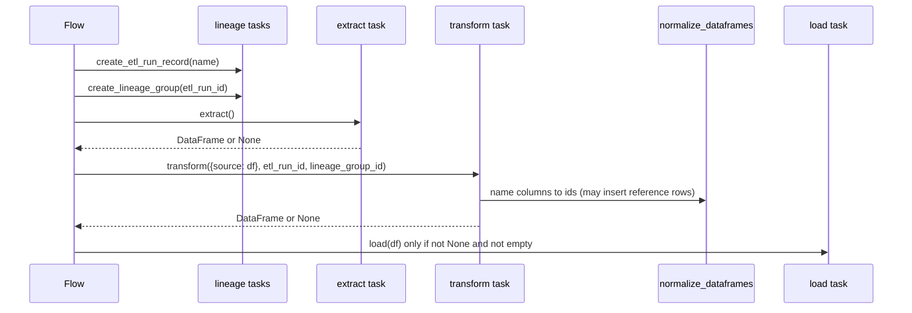

## Purpose
Shows the standard shape of an ETL flow and the conventions tasks must follow so that `run_etl_pipeline`-style plumbing and flows agree.

## Key files
| Path:line | Role |
|---|---|
| `src/ca_biositing/pipeline/ca_biositing/pipeline/flows/prepared_sample_etl.py:7-43` | Canonical example: lineage → extract → transform → load with `None`/empty guards. |
| `src/ca_biositing/pipeline/ca_biositing/pipeline/etl/transform/prepared_sample.py:16-23` | `EXTRACT_SOURCES = ["preparation"]` and `@task transform(data_sources, etl_run_id, lineage_group_id)`. |
| `src/ca_biositing/pipeline/ca_biositing/pipeline/etl/load/prepared_sample.py:9-70` | Load by natural key `name`: select, then update or add, one commit. |
| `src/ca_biositing/pipeline/ca_biositing/pipeline/flows/landiq_etl.py:21-118` | Chunked variant. Reads with pyogrio `skip_features`/`max_features`, then calls transform and load per chunk. |
| `src/ca_biositing/pipeline/ca_biositing/pipeline/utils/name_id_swap.py:148` | `normalize_dataframes`: swaps name columns for `<col>_id` and creates missing reference rows (get-or-create). |

## How it works

1. Lineage first: `create_etl_run_record` and `create_lineage_group` (see `architecture/pipeline-lineage-tracking`).
2. Extract: one task per source. Output is keyed by source name in `data_sources`.
3. Transform: `cleaning_mod.standard_clean`, coercion, stamp `etl_run_id` and `lineage_group_id`, then `normalize_dataframes`. Returns `None` if a required source is missing.
4. Load: a Prefect task that writes rows. Returns nothing.

## Interfaces
- Task inputs/outputs are pandas DataFrames. `None` means failure and short-circuits the flow.
- Transform signature convention: `transform(data_sources: Dict[str, DataFrame], etl_run_id, lineage_group_id) -> Optional[DataFrame]`.
- The module-level `EXTRACT_SOURCES` list is the contract that tells the runner which extracts to call.

## Gotchas
- `landiq_etl_flow` wraps the whole chunk loop in `except Exception` and only logs (`src/ca_biositing/pipeline/ca_biositing/pipeline/flows/landiq_etl.py:109-110`). A failed run can look successful. See `bugs/pipeline-normalization-silent-null-ids` for the same pattern.
- Landiq loads commit per chunk, so a mid-run failure leaves partial data.
- The `etl_run_id` type is `str` in some transforms and `int` in the template. Check the lineage table type before relying on it.

## History
- `9d1e16f` (PR #154): Aim 2 fermentation ETL added the extractor factory and this layout.
- `5ebbe4f` (PR #123) and `9697eeb` (PR #320): analytical suite and almond ETL added more flows (the same wiring is inferred; confirm per flow).
- `c5a592e` (PR #493): gasification archival prep moved into a transform task.

## Open questions
- `flows/master` calls sub-flows as `flow_func()` (`resources/prefect/run_prefect_flow.py:152`). The AGENTS guidance says use `.fn()` to avoid scheduling deadlocks. Confirm which is correct by running the master deployment locally (inferred; confirm by a local run).

# Related Concepts
- [Pipeline package layout and ETL layers](pipeline-package-layout.md): Layer definitions this wiring composes.
- [ETL run and lineage group tracking](pipeline-lineage-tracking.md): Lineage tasks every flow calls first.
- [Name-to-ID normalization (get-or-create reference rows)](pipeline-name-id-normalization.md): Get-or-create step inside transform.
- [Land IQ ETL flow (shapefile to landiq_record and polygon)](flow-landiq-etl.md): Chunked flow variant in detail.
- [USDA Census and Survey ETL flow (NASS Quick Stats to observations)](flow-usda-etl.md): Another flow built on this wiring.
