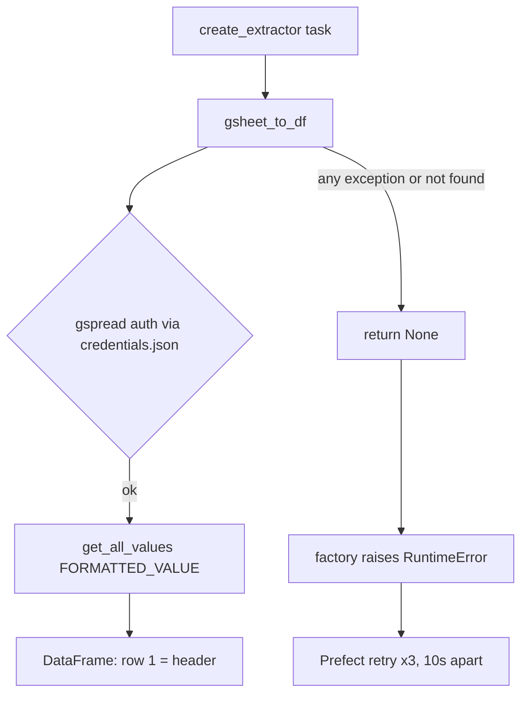

## Purpose
Turns a Google Sheet tab into a raw DataFrame inside a Prefect task. Most of the `etl/extract/` modules are built this way.

## Key files
| Path:line | Role |
|---|---|
| `src/ca_biositing/pipeline/ca_biositing/pipeline/etl/extract/factory.py:10-44` | `create_extractor(gsheet_name, worksheet_name, task_name)` returns a `@task` with `retries=3`, `retry_delay_seconds=10` (lines 15-19). |
| `src/ca_biositing/pipeline/ca_biositing/pipeline/etl/extract/factory.py:25-27` | Credentials path: env `CREDENTIALS_PATH`, default `credentials.json`, relative to the process cwd. |
| `src/ca_biositing/pipeline/ca_biositing/pipeline/etl/extract/factory.py:36-39` | Raises `RuntimeError` if `gsheet_to_df` returns `None`. This is what triggers Prefect retries. |
| `src/ca_biositing/pipeline/ca_biositing/pipeline/utils/gsheet_to_pandas.py:30-111` | `gsheet_to_df`: `gspread.service_account(filename=...)`, `gc.open(name)` with `open_by_key` fallback for keys of 20+ chars (lines 53-69), worksheet by gid or title, header row = first row, duplicate columns dropped (lines 99-102). |
| `src/ca_biositing/pipeline/ca_biositing/pipeline/etl/extract/preparation.py:7-10` | Example: `extract = create_extractor(GSHEET_NAME, WORKSHEET_NAME)`. |
| `src/ca_biositing/pipeline/ca_biositing/pipeline/utils/gsheet_sheets.py` | `get_sheet_names` helper for listing tabs. |
| `src/ca_biositing/pipeline/ca_biositing/pipeline/etl/templates/extract_gsheet_template.py` | Template for a new gsheet extract. Its import path is stale (line 17). |

## How it works

## Interfaces
- Input: sheet title (or key) and tab name, plus credentials file.
- Output: `pd.DataFrame` of strings. `get_all_values` returns cell text, so typing is done in transform (`cleaning/coercion`). (inferred from gspread behavior; confirm with a sample sheet.)
- Callers: `flows/*` and `etl/extract/*.py`.

## Gotchas
- `gsheet_to_df` swallows nearly every exception and returns `None`, so the real cause is printed, not raised. Read the task logs.
- Empty sheet returns an empty DataFrame, not `None`. Transforms must handle empty input.
- Extractor modules use the name `extract`, not `extract_<source>`. This does not match the legacy runner’s naming convention.

## History
- `9d1e16f` (PR #154): extractor factory introduced.
- `b328b5f` (PR #377): gsheet utilities touched by gasification ETL.
- `cf8b07f` (PR #385): credentials location fixed for Cloud Run.

## Open questions
- Whether `gdrive_to_pandas.py` shares this retry/None contract (not reviewed in depth; inferred no).

# Related Concepts
- [Google Sheets extracts need a service-account credentials.json](../requirements/pipeline-gsheet-credentials-file.md): Extracts fail without the service-account file this code reads.
- [Pipeline package layout and ETL layers](pipeline-package-layout.md): Extract layer in context.
- [USDA Census and Survey ETL flow (NASS Quick Stats to observations)](flow-usda-etl.md): Flows that consume extract outputs.
