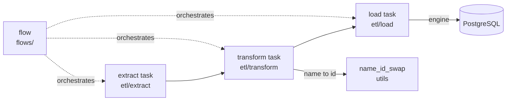

## Purpose
Namespace package `ca_biositing.pipeline` holds the ETL code that moves Google Sheets, shapefiles and public datasets into PostgreSQL via Prefect 3 tasks and flows. Shared DB models come from the sibling `ca_biositing.datamodels` package.

## Key files
| Path | Role |
|---|---|
| `src/ca_biositing/pipeline/ca_biositing/pipeline/etl/extract/*.py` | Extract tasks (~50 modules). Most are one-liners built by `factory.create_extractor` (`etl/extract/preparation.py:10`). |
| `src/ca_biositing/pipeline/ca_biositing/pipeline/etl/transform/**` | Transform tasks. Each declares `EXTRACT_SOURCES` and a `transform` / `transform_<name>` task. Subfolders: `analysis/`, `field_sampling/`, `usda/`, `landiq/`, `products/`, `resource_information/`. |
| `src/ca_biositing/pipeline/ca_biositing/pipeline/etl/load/**` | Load tasks. Each writes to the DB, usually with lazy model imports. |
| `src/ca_biositing/pipeline/ca_biositing/pipeline/etl/templates/` | Copy-start templates for extract (gsheet, gdrive csv/geojson), transform, and load. See gotchas on stale import paths. |
| `src/ca_biositing/pipeline/ca_biositing/pipeline/flows/*.py` | Prefect `@flow` modules that wire extract → transform → load. |
| `src/ca_biositing/pipeline/ca_biositing/pipeline/utils/` | Shared helpers: `engine.py` (DB engines), `lineage.py` (EtlRun/LineageGroup), `gsheet_to_pandas.py`, `name_id_swap.py`, `lookup_utils.py`, `geo_utils.py`, `gcs_utils.py`, `cleaning_functions/`. |
| `src/ca_biositing/pipeline/pyproject.toml:9,26-28` | Python >=3.12, pandas >=2.2,<3, prefect >=3,<4. |
| `src/ca_biositing/pipeline/AGENTS.md` | Package guide (pattern examples). Its pitfalls section is the best local summary. |

## How it works

Extract returns a DataFrame; transform reshapes it; load writes it. Flows are thin and mostly contain sequencing plus lineage setup (see `architecture/pipeline-flow-wiring`).

## Interfaces
- Inputs: Google Sheets (via gspread), shapefiles/GeoJSON/CSV under `data/` or `temp_external_datasets/`, USDA API.
- Outputs: rows in the `ca_biositing.datamodels` tables.
- Callers: Prefect worker (`resources/docker/docker-compose.yml`), `resources/prefect/run_prefect_flow.py` master flow, `scripts/run_flow.py`.

## Gotchas
- `etl/__init__.py` says to keep imports in submodules to avoid import-time side effects. Follow that.
- `pipeline/README.md` Quick Start shows `pip install ca-biositing-pipeline`. The supported path is pixi plus Docker (`docs/pipeline/PREFECT_WORKFLOW.md`). Treat the README as stale.
- `utils/common.py` does not exist in this package. The "common.py" data-quality filters live in datamodels (see `architecture/views-data-quality-filters`).

## History
- `43f3147` (PR #53, 2025-10-29): Prefect implementation and directory reorg.
- `ab8fa6c` (PR #66, 2025-11-05): PEP 420 namespace split into datamodels, pipeline, webservice.
- `7a41e0e` (PR #112, 2026-02-12): datamodels moved from LinkML to SQLModel. Pipeline imports changed with it.

## Open questions
- Whether the pipeline README should be rewritten or removed (inferred; confirm with maintainers).

# Related Concepts
- [System overview (start here)](system-overview.md): Pipeline is one of the three namespace packages in the system.
- [How a pipeline flow wires extract, transform, and load](pipeline-flow-wiring.md): Explains how these layers are composed inside one flow.
- [Land IQ ETL flow (shapefile to landiq_record and polygon)](flow-landiq-etl.md): Example of a flow that uses this layout.
