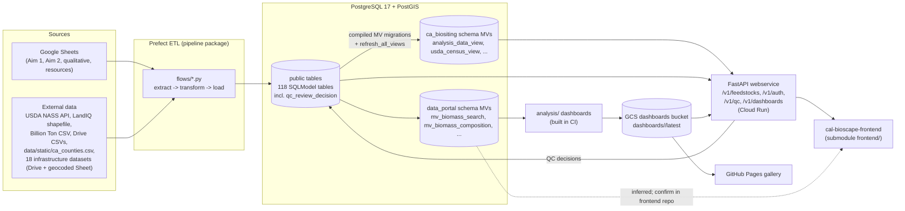

## Start here

**ca-biositing** is the data backend of the BioCirV / Cal BioScape research project: biomass feedstock siting for California, with a focus on the San Joaquin Valley. It answers two kinds of questions:

- **What feedstock exists, where, and how much?** County crop production (USDA NASS, county ag reports, Billion Ton 2023, LandIQ crop maps) turned into residue volumes with residue factors, plus seasonal availability and prices.
- **What is it made of and how does it convert?** Lab characterization of field samples (Aim 1: proximate, ultimate, compositional, ICP, XRF, ...) and conversion experiments (Aim 2: pretreatment, fermentation, gasification). See `facts/domain-aims-aim1-aim2`.

Users are the research team (analysts loading lab data through Google Sheets and reviewing QC in the BioCirV dashboard portal behind an allowlisted Google sign-in), the public Cal BioScape data portal (separate frontend repo), and API consumers holding API keys.

## Architecture

- Schema lives in hand-written SQLModel classes (`architecture/datamodels-model-registry`) and reaches the DB through Alembic (`architecture/migrations`). Materialized views are SQLAlchemy `select()` expressions compiled into raw-SQL migrations (`architecture/views-overview`).
- Every ETL flow runs inside the Prefect worker container locally (`architecture/infra-local-topology`) or a Cloud Run worker in GCP (`architecture/infra-cloud-topology`). Flows are wired in `architecture/pipeline-flow-wiring` and registered in `architecture/pipeline-flow-registry-and-run`.
- The webservice reads only the `ca_biositing` views plus a few base tables (`architecture/webservice-endpoints`). The `data_portal` views are read by analysis scripts; the portal frontend presumably reads them too, but the frontend code is not checked out here (`architecture/frontend`, inferred).
- The webservice also hosts the QC review loop: analysts record decisions through `/v1/qc` (`architecture/qc-review-api-v1-qc`, `architecture/qc-review-decision-ledger`) under portal auth (`architecture/portal-oidc-auth-and-rbac`), ETL reloads skip protected records (`decisions/qc-decisions-protected-from-etl-overwrite`), and an admin Stage 2 sync writes decisions back to the source sheets (`architecture/gsheet-qc-writeback`).
- Dashboards are generated in CI and published to a GCS bucket, never committed (`decisions/dashboards-gcs-over-committed-exports`, `requirements/generated-artifacts-never-committed`); `/v1/dashboards` serves them (`architecture/dashboard-snapshot-loader-gcs`) and GitHub Pages copies an allowlist (`architecture/ci-gh-pages-gallery-consumer`).
- Three installable packages share the PEP 420 namespace `ca_biositing`: `datamodels`, `pipeline`, `webservice` (`decisions/pep420-namespace-packages`). Pixi runs everything (`architecture/tooling-pixi-manifest`).

## One dataset end to end: USDA Census

1. **Source**: the USDA NASS Quick Stats API, keyed by `USDA_NASS_API_KEY`. Commodity mappings are seeded from `utils/commodity_mappings.csv`.
2. **Flow**: `pixi run run-single-flow usda_etl` runs `usda_etl_flow` in the worker container (`architecture/flow-usda-etl`). It creates an `etl_run` and lineage group (`architecture/pipeline-lineage-tracking`), syncs commodity mappings, then extracts every mapped commodity plus the top 5 for all CA counties.
3. **Transform and load**: rows are normalized (names swapped for FK ids, `architecture/pipeline-name-id-normalization`) and written to `dataset`, `usda_census_record`, `usda_survey_record` and the long-format `observation` table (`decisions/datamodels-observation-long-table`).
4. **Views**: `usda_census_view` in the `ca_biositing` schema joins census records to commodity and `place` (`architecture/views-ca-biositing-schema`); `mv_usda_county_production` in `data_portal` aggregates production per county and year (`architecture/views-data-portal-matviews`). Both are refreshed with `pixi run refresh-views` (`architecture/views-refresh`).
5. **API**: `GET /v1/feedstocks/usda/census/crops/{crop}/geoid/{geoid}/parameters` resolves the crop name (normalized, `api_name` preferred) and reads `usda_census_view` (`architecture/webservice-usda-query-services`), behind JWT or X-API-Key auth (`architecture/webservice-auth-jwt`, `architecture/webservice-api-keys`).
6. **Consumers**: the portal frontend and API-key clients; volume estimates combine the same production numbers with residue factors in `mv_biomass_volume_estimate`.

## Reading order

1. This concept, then `facts/glossary` for vocabulary.
2. Data model: `architecture/datamodels-er-diagram`, `facts/domain-core-terms`, `architecture/datamodels-general-analysis`.
3. Pipeline: `architecture/pipeline-package-layout`, `architecture/pipeline-flow-wiring`, then any `architecture/flow-*` concept.
4. Views: `architecture/views-overview`, `architecture/views-data-quality-filters`.
5. API: `architecture/webservice-overview`, `architecture/webservice-endpoints`.
6. Running things: `architecture/infra-local-topology`, `architecture/tooling-task-services-and-etl`, `architecture/testing`.
7. Hard rules before changing code: `requirements/pipeline-lazy-model-and-settings-imports`, `requirements/autogenerate-then-review`, `requirements/single-linear-head`, `requirements/mv-migrations-embed-raw-sql`.
8. What is happening now: `facts/current-state`; why things are the way they are: `facts/history-eras` and the `decisions/*` concepts. Common how-to questions: `facts/newcomer-faq`.

## Repository map

| Path | What it is |
|---|---|
| `src/ca_biositing/datamodels/` | SQLModel models, views, DB session (`architecture/datamodels-*`, `architecture/views-*`) |
| `src/ca_biositing/pipeline/` | Prefect ETL (`architecture/pipeline-*`, `architecture/flow-*`) |
| `src/ca_biositing/webservice/` | FastAPI app (`architecture/webservice-*`) |
| `src/ca_biositing/visualization/` | Plot theme helpers (`architecture/analysis-visualization-package`) |
| `datamodels/`, `pipeline/`, `webservice/` | Symlinks to the src packages (`facts/repo-root-package-symlinks`) |
| `alembic/` | Migrations (`architecture/migrations`) |
| `resources/` | Docker Compose, Prefect deployment runner (`architecture/infra-local-topology`) |
| `deployment/` | Pulumi program for GCP (`architecture/infra-pulumi-program`) |
| `scripts/` | Operational helpers (`architecture/infra-scripts-inventory`) |
| `analysis/`, `exports/`, `data/` | Chart and dashboard scripts (`architecture/analysis-resource-dashboard-suite`, `architecture/analysis-db-drift-assessment`); `exports/plots/` is generated and untracked since #522; static inputs and `data/qc/` seed CSV |
| `frontend/` | Git submodule, uninitialized here (`architecture/frontend`) |
| `tests/` | Root tests and agent-harness tests (`architecture/testing`) |
| `docs/`, `mkdocs.yml`, `plans/`, `audit/` | Docs site and planning records (`architecture/tooling-docs-site-mkdocs`) |
| `.agents/`, `AGENTS.md`, `CLAUDE.md`, `knowledge/` | Agent harness and this memory (`architecture/tooling-agent-harness`) |
| `config.py` (root) | Pydantic `Settings` with only `DATABASE_URL`; no importer found at a2c8de8 (the `from config import` lines in `deployment/` resolve to `deployment/cloud/gcp/infrastructure/config.py`). Likely dead (inferred; confirm before deleting). |
| `.vscode/`, `.gitattributes`, `LICENSE`, `CODE_OF_CONDUCT.md` | Editor settings, `pixi.lock merge=binary` attribute, license and community files |

## Gotchas
- Counts in older docs (91 models, nine views) are stale (118 table models at a2c8de8); see `bugs/doc-drift-model-count` and `bugs/doc-drift-materialized-view-count`.
- Several flows are commented out of the master runner and must be run individually (`architecture/pipeline-flow-registry-and-run`).

## History
See `facts/history-eras`. Written 2026-10-16 at e41d00d; refreshed 2026-10-22 at a2c8de8 after 17 commits that added the infrastructure ETL family (#514), the QC review ledger and `/v1/qc` API (#523-#526), the dashboard suite and drift audit (#517, #518, #525), and GCS dashboard publishing (#519-#522, #533).

# Related Concepts
- [Glossary](../facts/glossary.md): vocabulary used throughout the overview
- [Current state snapshot (2026-10-16)](../facts/current-state.md): what is in flight and broken now
- [Newcomer FAQ](../facts/newcomer-faq.md): task-oriented follow-up questions
- [Research aims: Aim 1 feedstock characterization vs Aim 2 conversion experiments](../facts/domain-aims-aim1-aim2.md): the research aims the data encodes
- [ER diagram: core, places, people, auth and infrastructure tables with verified FKs](datamodels-er-diagram.md): table relationships behind the Postgres box
- [How models are registered: models/__init__.py re-exports and Alembic metadata](datamodels-model-registry.md): how models reach SQLModel metadata
- [Alembic migrations: env.py, URL resolution, autogenerate filters, MV handling](migrations.md): how schema reaches the database
- [Materialized view system: two schemas, one compile-and-refresh loop](views-overview.md): materialized view layer
- [Pipeline package layout and ETL layers](pipeline-package-layout.md): ETL package map
- [How a pipeline flow wires extract, transform, and load](pipeline-flow-wiring.md): how a flow runs extract, transform, load
- [How flows are registered and run (master flow, run-single-flow, list-flows)](pipeline-flow-registry-and-run.md): which flows run and in what order
- [USDA Census and Survey ETL flow (NASS Quick Stats to observations)](flow-usda-etl.md): the end-to-end walkthrough flow
- [ca_biositing schema views in views.py: definitions, order, and consumers](views-ca-biositing-schema.md): views the walkthrough and API read
- [data_portal materialized views: modules, grain, and consumers](views-data-portal-matviews.md): portal views
- [Webservice package layout and app factory](webservice-overview.md): API layer
- [Full webservice endpoint table (36 routes)](webservice-endpoints.md): route inventory
- [frontend/ git submodule (cal-bioscape-frontend), pin, and API consumption](frontend.md): UI consumer of the API
- [Local Docker Compose topology (db, setup-db, Prefect server/worker, oauth2-proxy)](infra-local-topology.md): local runtime
- [GCP cloud topology per environment (Cloud Run, Cloud SQL, AR proxies, GCS, WIF)](infra-cloud-topology.md): cloud runtime
- [pixi.toml: workspace, features and environment composition](tooling-pixi-manifest.md): how commands are run
- [Agent harness layout: AGENTS.md entry point, .agents/rules, .claude links, and its invariant tests](tooling-agent-harness.md): agent instructions and this memory
- [Test suite layout, how to run each suite, and fixture map](testing.md): test suites
- [Analysis visualization scripts (analysis/) and how they query the DB](analysis-visualization-scripts.md): analysis consumers of the views
- [ca_biositing is a PEP 420 namespace shared by three distributions](../decisions/pep420-namespace-packages.md): why three packages share one namespace
- [Project history eras (2025-08 to 2026-10)](../facts/history-eras.md): how the system got here
- [Root datamodels/, pipeline/, webservice/ are symlinks into src/](../facts/repo-root-package-symlinks.md): root package directories are symlinks
- [ETL run and lineage group tracking](pipeline-lineage-tracking.md): cited under ’One dataset end to end: USDA Census’
- [Name-to-ID normalization (get-or-create reference rows)](pipeline-name-id-normalization.md): cited under ’One dataset end to end: USDA Census’
- [Measurements as a long observation table instead of one column per analysis](../decisions/datamodels-observation-long-table.md): cited under ’One dataset end to end: USDA Census’
- [refresh_all_views: refresh order, concurrency, and callers](views-refresh.md): cited under ’One dataset end to end: USDA Census’
- [Service layer behind feedstock queries and canonical view selection](webservice-usda-query-services.md): cited under ’One dataset end to end: USDA Census’
- [JWT login, cookie transport, and refresh in the webservice](webservice-auth-jwt.md): cited under ’One dataset end to end: USDA Census’
- [Per-client X-API-Key auth with rate limiting](webservice-api-keys.md): cited under ’One dataset end to end: USDA Census’
- [Domain terms as used in the datamodels: resource, field sample, prepared sample, analysis record, observation, parameter, unit, method, dataset](../facts/domain-core-terms.md): cited under ’Reading order’
- [General analysis: observation (long-format measurements), dataset, analysis type, dimension type](datamodels-general-analysis.md): cited under ’Reading order’
- [common.py: the single gatekeeper for view data-quality filters](views-data-quality-filters.md): cited under ’Reading order’
- [Pixi tasks for Docker services, psql access and ETL triggering](tooling-task-services-and-etl.md): cited under ’Reading order’
- [Import models and settings inside task or flow bodies](../requirements/pipeline-lazy-model-and-settings-imports.md): cited under ’Reading order’
- [Table changes: edit SQLModel, run migrate-autogenerate, then review the generated revision](../requirements/autogenerate-then-review.md): cited under ’Reading order’
- [Keep one Alembic head: linear chain, merge revisions for conflicts](../requirements/single-linear-head.md): cited under ’Reading order’
- [Migrations must not import SQLAlchemy models or view definitions](../requirements/mv-migrations-embed-raw-sql.md): cited under ’Reading order’
- [ca_biositing.visualization package and LBNL theme](analysis-visualization-package.md): cited under ’Repository map’
- [Pulumi Automation API program: modules, stacks, naming, and commands](infra-pulumi-program.md): cited under ’Repository map’
- [Inventory of scripts/ (deploy and ops scripts vs analysis and audit helpers)](infra-scripts-inventory.md): cited under ’Repository map’
- [MkDocs site and Read the Docs build: mkdocs.yml, readthedocs.yaml and the docs environment](tooling-docs-site-mkdocs.md): cited under ’Repository map’
- [Docs say 91 models; the code has 112 table models (15 subdirectories is correct)](../bugs/doc-drift-model-count.md): cited under ’Gotchas’
- [Docs disagree on materialized view count: 7, 9, 10 and ’nine’ vs 12 data_portal modules plus 7 ca_biositing views](../bugs/doc-drift-materialized-view-count.md): cited under ’Gotchas’
- [Pixi tasks for Alembic migrations, materialized views, DB reset, audits and pgschema](tooling-task-db-migrations-and-views.md): The pixi task family that generates and applies Alembic migrations, compiles MV fixes, refreshes views, resets databases, runs audits and calls the pgschema validation tools.
- [People tables: contact and provider](datamodels-people.md): contact (person) and provider (codename only) are BaseEntity tables referenced as analyst, collector, preparer and provider on sampling and experiment records.
- [Snapshot: datamodels table and subpackage counts disagree across docs](../facts/datamodels-model-inventory.md): At HEAD e41d00d: 112 table classes in 88 files, 15 domain subpackages; docs say 91 models and 7 or 9 materialized views. Use code counts, not doc numbers.
- [Billion Ton 2023 ETL flow (Google Drive CSV)](flow-billion-ton-etl.md): Downloads the Billion Ton 2023 agricultural CSV from a fixed Drive file ID and loads BillionTon2023Record plus Place rows; commented out of the master runner.
- [Biodiesel Plants ETL flow (Drive CSV with geocoding)](flow-biodiesel-plants.md): Loads biodiesel plant infrastructure from a Drive CSV, geocoding addresses via GoogleV3; returns a bool; disabled in the master runner since #380.
- [Gasification Timeseries Archiver subflow](flow-gasification-archive-pipeline.md): Subflow called by thermochem_etl that copies each gasification GSheet worksheet to a GCS CSV and upserts GasificationTimeseries metadata; it never fails on a single record.
- [Qualitative ETL flow (four-sheet qualitative market and end-use workbook)](flow-qualitative.md): Reads four worksheets of a qualitative market/end-use Google Sheet and writes datasets, observations, storage, transport and end-use records with lineage.
- [Pagination: unused PaginationDep versus per-route limit/offset](webservice-pagination.md): Only the admin API-key list paginates (limit/offset). The shared pagination_params dependency exists but no route uses it; data endpoints return full lists.
- [Running the webservice locally and generating OpenAPI](webservice-local-run-and-tooling.md): pixi start-webservice runs uvicorn from src; generate-openapi writes docs/api/openapi.json; create-admin seeds the first user. Includes the docs and health endpoints to check.
- [County biomass map and sample-lineage Sankey scripts](analysis-geospatial-and-lineage.md): Two non-categorized analysis scripts: a plotly county choropleth from ca_counties.csv and a Sankey of resource to analysis lineage; the lineage one is not run by update-plots.
- [Metadata and summary dashboards (analysis/metadata)](analysis-metadata-dashboards.md): analysis/metadata has a matplotlib summary (guarded by __main__) and a Plotly database dashboard that writes files at import time; its failed-run log is kept as audit_profiling_output.txt.
- [Jupyter notebook inventory (17 notebooks, outside analysis/)](analysis-notebooks.md): All 17 .ipynb files live under datamodels and pipeline, not analysis/; several import a schemas.generated package that does not exist in the tree.
- [Agent-harness tests: repo-structure invariants for AI rules, skills, and pins](testing-agent-harness.md): tests/agent_harness checks instruction files, rules, skills, links and pixi pins with git and YAML parsing; no DB or network.
- [Testing Prefect tasks by calling .fn() with a patched run logger](../facts/testing-prefect-fn-pattern.md): Prefect tasks are unit-tested via task.fn(...) with get_run_logger patched; used in about 100 call sites across the test tree.
- [Integration smoke tests need a live API, seeded DB and credentials; CI deselects them](../facts/testing-integration-smoke-tests.md): src/ca_biositing/webservice/tests/test_smoke.py hits a running server (23 tests); skipped without env vars and never run in CI.
- [ETL orchestrated by Prefect inside Docker Compose services](../decisions/prefect-docker-orchestration.md): Prefect server, worker and Postgres run as Docker Compose services started by pixi tasks; flows run inside containers, not on the host.
- [Cloud SQL uses a grant-based control model instead of strict ownership](../decisions/grant-based-cloud-sql-permissions.md): Cloud SQL cannot support strict ownership for postgres, so the reset scripts grant privileges and set default privileges rather than transferring ownership.
- [Refactor: PEP 420 namespace packages split (PR #66, 2025-11-05)](../facts/history-namespace-packages.md): Nov 2025 split of the ca_biositing namespace into datamodels, pipeline, and webservice distributions; the reason for the current import layout.
- [History: webservice auth, API keys, and DB hardening (2026)](../facts/history-auth-and-security.md): Chronology of JWT auth (#139), per-client API keys with rate limiting (#248), Prefect UI oauth2-proxy, and the May 2026 Postgres hardening commits.
- [History: ETL buildout by data source (Oct 2025 to Oct 2026)](../facts/history-etl-buildout.md): Which ETL sources were added when (Prefect, BT2023, analytical suite, gasification, USDA counties, almond, biodiesel) and by whom, to date a pipeline module.
- [History: AI agent tooling, skills manager, and SSEC harness (Oct 2025 to Oct 2026)](../facts/history-agent-harness.md): How AGENTS.md, skills.py replacing skills.sh, .agents/ rules and skills, and the Oct 2026 SSEC harness adoption evolved, with the files each change touched.
- [History: docs consolidation, CalVer, and CHANGELOG policy (2025-11 to 2026-04)](../facts/history-docs-and-release-policy.md): How docs moved to MkDocs/ReadTheDocs, adopted CalVer with an empty CHANGELOG, added CITATION.cff and a Zenodo-ready README, and what those imply for release notes.
- [/v1/qc API: routes, auth, request and response shapes](qc-review-api-v1-qc.md): QC review API hosted by the webservice
- [QC review decision ledger (qc_review_decision table, lifecycle, seed CSV)](qc-review-decision-ledger.md): Table that stores analyst QC decisions
- [BioCirV portal auth: Google OIDC, 2-role RBAC, isolated cookie](portal-oidc-auth-and-rbac.md): Portal sign-in and roles for QC and dashboards
- [QC decisions are protected from ETL overwrite until they reach the Google Sheet](../decisions/qc-decisions-protected-from-etl-overwrite.md): Why ETL reloads skip QC-protected records
- [Stage 2 Google Sheets writeback: webservice path and dormant pipeline copy](gsheet-qc-writeback.md): Stage 2 sync back to the source sheets
- [Decision: store generated dashboards in a GCS bucket instead of committing them to git (#519)](../decisions/dashboards-gcs-over-committed-exports.md): Why dashboards live in GCS, not in git
- [Generated dashboards, fingerprints, drift reports and insights are never committed to git](../requirements/generated-artifacts-never-committed.md): Rule on generated outputs
- [Dashboard snapshot loader: local-first, then GCS with TTL and ETag cache](dashboard-snapshot-loader-gcs.md): How /v1/dashboards serves dashboards
- [gh-pages.yml: builds the public Pages gallery from the GCS latest bundle](ci-gh-pages-gallery-consumer.md): Pages copy of the dashboards
- [Five-product BioCirV resource dashboard suite and how each is generated](analysis-resource-dashboard-suite.md): The dashboard products
- [Multi-environment DB drift assessment (4 layers, local/staging/production)](analysis-db-drift-assessment.md): Cross-environment DB drift audit
- [Infrastructure ETL family: 18 facility and line datasets, one shared extract/transform/load pattern](pipeline-infrastructure-etl-family.md): The 18 infrastructure ETL flows
