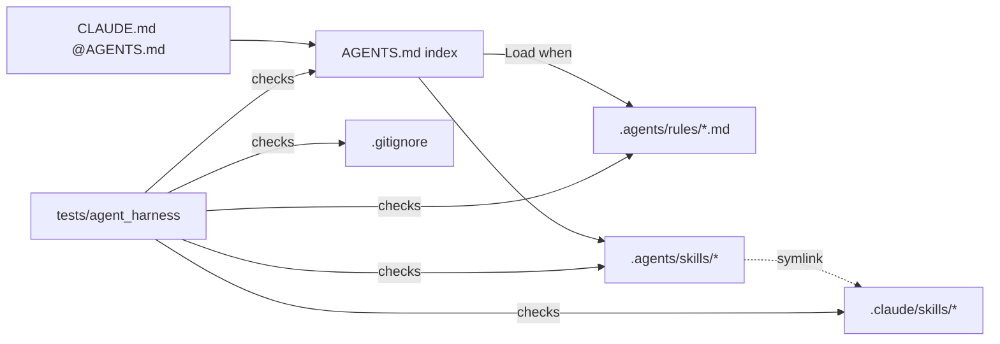

## Purpose
The repo’s guidance for AI coding agents, adopted from the SSEC project template in `e41d00d` (#497, 2026-10-16). `AGENTS.md` is a short index; detail lives in `.agents/rules/`, loaded when a task matches the rule’s "Load when" line.

## Key files
| Path | Role |
| --- | --- |
| AGENTS.md | Entry point: repository overview, build commands, schema workflow, pitfalls |
| CLAUDE.md | One line `@AGENTS.md`, so Claude Code imports the entry point |
| alembic/AGENTS.md, audit/AGENTS.md, resources/AGENTS.md, src/ca_biositing/{pipeline,datamodels,webservice}/AGENTS.md | Nested guides; `tests/agent_harness/test_entrypoint.py` checks each reaches Claude Code |
| .agents/rules/*.md (13 files) | namespace-packages, code-quality, pixi-environments, contribution-discipline, troubleshooting, docker-workflow, working-agreement, repository-map, testing-patterns, schema-and-migrations, mkdocs-okf-knowledge-bundle, agent-skills, generated-artifacts |
| .agents/skills/<name>/ | 10 committed project skills: clean-branches, commit, create-issue, create-pr, db-drift-assessment, docs, merge-pr, okf-memory, push, resource-analysis-dashboards |
| .claude/skills/<name> | Committed relative symlinks `../../.agents/skills/<name>`, one per project skill; the directory itself is real |
| .gitignore "Agents Braindump" block (lines 81-110) | Ignores `.agents/*` and `.claude/*` except the allowlisted rules and skills |
| tests/agent_harness/ | 10 test modules (ai_policy, agent_environments, okf, entrypoint, links, lockfile, pixi_references, readme, rules, skills) plus conftest |
| .github/workflows/ci.yml `harness` job (line 37-40) | Runs the harness tests with pixi installed but without installing from `pixi.lock` |

## How it works

- Rules are read on demand: each file opens with `# Title` then `**Load when:**`, enforced by `test_rules.py`.
- Behavior rules (`working-agreement.md`, `contribution-discipline.md`) constrain agents: minimal diffs, verify before claiming done, and a human reviews the full diff before any PR.

## Interfaces
- Inputs: none at runtime; humans and agents read the files.
- Outputs: none; the harness is documentation plus invariants.
- Callers: Claude Code (via CLAUDE.md and `.claude/skills`), Codex/Copilot/Cursor/OpenCode (via `.agents/`), CI `harness` job.

## Gotchas
- `.agents/` and `.claude/` are git-ignored by default. A new project skill is silently ignored unless it is added to the allowlist in `.gitignore` (lines 86-110) and to `.claude/skills` (see `.agents/rules/agent-skills.md`). Both 2026-10-19 skills were added this way.
- `.claude/skills` must stay a real directory; a symlinked directory was the cause of lost personal skills (commit message of `e41d00d`).
- `contribution-discipline.md` says behavior-shaping files (AGENTS.md, rules, skills, AI_POLICY.md, templates, pre-commit config) should not be reworded without a stated reason and human approval.
- The `skills.json` local registry must match the allowlist; see bugs/tooling-skills-json-declares-missing-local-skills (fixed in #531).

## History
- `e41d00d` (#497, 2026-10-16) moved `agent_docs/` into `.agents/rules/`, shrank `AGENTS.md`, added CLAUDE.md import, the AI policy and the project skills.
- `4f3e0be` (#517, 2026-10-19) and `d290906` (#518, 2026-10-19): added the db-drift-assessment and resource-analysis-dashboards skills with allowlist and link entries.
- `ae147f6` (#522, 2026-10-19): added the generated-artifacts rule.
- Harness invariants: `tests/agent_harness/*`, added in `e41d00d`.

## Open questions
- Whether the `pixi exec` harness job will keep working once pixi 0.68+ is adopted (see requirements/tooling-pixi-lockfile-format-pin).

# Related Concepts
- [skills.json / skills.py: how third-party and project agent skills are declared and synced](tooling-skills-sync.md): Third-party skills installed alongside the committed ones
- [PRs need pre-commit passing, the full PR template, AI disclosure and human diff review](../requirements/tooling-pr-ai-disclosure-and-preflight.md): Rules that PRs must satisfy
- [System overview (start here)](system-overview.md): Hub
- [okf memory task: pixi exec fetches okf-agent-memory on demand; knowledge/ is the bundle](../facts/tooling-okf-memory-task.md): Project memory the okf-memory skill reads and writes
- [Multi-environment DB drift assessment (4 layers, local/staging/production)](analysis-db-drift-assessment.md): project skill db-drift-assessment, one of the 10
- [Five-product BioCirV resource dashboard suite and how each is generated](analysis-resource-dashboard-suite.md): project skill resource-analysis-dashboards, one of the 10
