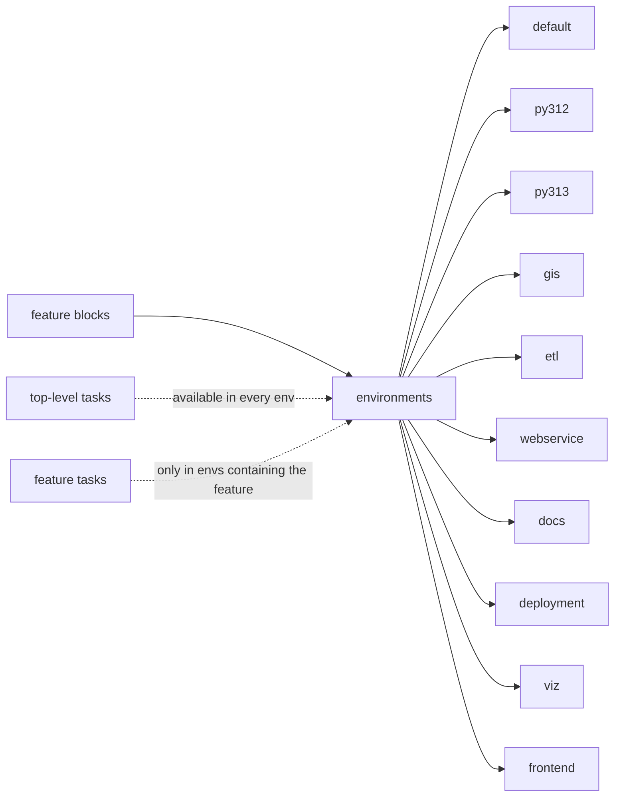

## Purpose
`pixi.toml` is the only environment and task manifest for local development, CI and the deployment tooling. It declares one workspace (`ca-biositing`, version `2026.4.6`, channel `conda-forge`, five platforms), ten named environments, and feature blocks that add dependencies and tasks to specific environments.

## Environment matrix
| Environment | Features | Intended use |
| --- | --- | --- |
| default | datamodels, pipeline, webservice, kernel, gis | Main dev: packages, notebooks, tests |
| py312, py313 | the three packages on that Python | CI test matrix |
| gis | qgis, raster, vector, kernel | QGIS and raster/vector work (`pixi run qgis`) |
| etl | datamodels, pipeline | ETL code (pipeline image) |
| webservice | datamodels, webservice | FastAPI service (webservice image) |
| frontend | frontend (no-default-feature) | Node.js for the `frontend/` submodule |
| docs | datamodels, pipeline, docs (no-default-feature) | MkDocs build for Read the Docs |
| deployment | cloud | gcloud, Pulumi, Prefect, deploy tasks used by all deploy workflows |
| viz | datamodels, visualization, kernel | Plot and gallery regeneration |

## Key files
| Path:line | Role |
| --- | --- |
| pixi.toml:1-10 | `[workspace]`: `requires-pixi = ">=0.55,<1.0"`, platforms osx-arm64/osx-64/linux-64/linux-aarch64/win-64 |
| pixi.toml:12-27 | `[environments]`: default, py312, py313, gis, etl, webservice, frontend, docs, deployment, viz |
| pixi.toml:29-57 | Base conda deps shared by every environment (python ~=3.12, pre-commit, pytest, docker-compose, pandas 2.x, geopandas, pixi-kernel ...) |
| pixi.toml:59-64, 205-244 | Top-level tasks (no feature): services, ETL, migrations, views, DB reset/audit, pgschema |
| pixi.toml:272-312 | Feature blocks: `qgis`, `raster`, `vector`, `py312`/`py313`, `frontend`, `kernel` |
| pixi.toml:314-335 | Editable path features: `datamodels`, `pipeline` (adds alembic, prefect>=3,<4, google-cloud-storage), deploy task |
| pixi.toml:338-368 | `visualization` and `webservice` features (fastapi <0.115, pwdlib[argon2]) and their tasks |
| pixi.toml:370-388 | `docs` feature (mkdocs-material, mkdocstrings) and `rtd-publish` |
| pixi.toml:391-495 | `cloud` feature (gcloud/pulumi, deployment tasks) |
| pixi.toml:497-503 | `gis` feature (geopandas, matplotlib) and top-level PyPI deps (sqlalchemy, geoalchemy2) |

## How it works

- Top-level `[tasks]` apply to every environment; `[feature.X.tasks]` only to environments that include feature X (inferred from pixi’s feature model; confirm with `pixi task list -e <env>`).
- `solve-group = "default"` makes most environments share one solve. `docs` and `frontend` set `no-default-feature = true`.
- The three packages are installed editable from `src/ca_biositing/{datamodels,pipeline,webservice,visualization}`.

## Interfaces
- Inputs: `pixi install [-e env]`, `pixi run [-e env] <task>`.
- Lock file: `pixi.lock` (format v6; see requirements/tooling-pixi-lockfile-format-pin).
- Callers: developers, every GitHub workflow (`pixi run -e deployment ...`), both Docker images and the devcontainer.

## Gotchas
- `default` includes the feature named `gis` (light: geopandas, matplotlib), not the QGIS/raster stack in the `gis` environment. The devcontainer `onCreate.sh` comment says GIS is excluded; that matches the QGIS stack, not this feature (inferred; confirm with `pixi list -e default`).
- The environment name `gis` and the feature name `gis` are the same string but different things.
- `pipeline.tasks.deploy` defaults `env_file` to `../docker/.env` relative to `resources/prefect`, i.e. `resources/docker/.env`. That file is not in the worktree (it is local, not committed).
- Root `config.py` (Pydantic `Settings` with `DATABASE_URL`, `get_settings()`) has no importer in the repo: the datamodels and webservice packages each have their own config module, and `deployment/cloud/gcp/infrastructure/deploy.py` imports a different `config`. Treat root `config.py` as dead code (inferred from grep; confirm before deleting).
- `jupyterlab` and `pixi-kernel` are in the top-level `[dependencies]` (pixi.toml:53-54), so every environment includes them.

## History
- `522d108` (#398, 2026-06-12) integrated skills management (`skills-sync`); `be75727` (#440) added `update-static-resource-info`; `707afa8` (#442) added the visualization feature and gallery tasks; `b5887e4` (#456) separated the geocoding and ETL pipelines; `102afdf` (#150) bumped the pixi pin to v0.63.2; `e41d00d` (#497, 2026-10-16) added the `okf` task.
- Sources: `git log --follow` on pixi.toml.

## Open questions
- Whether `pixi.toml` should move the `okf` task into a feature once every pin reaches pixi 0.68+ (the rule file says so; not yet planned in the repo).

# Related Concepts
- [System overview (start here)](system-overview.md): Hub for how the packages, Docker services and cloud pieces fit together
- [Pixi tasks for Docker services, psql access and ETL triggering](tooling-task-services-and-etl.md): Task families defined in this manifest
- [Do not run pixi commands that rewrite pixi.lock while any pinned pixi is older than 0.68](../requirements/tooling-pixi-lockfile-format-pin.md): Constraints on editing this manifest and its lock
