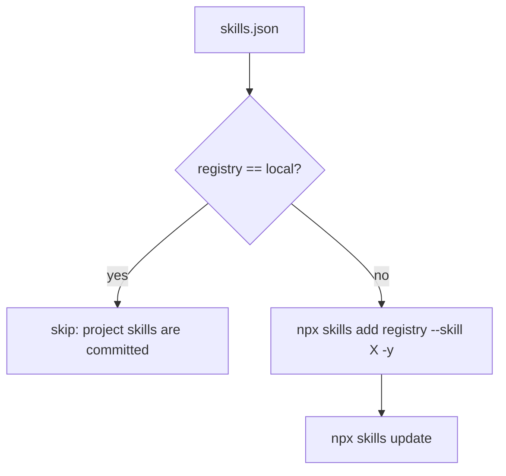

## Purpose
Declarative management of agent skills under `.agents/skills/`, shared by Claude Code, Codex, Copilot, Cursor and OpenCode.

## Key files
| Path | Role |
| --- | --- |
| skills.json | Manifest: one `"local"` registry (10 project skills) plus remote registries: `vercel-labs/agent-skills` (all skills), `github/awesome-copilot` (`github-issues`), `vercel-labs/skills` (`find-skills`), `skillscatalog/registry` (`skill-create`), `garrytan/gbrain` (`skillify`) |
| skills.py | Reads the manifest. Local registry is skipped. Each remote entry runs `npx skills add <registry> [--skill X] -y`, then `npx skills update` |
| skills.sh | Stub: prints that the script was removed and exits 1 |
| skills-lock.json | Version 1; 14 installed third-party skills with `source`, `skillPath` and `computedHash` |
| pixi.toml:60 | `skills-sync = "python skills.py"` |

## How it works

- `skills.py` `run()` only prints a warning on a non-zero exit (`check=True` does not raise), and `main()` returns 0 regardless, so a failed install is easy to miss (verified by reading the code).
- Installing a registry skill deletes `.agents/skills/<name>/` and copies the new one in: a same-name registry skill overwrites a committed project skill (see `.agents/rules/agent-skills.md`, "Name Collisions").

## Interfaces
- Inputs: `skills.json`, network access, `npx` on PATH (Node.js comes from the pixi default env).
- Outputs: `.agents/skills/<name>/` (git-ignored for third-party skills), `skills-lock.json` updates when run with the lock.
- Callers: developers via `pixi run skills-sync`; `.agents/rules/agent-skills.md` says what to commit (manifest and lock only).

## Gotchas
- The local registry must match the `.gitignore` allowlist and `.claude/skills` links. The two names that broke this (data-visualization, database-query) were removed in f954bd3 (#531); see bugs/tooling-skills-json-declares-missing-local-skills.
- The `vercel-labs/agent-skills` entry has no `skills` filter, so it installs everything that registry publishes.
- Windows needs `core.symlinks` for the `.claude/skills` links (see agent-harness concept).

## History
- `522d108` (#398, 2026-06-12) integrated declarative skills management.
- `707afa8` (#442) added the local entries that were never committed.
- `e41d00d` (#497) added the rule file `.agents/rules/agent-skills.md` and the project-skill allowlist. `skills.sh` is now a stub that points to `skills.py`.
- `4f3e0be` (#517) and `d290906` (#518), 2026-10-19: added db-drift-assessment and resource-analysis-dashboards to the local registry.
- `f954bd3` (#531), 2026-10-21: removed data-visualization and database-query.

## Open questions
- Whether `skills.py` should exit non-zero on a failed `npx` call (it currently does not).

# Related Concepts
- [Agent harness layout: AGENTS.md entry point, .agents/rules, .claude links, and its invariant tests](tooling-agent-harness.md): The rule and link layout these skills plug into
- [skills.json declares two local skills that do not exist in .agents/skills](../bugs/tooling-skills-json-declares-missing-local-skills.md): Stale local registry entries described here
- [System overview (start here)](system-overview.md): Hub
- [Five-product BioCirV resource dashboard suite and how each is generated](analysis-resource-dashboard-suite.md): resource-analysis-dashboards is a declared local skill
