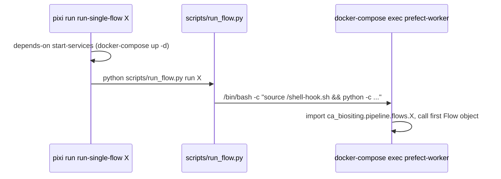

## Purpose
The task family that operates the local stack in `resources/docker/docker-compose.yml` and triggers ETL. Everything runs through `docker-compose`, and ETL runs inside the `prefect-worker` container.

## Key files
| Path:line | Role |
| --- | --- |
| pixi.toml:81-113 | `start-services`, `teardown-services[-volumes]`, `service-status`, `service-logs`, `rebuild-services` (all `docker-compose -f resources/docker/docker-compose.yml ...`) |
| pixi.toml:121-134 | `exec-prefect-worker`, `exec-db` (pass-through of a command) |
| pixi.toml:135-153 | `run-etl` (Prefect deployment run), `run-single-flow`, `list-flows`, `update-static-resource-info` |
| pixi.toml:155-203 | `check-db-health` (pg_isready), `access-db`, `access-prefect-db` (psql), `restart-services`, `restart-prefect-worker` |
| scripts/run_flow.py | `list` scans `src/ca_biositing/pipeline/ca_biositing/pipeline/flows/*.py`; `run <name>` execs into `prefect-worker` and calls the first `prefect.Flow` in module `ca_biositing.pipeline.flows.<name>` |
| src/ca_biositing/pipeline/ca_biositing/pipeline/utils/seed_commodity_mappings.py | step 2 of `update-static-resource-info` |
| scripts/csv_to_json.py, scripts/validate_headers.py | steps 3-4 of `update-static-resource-info` |

## How it works

- `run-etl` instead calls `prefect deployment run "Master ETL Flow/master-etl-deployment"` in the worker (it needs the deployment to exist; see `resources/prefect/deploy.py`).
- `update-static-resource-info` chains four commands with `&&`: run `static_resource_info` flow, `seed_commodity_mappings.py`, `csv_to_json.py`, `validate_headers.py`. It is the way Google Sheet changes reach `resources/assets`.

## Interfaces
- Inputs: a flow module name (`landiq_etl`, `static_resource_info`, ...) for `run-single-flow`; running Docker services.
- Outputs: data written to the local Postgres; JSON assets refreshed by `update-static-resource-info`.
- Callers: developers; `gh-pages.yml` consumes the JSON it produces (validation and Pages deploy).

## Gotchas
- `run_flow.py run` calls the first `Flow` object found in the module; a module with two flows runs whichever comes first in `__dict__` order (inferred from code; confirm by reading a multi-flow module).
- `run_flow.py run` executes the flow directly in the worker, while `run-etl` goes through a Prefect deployment. They are different code paths.
- `teardown-services-volumes` deletes all data (documented in the task description).
- `exec-prefect-worker` and `exec-db` take their command as trailing arguments, so the usage string is the only documentation.

## History
- `be75727` (#440, 2026-06-23) added `update-static-resource-info`. The Prefect layout came from `43f3147` (#53). No TODO/FIXME markers in these files.

## Open questions
- Whether `list-flows` should filter out helper modules. It currently lists every `*.py` except `__init__.py`.

# Related Concepts
- [Pipeline package layout and ETL layers](pipeline-package-layout.md): ETL flows that these tasks trigger (slice may not yet exist; prefix from the slice table)
- [System overview (start here)](system-overview.md): Hub for the Docker and Prefect topology
- [pixi.toml: workspace, features and environment composition](tooling-pixi-manifest.md): Manifest that defines these tasks
