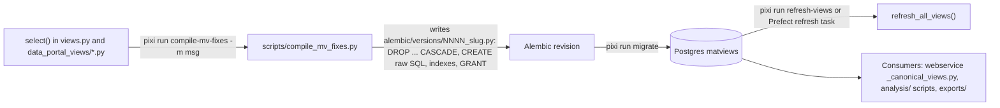

## Purpose
Materialized views (MVs) are the read layer for the data portal, analysis scripts and parts of the webservice. They are defined as SQLAlchemy Core `select()` expressions in Python, **not** as ORM models, so Alembic autogenerate never sees them. A change to a view reaches the database through a generated migration that embeds raw SQL.

Two families exist:
- `ca_biositing` schema: defined in `views.py` (8 definitions plus a `usda_resource_commodity_view`), consumed by the webservice feedstock/analysis/USDA services.
- `data_portal` schema: one module per view in `data_portal_views/` (10 current views plus 2 legacy views), consumed by analysis scripts and the portal.

## Key files
| Path:line | Role |
|---|---|
| `src/ca_biositing/datamodels/ca_biositing/datamodels/views.py:71` | `VIEW_SCHEMA = "ca_biositing"` |
| `views.py:523` | `VIEW_DEFINITIONS`: refresh order for ca_biositing views |
| `views.py:541` | `refresh_all_views(engine, log_summary=False)` |
| `data_portal_views/__init__.py:1` | Re-exports 11 `mv_*` expressions (not `mv_biomass_county_production`) |
| `data_portal_views/common.py:42` | Shared data-quality filters (see views-data-quality-filters) |
| `scripts/compile_mv_fixes.py:49` | `VIEWS` list of 13 compiled views (see views-compile-workflow) |
| `alembic/versions/0024_centralize_qc_constants_across_data_portal_views.py` | Latest view migration (HEAD e41d00d) |
| `pixi.toml:212`, `pixi.toml:244` | `compile-mv-fixes`, `refresh-views` tasks |

## How it works

## Interfaces
- Input: SQLAlchemy expressions in the two Python packages.
- Output: a migration file containing SQL strings (no Python imports at replay time).
- Refresh: `refresh_all_views(engine)`, called by `pixi run refresh-views` and by `resources/prefect/run_prefect_flow.py` (refresh task around line 31-40).

## Gotchas
- Editing a view and running only `pixi run migrate` changes nothing. Autogenerate ignores MVs (AGENTS.md, "Materialized Views").
- Every compiled migration drops and recreates the whole compiled set (13 views in 0024), not only the view you changed.
- Python definitions and migration SQL can drift. The migration is the live-DB truth. Example: the ICP ppm cap was present in `data_portal_views/` but missing from `analysis_data_view` until migration 0023 (commit 85373ad message).
- Docs disagree on how many views exist (7, 9, 10, 13, 19). See facts/views-sql-artifacts-status.

## History
- 930d868 (PR #220, 2026-04-01): introduced the `data_portal` schema and first views.
- d961724 (PR #258, 2026-04-09): split views into per-view modules and switched migrations to raw SQL snapshots.
- 2576d03 (PR #362, 2026-05-19): added `compile_mv_fixes.py` and the `compile-mv-fixes` task.
- 85373ad (PR #492, closes #476/#480, 2026-10-08): centralized filters into `common.py`.

## Open questions
- Whether the legacy `mv_billion_ton_county_production` and `mv_biomass_county_production` still exist in the live DB (inferred: they were created in migration 0004 and are not recompiled; confirm with `pixi run schema-analytics-list`).
- Whether the `frontend/` submodule (not checked out in this worktree) queries `data_portal` views directly (unknown here).

# Related Concepts
- [System overview (start here)](system-overview.md): Hub for where the datamodels package sits in the whole system.
- [Alembic migrations: env.py, URL resolution, autogenerate filters, MV handling](migrations.md): View changes are delivered as Alembic revisions; migration chain rules apply.
- [data_portal materialized views: modules, grain, and consumers](views-data-portal-matviews.md): Catalogue of the data_portal views this overview describes.
- [ca_biositing schema views in views.py: definitions, order, and consumers](views-ca-biositing-schema.md): Catalogue of the ca_biositing views and their refresh order.
- [compile_mv_fixes.py: turning view expressions into an Alembic migration](views-compile-workflow.md): Mechanics of the compile step that turns expressions into migrations.
- [refresh_all_views: refresh order, concurrency, and callers](views-refresh.md): How populated views are refreshed after data loads.
- [Decision: migrations embed frozen compiled SQL instead of importing view expressions](../decisions/views-compiled-sql-snapshots.md): Why migrations hold frozen SQL instead of importing the Python expressions.
