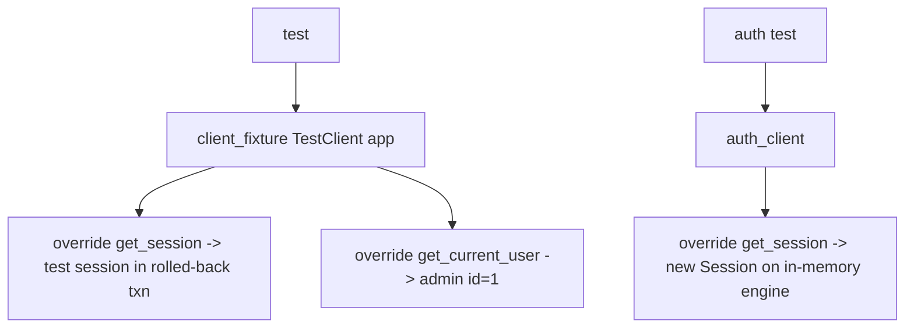

## Purpose
Where webservice tests live and what each requires.

## Key locations
| Path | Kind | Requires |
|---|---|---|
| `tests/webservice/` (repo root): `test_auth_endpoints.py`, `test_auth_service.py`, `v1/test_api_keys.py`, `v1/test_analysis.py`, `v1/test_auth.py`, `v1/test_availability.py`, `v1/test_usda_census.py`, `v1/test_usda_survey.py`, `v1/test_exceptions.py` | Unit and TestClient tests | SQLite in-memory via fixtures in `tests/webservice/conftest.py` and `v1/conftest.py` |
| `src/ca_biositing/webservice/tests/test_health.py` | Unit tests for `/health` with mocked engine | none |
| `src/ca_biositing/webservice/tests/test_smoke.py` | Live smoke, `@pytest.mark.integration` | running server at `CA_BIOSITING_BASE_URL` (default localhost:8000), `CA_BIOSITING_TEST_USERNAME/PASSWORD` |
| `src/ca_biositing/webservice/tests/conftest.py` | Provides `base_url`, `auth_headers`, `client` (httpx) and skips when env missing | |

## Commands
- CI: `pixi run pytest src/ca_biositing/webservice -m "not integration"` (`.github/workflows/ci.yml:75`). This runs `test_health.py` and not the root `tests/webservice` tree.
- Full: `pixi run test` runs `python -m pytest tests/ --verbose` (pixi.toml:258), which does include `tests/webservice`.

## Gotchas
- `src/.../tests/test_placeholder.py` is a placeholder.
- The README and AGENTS.md describe a `tests/test_main.py` and `tests/README.md` that are not present.
- No step in `ci.yml` runs the root `tests/webservice` tree (grep of `ci.yml`); coverage can drift unless someone runs `pixi run test` locally.
- Not run during this documentation pass (no DB or pixi env used). Pass/fail status unverified.

## Merged detail: Webservice test client fixtures and dependency overrides

### Purpose
Explains how webservice tests get a FastAPI TestClient bound to an in-memory DB and how auth is bypassed or exercised.

### Key files
| Path:line | Role |
|---|---|
| tests/webservice/v1/conftest.py:50 | `engine_fixture`: SQLite, creates Unit, Parameter, UsdaCommodity, Resource, FieldSample, Provider, ... tables |
| tests/webservice/v1/conftest.py:96 | `session_fixture`: `engine.connect()`, `begin()`, session via sessionmaker bound to connection; rollback on teardown |
| tests/webservice/v1/conftest.py:118-144 | `client_fixture`: overrides `get_session` (yields the test session) and `get_current_user` (returns admin ApiUser id=1); `dependency_overrides.clear()` on teardown |
| tests/webservice/v1/conftest.py:148, :313, :496, :762 | seed fixtures: `test_census_data`, `test_survey_data`, `test_analysis_data`, `test_availability_data` |
| tests/webservice/conftest.py:21-37 | `auth_engine`: StaticPool, `api_user` table only, `raise_server_exceptions` disabled for client |
| tests/webservice/conftest.py:53-70 | `auth_client`: overrides `get_session` with a per-request Session on the same engine; pops override on teardown |
| tests/webservice/conftest.py:73-150 | `admin_user`, `regular_user`, `disabled_user`, `admin_token`, `user_token` (bcrypt via get_password_hash) |
| src/ca_biositing/webservice/tests/conftest.py:8-42 | live-server `base_url`, `auth_headers` (logs in via /v1/auth/token), `client` (httpx); skips if env vars missing or connect fails |

### How it works

- Auth-bypassing endpoint tests (v1) do not exercise JWT; auth is covered in tests/webservice/test_auth_*.py.
- The v1 `client` fixture uses `TestClient(app)` with default `raise_server_exceptions=True`; the auth fixture disables it.

### Gotchas
- Overrides are global on `app`; a test that forgets to clear them leaks into others. v1 clears all overrides; auth conftest pops only `get_session`.
- The v1 fixture comment says the override bypasses auth for "feedstocks route tests"; so auth-required behaviour of feedstock routes is not exercised in that suite (auth is tested separately).

### History
- bd42ca2 (2026-10-02, PR #490): added Provider table creation after PR #472 added a Provider join to ANALYSIS_DATA_VIEW.
- 203b787 (2026-02-26, PR #139): JWT auth; origin of the auth fixtures.

### Open questions
- Whether root tests/webservice ever ran in CI historically: not checked here. (inferred; confirm via git log -- .github/workflows/ci.yml.)

# Related Concepts
- [Test suite layout, how to run each suite, and fixture map](testing.md): Project-wide testing conventions and fixture patterns
- [Per-client X-API-Key auth with rate limiting](webservice-api-keys.md): Largest test file covers key auth and rate limits
- [Webservice package layout and app factory](webservice-overview.md): What is under test
- [System overview (start here)](system-overview.md): webservice is the FastAPI layer under test
- [DB tests use SQLite in-memory with selected tables, not Postgres or testcontainers](../decisions/testing-sqlite-in-memory-fixtures.md): why these engines are SQLite
