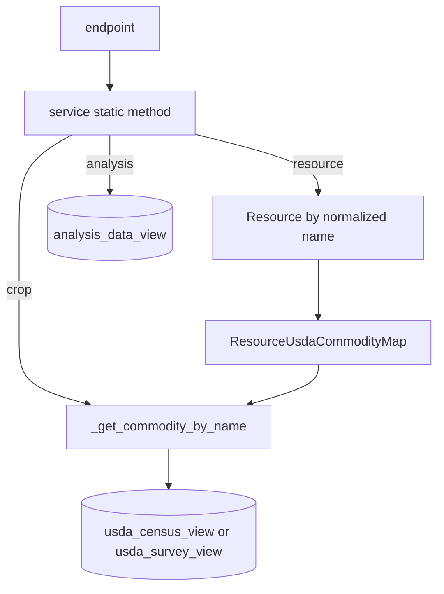

## Purpose
All feedstock business logic. Each service is a static-method class that takes a `Session` and returns dicts shaped for a Pydantic response.

## Key files
| Path | Role |
|---|---|
| `.../services/_canonical_views.py:1` | `get_*_view(session)` returns `table(name, columns, schema=ca_biositing)` on Postgres; otherwise the SQLAlchemy view subquery from datamodels `views.py` |
| `.../services/_usda_lookup_common.py:1` | `normalize_crop_name`, `normalized_sql_text` (replace `_`, collapse spaces, lower, trim), `get_commodity_by_name` (prefers `api_name` over `name`; raises CropNotFound) |
| `.../services/usda_census_service.py` | get_by_crop / get_by_resource / list_by_crop / list_by_resource + 4 discovery lists |
| `.../services/usda_survey_service.py` | Same shape over `usda_survey_view` |
| `.../services/analysis_service.py` | Resource lookup with normalization, observations from `analysis_data_view`, returns first match for single-parameter route |
| `.../services/availability_service.py` | Exact-match `Resource.name` (no normalization), `ResourceAvailability` row |

## How it works

- Census or survey by resource: `Resource` -> `ResourceUsdaCommodityMap` -> `UsdaCommodity` -> view rows filtered on `commodity_id` and `geoid`.
- Discovery lists use `SELECT DISTINCT ... WHERE col IS NOT NULL ORDER BY col`. Census `list_resources` reverse-maps commodity ids through `usda_resource_commodity_view`.
- Observations are de-duplicated by source record id in the census and survey services (inferred from the subquery in `_get_observations_for_census_record`; confirm by reading lines 92-170).

## Interfaces
- Input: `Session` from `SessionDep`; string path params.
- Output: dicts consumed by `CensusDataResponse` etc. Numeric values are cast with `float()`; None is preserved.
- Callers: only the v1 feedstock routers.

## Gotchas
- Views are created by datamodels (`ca_biositing` schema). Test SQLite runs use the SQLAlchemy fallback, so behavior can differ from Postgres.
- Matching differs by slice: analysis and census use normalized matching; availability does not, so `almond hulls` and `almond_hulls` behave differently there.
- `AnalysisService.list_geoids` returns `[]` because the analysis view’s geoid column is NULL (the code comment says "known analysis_data_view geoid bug"). See `bugs/views-analysis-data-view-null-geoid`.
- The analysis single-parameter route silently returns the first observation when several exist.

## History
- `6aa44b6` (2026-03-03), PR #159: switched services to query the data model views instead of rebuilding joins.
- `83d42dc` (2026-03-02), PR #155/#156/#157: USDA crop normalization and `api_name` lookup.
- `5ab52b8` (2026-06-01), PR #382: QC filters were added to analysis views in datamodels (migration `0015_implement_qc_filters_for_analysis_views`). Interacts with what the analysis endpoints return.

## Open questions
- Are the census and survey list endpoints expected to be bounded? See `architecture/webservice-pagination`.

# Related Concepts
- [Full webservice endpoint table (36 routes)](webservice-endpoints.md): Routes that call these services
- [Webservice error responses and exception classes](webservice-error-handling.md): Domain exceptions raised from here
- [Alembic migrations: env.py, URL resolution, autogenerate filters, MV handling](migrations.md): Views the services query are created through migrations
- [Open bug: analysis_data_view geoid is NULL, so geoid-based analysis returns nothing](../bugs/views-analysis-data-view-null-geoid.md): Known view defect that empties the geoid list
