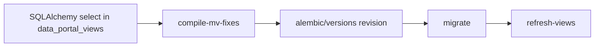

## Decision
Migrations hold compiled SQL strings. They do not import `data_portal_views/` or `views.py` at replay time. Python expressions are the development source; the migration is the deployed truth.

## Rationale (documented)
- `docs/datamodels/ALEMBIC_VIEW_WORKFLOW.md` ("Why Two Definitions?"): importing the ORM at deploy time can hang or time out, and a migration should be fast and deterministic.
- Commit d961724 (PR #258, 2026-04-09): "Switch to raw SQL snapshots for materialized view migrations". Problem stated: when replaying from scratch, a migration that imports current models fails if the schema has changed since it was written, which breaks the whole chain.
- Commit 2576d03 (PR #362, 2026-05-19): added `compile_mv_fixes.py` so the snapshot is generated rather than hand-written, and documented the iterate-with-`--revision --force` loop.

## Alternatives considered
- Alembic autogenerate for MVs: not supported (AGENTS.md).
- Import expressions in migrations: rejected in d961724 because of replay fragility.
- Hand-written SQL in migrations: earlier migrations (0004-0012) also embedded view SQL; the generator replaced that practice for the compiled set. Which of those were hand-written versus generated was not verified.

## Trade-offs
- Gained: replay-safe chain; reviewers can read the exact SQL that runs.
- Cost: two copies of each view (Python and SQL) that can drift. Concrete instance: the ICP ppm cap existed in Python but was missing from `analysis_data_view` until migration 0023 (commit 85373ad message). Also every change re-creates all compiled views (see views-compile-workflow).

## Governance
Constraint: applied view migrations must not be edited; fix forward with a new revision. The compile script’s `--revision --force` path is intended only for revisions that are not yet deployed (inferred from its message; confirm with the team).

## Merged detail: Materialized view migrations embed raw SQL snapshots instead of importing SQLAlchemy views

### Purpose
Record why migrations never import view definitions and why every MV change is a full, frozen SQL revision.

### Key files
| path:line | role |
|---|---|
| `src/ca_biositing/datamodels/ca_biositing/datamodels/data_portal_views/mv_*.py` | live SQLAlchemy definitions for the MVs (development use) |
| `alembic/versions/0024_centralize_qc_constants_across_data_portal_views.py:98-556` | frozen SQL strings (`MV_*_SQL`), then `upgrade()` at :611 |
| `scripts/compile_mv_fixes.py:356` | `main()` renders definitions and writes a new revision |
| `alembic/AGENTS.md` | the ’raw SQL snapshot (RECOMMENDED)’ template |

### Problem (PR #258 body)
Migrations imported `data_portal_views` at upgrade time. Replays failed when tables created later, or when current code diverged from the revision’s intent. A teardown and rebuild could fail to rebuild the chain.

### Decision
- Compile each view to PostgreSQL SQL and embed it as a string in the revision (`d961724`, 2026-04-09, PR #258; the 9e8f7a6b5c54 revision was the first).
- Later, `2576d03` (PR #362) added `scripts/compile_mv_fixes.py` so that the compile step is one command.
- Indexes are created in separate statements after the views (`CREATE_INDEX_STATEMENTS`).

### Alternatives and trade-offs
- Import SQLAlchemy definitions at migration time: short, but replays depend on current code. Rejected.
- Raw SQL snapshots: long files (about 640 lines per MV revision), but replays are frozen. Chosen.
- Cost: each MV change duplicates the full SQL set, and the snapshot can drift from `mv_*.py` if someone edits Python and forgets to compile. The docs warn about this.

### Interfaces
- Input: `data_portal_views/mv_*.py` (SQLAlchemy). Output: new revision file.
- Callers: `pixi run compile-mv-fixes`, `pixi run refresh-views` after data loads (not a migration).

### Gotchas
- `alembic/AGENTS.md` still shows the legacy import pattern as an example to avoid. Do not copy it.
- `scripts/compile_mv_fixes.py` assumes numeric revision names (see architecture/migrations).

### History
- `d961724` (2026-04-09, PR #258): raw SQL pattern adopted.
- `2576d03` (2026-05-19, PR #362): compile tooling and workflow.
- `85373ad` (2026-10-08, PR #476/#480/#492): QC constants centralized across views (0023, 0024).

### Open questions
- Does `pixi run refresh-views` need a migration step after each MV change? (inferred: no, it only refreshes data; confirm in `pixi.toml`.)

## Merged detail: Materialized views are migrated by hand via compile-mv-fixes, not autogenerate

### Purpose
Record why view changes go through a custom compile step, and how to iterate on one revision.

### Key files
| Path | Role |
|---|---|
| `pixi.toml:212` | `compile-mv-fixes` task runs `scripts/compile_mv_fixes.py` |
| `scripts/compile_mv_fixes.py` | argparse: `-m/--message`, `--revision`, `--force` |
| `src/ca_biositing/datamodels/ca_biositing/datamodels/data_portal_views/` | Current view definitions (12 `mv_*.py` files plus `common.py`) |
| `src/ca_biositing/datamodels/ca_biositing/datamodels/views.py` | Seven `ca_biositing`-schema views and `refresh_all_views()` |
| `docs/datamodels/ALEMBIC_VIEW_WORKFLOW.md` | Two-part system and scenarios |
| `src/ca_biositing/datamodels/AGENTS.md:112-130` | "Alembic autogenerate does NOT detect changes to materialized views" |

### How it works
1. Edit SQLAlchemy `select()` in `data_portal_views/` or `views.py`.
2. `pixi run compile-mv-fixes -m "..."` creates a revision, or `--revision 0009 --force` overwrites one.
3. `pixi run migrate` applies it.
4. `pixi run refresh-views` runs `refresh_all_views()`, which refreshes `data_portal` views dynamically from `pg_matviews` (`CONCURRENTLY`).

### Interfaces
- Input: view expressions. Output: Alembic revision with full view-body SQL.
- Callers: `refresh_all_views` is called by the `refresh-views` task.

### Gotchas
- Revisions are full view-body snapshots, so review the diff for unintended changes (datamodels README "How to exclude").
- Revisions 0009 (`0009_almond_etl_mv_edits.py`) and 0010 (`0010_mv_fixes.py`) exist in `alembic/versions/`.
- Migration `0004_views_and_indexes.py` created early views and indexes.

### History
- Commit 930d868 (2026-04-01), PR #220: data-portal schema with views.
- Commit d961724 (2026-04-09), PR #258: view creation and iteration Alembic workflow.
- Commit 4ce9559 (2026-05-12), PR #326: audits and view fixes.

### Rejected alternatives
Autogenerate (rejected because it does not see materialized views; this is the stated reason in AGENTS guidance).

### Open questions
- Whether the compile script should replace hand-written migrations entirely is not decided (unknown).

# Related Concepts
- [compile_mv_fixes.py: turning view expressions into an Alembic migration](../architecture/views-compile-workflow.md): The mechanism that implements this decision.
- [Decision: SQL-first pgschema workflow replaced by SQLModel plus Alembic](views-sql-first-to-alembic.md): Parent decision that made Alembic the DDL path.
- [Alembic migrations: env.py, URL resolution, autogenerate filters, MV handling](../architecture/migrations.md): Migrations are the deployed truth this decision protects.
- [Materialized view system: two schemas, one compile-and-refresh loop](../architecture/views-overview.md): Context for the two-definition model.
- [Migrations must not import SQLAlchemy models or view definitions](../requirements/mv-migrations-embed-raw-sql.md): The hard rule that follows from this decision.
- [System overview (start here)](../architecture/system-overview.md): The MVs are the data-portal read layer that the webservice serves.
- [mv_billion_ton_county_production has no migration and is missing from the package export; mv_biomass_county_production is not exported](../bugs/mv-billion-ton-county-production-unmigrated.md): Shows the compile-and-migrate path missing one view
