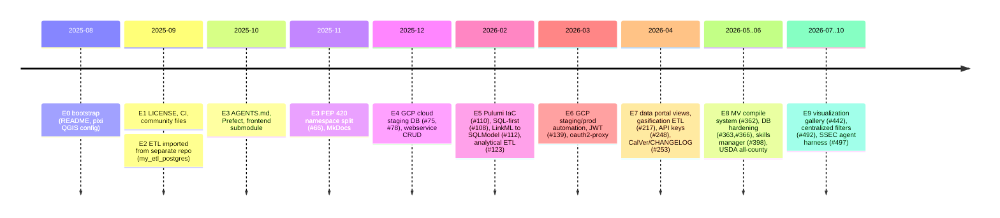

## Purpose
Orientation map of how ca-biositing evolved. Use it to date a file or decision before reading its blame.

## Key files
| Path | Role |
|---|---|
| CHANGELOG.md | Keep-a-Changelog stub, CalVer YYYY.M.D; only `[Unreleased]` exists (no released entries) |
| plans/phase3_materialized_views_assessment.md | Only planning doc; dated 2026-04-20 |
| alembic/versions_old/ | Archived pre-squash Alembic revisions (initial revision f5c8c031aef9, "initial migration sqlmodel") |

## How it works (eras, verified from `git log --reverse`)

- E0 2025-08-12..15: single author (Don Setiawan) README edits; initial commit 3d593f0.
- E1 2025-08-28..09-11: LICENSE (5ac25db), community health files (8e6e997), CI/CD actions (d8b1ad4) by Niki Burggraf.
- E2 2025-09-29..10-15: petercarbsmith imports the ETL from another repo (bf94d1b, 608530b), removes .DS_Store, adds pixi hooks; PR #26 merged; #31 adds AGENTS.md; #33 lint.
- E3 2025-10-20..11-17: Prefect implementation + directory reorg (43f3147, #53), frontend submodule (0c06f60, #49), PEP 420 namespace split (ab8fa6c, #66), docs consolidation/ReadTheDocs (c6a15a6, #67).
- E4 2025-12-01..2026-01-27: cloud staging DB (5ab7c44, PR #75), GCP backend docs (b9ee91e, #78), webservice full CRUD (cd1b9bd, #68).
- E5 2026-02-05..02-19: Berkeley upstream (a9a86eb, #84), OpenTofu to Pulumi (96a4eec, #110), SQL-first workflow (dc98b30, #108), LinkML to SQLModel (7a41e0e, #112), analytical suite and BT2023 ETL (5ebbe4f #123, 447162c #121).
- E6 2026-02-19..04-07: GCP staging deployment (5bdefc9 #125), automated GHA deploy (13675d8 #189), multi-env parameterization (844ef97 #203), production bootstrap (d4f3a33 #228), JWT (203b787 #139), oauth2-proxy for Prefect UI (72439c5 #221, f3ca6dd #222, 09787cd #223), per-client API keys (e289fd1 #248).
- E7 2026-04-01..06-12: gasification ETL (a4e6fc9 #217), data portal schema with views (930d868 #220), MV compile system (2576d03 #362), DB reset and hardening (db578ad #340, dffbaba #363, e74c5b8 #366), skills manager (522d108 #398).
- E8 2026-06-18..09-29: data portal view fixes (c0f0b62 #422/#431), USDA all California counties (4d2f128 #432), unified static resource task (be75727 #440), visualization gallery (707afa8 #442), pretreatment/provider filters (12a1e2b #452, 5547c44 #468), provider exclusion (d4f6b33 #472), click-to-export audit tool (f372f18 #483).
- E9 2026-10-02..10-16: centralized data-quality filters (85373ad #492), gasification archival-prep refactor (c5a592e #493), SSEC project-template agent harness (e41d00d #497).

## Interfaces
Inputs: `git log`. Consumers: anyone dating a change. Related eras are detailed in the per-refactor `facts/history-*` concepts.

## Gotchas
- Some commits are on the same day with merge-style subjects; PR numbers in subjects are the reliable link, not commit order.
- The first commit (3d593f0) is a squashed "Initial commit" dated 2025-08-12, so pre-history before that is not in this clone.
- Author-name variants exist for the same people (see facts/history-contributors).

## History
Eras were derived by reading subject lines and date ranges; boundaries are approximate by week.

## Open questions
- Whether the LinkML schema predates 2026-02 in any other branch (inferred; confirm with `git log --all` on resources/linkml).
- Exact ETL migration start from the external repo is not visible in this clone (inferred; confirm with the original repo).

# Related Concepts
- [System overview (start here)](../architecture/system-overview.md): hub for the current architecture these eras produced
- [Contributors by commit count and area (snapshot at e41d00d)](history-contributors.md): who drove each era
- [Most-churned files and what the churn implies (snapshot at e41d00d)](history-churn.md): which files carry the most history across eras
- [Current state snapshot (2026-10-16)](current-state.md): current-state snapshot after the last era
